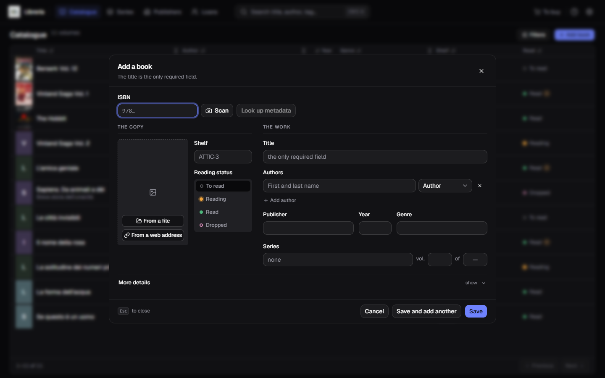
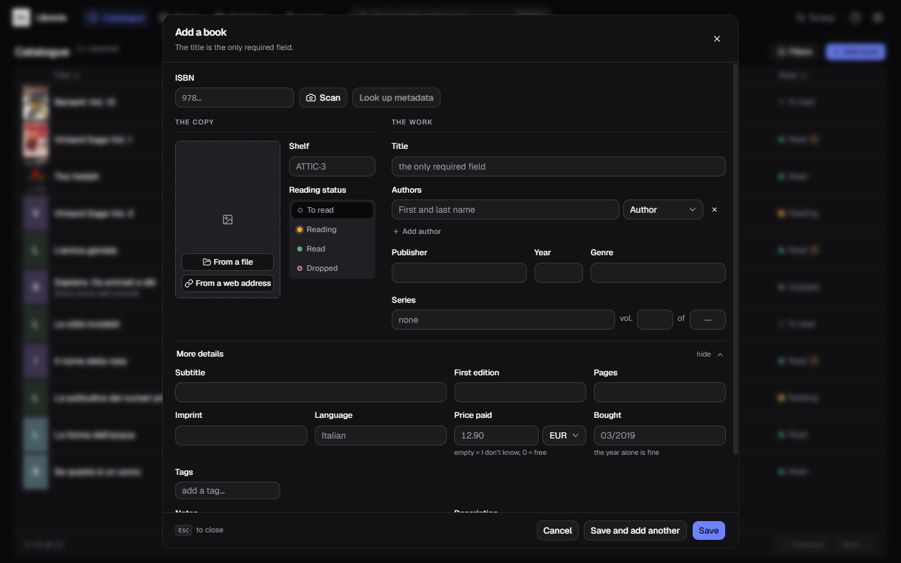
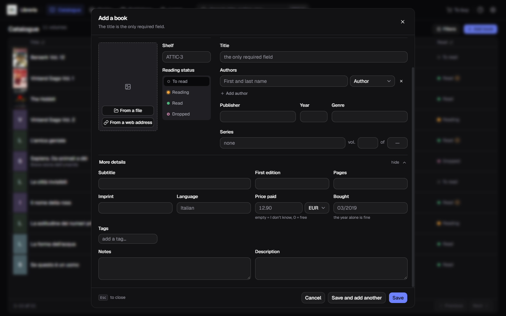
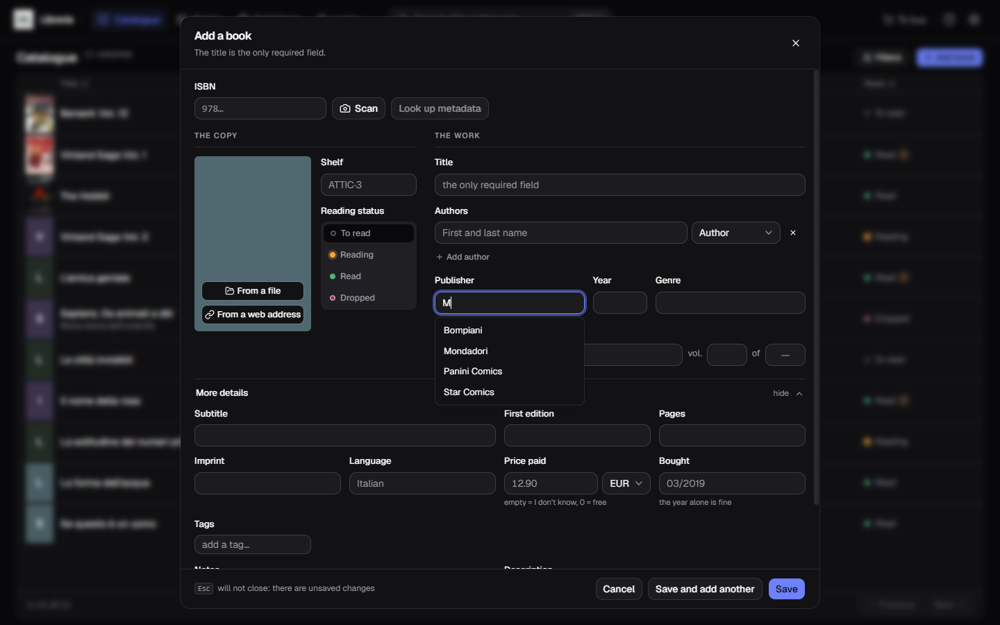
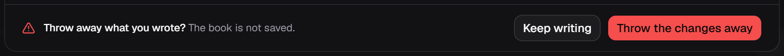
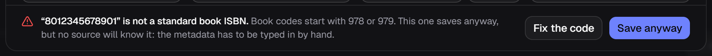
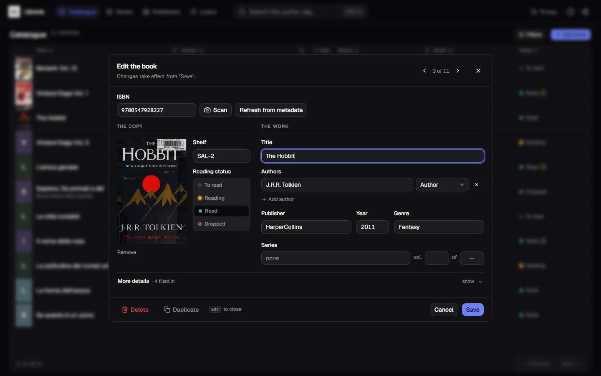
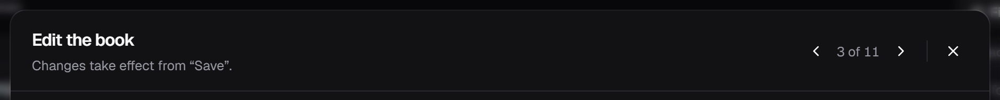
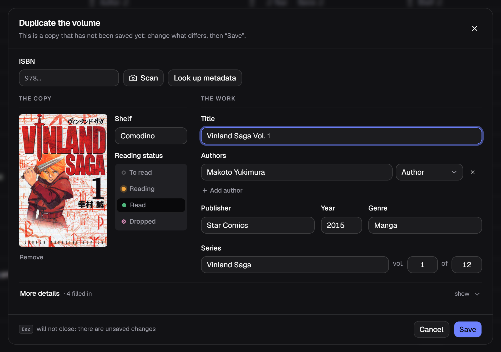

[Italiano](../it/Aggiungere-un-libro.md) · **English**

# Adding and editing a book

The **Add book** button sits top right in the catalogue. The same form reopens
from the pencil on a row, for editing.

**The title is the only required field.** Everything else can stay empty.

A book you **do not have yet** goes on [To buy](To-buy.md), and from there it
joins the catalogue already filled in the day it arrives. The form, though, is
**this one**: “Add by hand”, over there, opens the same dialogue in a context
that switches off the fields of a book you are holding — shelf location, reading
status, purchase date, price — and with them scanning, *Delete*, *Duplicate* and
*Save and add another*. Everything else on this page holds there too.

## How it is laid out

The form has two columns, and the split is not decoration:

- **The copy** — the one in your hands. Where it sits on the shelf, whether you
  have read it, what you paid, its cover.
- **The work** — the book as the world knows it. Title, authors, publisher,
  year, series.

Above the two columns sits the **ISBN** with the two buttons that do the work for
you: **Scan** (turns on the webcam) and **Look up metadata**.

## The ten always-visible fields

| Field | Notes |
|---|---|
| ISBN | 10 or 13 digits; the key metadata is looked up by |
| Shelf | free text: `SAL-1`, `Bedside`, `Lent to Marco` |
| Reading status | To read · Reading · Read |
| Title | **required** |
| Authors | one or more, each with a role: Author, Illustrator, Translator, Editor |
| Publisher | |
| Year | of this edition |
| Genre | just one |
| Series | the name, plus the volume number |
| Total volumes | how many volumes the series has altogether |

**+ Add author** adds a second author; the `×` on the right removes a row. With
two authors or more, two arrows show up next to the role — «Move … up» and
«Move … down», with the author's name in between — and change the order: the
first in the row is the one the catalogue names first. On the first one the up
arrow is off, and on the last one the down arrow.

## More details

Ten further fields live under **More details**, collapsed at first. It opens by
itself when a metadata lookup has filled something down there — and the label
says how many fields were filled (`· 4 filled in`), so you know it is worth a
look.

Subtitle, first-edition year, pages, imprint, language, price paid with its
currency, when you bought it, tags, notes and description.

Two boxes deserve a line:

- **Price paid** — empty means «I don't know», `0` means «free»: two different
  things, and they stay apart. The currency is picked next to it, book by book;
  which one is the default is decided in [Settings](Settings.md).
- **Bought** — the year alone is fine.

Several boxes **will not let you type what would be refused**, so there is
nothing left to find out when you save: **Price paid** takes digits and one
separator, two decimals at most; **Bought** takes only what can sit in a date;
**Year**, **First edition** and **Pages** take digits only. A refused character
**does not go in and does not wipe what was there** — the box stays as it was.
The same goes for a person's **Phone** in [loans](Loans.md), which also takes
`+`, spaces, hyphens and brackets: those are the ways a number is written.

The **ISBN** is the exception, and it is deliberate: there you paste from
anywhere, hyphens and spaces included, and the code is cleaned up by itself.
Narrowing that box would throw away a good code buried in a paste.

## Suggestions as you type

Seven fields offer you what you have used before: shelf, genre, publisher,
imprint, language, series and tags. The first letter is enough.

This is not just convenience. Type `Manga` in one book and `manga` in another and
you end up with **two genres** splitting the counts in the filters. Taking the
suggestion keeps you on the spelling you already chose.

## Joining a series fills a few boxes

Type the name of a series you already have in the **Series** field, and the form
fills itself with what that series learnt from the other volumes: **tags, genre,
publisher and imprint**. Tags are added to yours, the three single fields land
**only where they were empty** — what you typed stays as it is. If something
ended up under **More details**, the panel opens by itself.

The **total volumes** come from there too, if the series has one and you have not
already typed one of your own.

How a series learns those values, and how you correct them for every volume in
one go, is in [Series](Series.md).

## Saving

Three buttons at the bottom:

- **Save** — saves and closes;
- **Save and add another** — saves and clears the form while staying open, with
  the webcam still running if you were scanning. This is how you catalogue a
  stack of books one after another;
- **Cancel** — closes without saving.

If you have written something, `Esc` and **Cancel** do not close straight away:
they ask.

**Leaving without saving also throws away the covers you just picked.** An image
taken from a file, from an address or from the sources does not stay on disk if
the book is not saved. Correcting the cover of a book already saved, on the
other hand, throws the old one away when you press **Save** — if no other book
uses it. The details are in [Covers](Covers.md).

## A code that is not an ISBN

Book codes start with `978` or `979`. Type a thirteen-digit one that is not from
that family — or a `978` whose last digit does not add up — and **saving is not
blocked: you get a question.** The bottom of the form shows the code in full, the
line saying no source will know it, and two ways out:

- **Fix the code** — puts the focus back on the ISBN box;
- **Save anyway** — writes it to the catalogue as it is. That book's metadata
  will have to be typed in by hand: nobody looks up a code like that.

Confirm once and it will not ask again on every edit of that book. But **touch
the ISBN field** and it goes back to asking, which is the point: a wrong code
typed after a confirmation must not slip through in silence.

Below thirteen digits it is a refusal, not a question — `97888` is not a code to
save anyway, it is a wrong code.

## Editing a book that already exists

The pencil in the catalogue reopens the same form with the fields filled in.
Three differences:

- the lookup button reads **Refresh from metadata**, and what it finds does not
  overwrite what you have: it shows up as pills beside your values, and you
  decide field by field;
- **what you clear really is cleared.** The previous value does not survive: the
  empty box wins;
- **the one exception is the series' total volumes.** Clearing that box does not
  reset the total, because that number belongs to the series and not to this
  copy: resetting it while saving *one* volume would take it away from all the
  others. To really remove a total, go through [Series](Series.md).

**Delete** sits bottom left, away from Save. Next to it sits **Duplicate**, for
when the same edition has come into the house twice: how it works is
[further down](#duplicating-a-volume).

## Moving from one book to the next without closing

In edit mode the header carries two arrows and tells you where you are:
`3 of 11`.

They earn their keep when you are going through a whole series: open the first
volume, fix it, arrow, fix the second. `Alt`+`←` and `Alt`+`→` do the same.

Three things worth knowing:

- **the count is the catalogue as you are looking at it** — with the search and
  the filters you have on, in the order you chose. Filter by one shelf and you
  move through those books only;
- **the page does not stop you.** On the last book of a page, the arrow opens the
  first of the next one, and the table behind turns the page with you;
- **if you have typed something and not saved it, the arrow asks first** — the
  same question `Esc` asks. "Keep writing" leaves you where you are.

On the first book the back arrow is off, and on the last one the forward arrow
is.

## Duplicating a volume

Two copies of the same book are not a mistake: they are **two items**, and the
catalogue holds them as two rows. One bought new and one second-hand, one in the
living room and one out on loan, the same volume of a series twice. In edit mode,
next to **Delete**, sits **Duplicate**.

**It makes a one-to-one copy of the book you have open, and does not save it.**
The form stays open and changes job: from editing that book it becomes the
creation of another one that looks like it, and the header says so — *Duplicate
the volume*, «This is a copy that has not been saved yet».

The copy has everything, **ISBN and volume number included**: it is the same
edition, and the second «15» of a series carries the same number as the first.
You change what differs — the shelf, the price, the reading status — and press
**Save**.

Until then **nothing has been written**. `Esc` and **Cancel** ask what to do with
it, just as they do for any new book, and "Throw the changes away" leaves the
catalogue as it was.

With the copy in hand three things disappear, and it is not an oversight:

- **Delete**, because it spoke about the previous book;
- **the arrows** that move through the catalogue, and their `3 of 11` with them:
  that count names the row you started from, and the copy is not in the
  catalogue yet;
- **Save and add another**, which would clear the form instead of making a
  further copy. At the bottom you are left with **Cancel** and **Save**.

The **cover becomes a file of its own**, copied straight away and not on save.
The two rows do not share the image, so deleting one of the two books does not
leave the other one without it; and changing the copy's cover does not touch the
cover of the book you started from. If you abandon the copy without saving it,
that file goes with it and the cover of the book you started from stays where it
is.

Under the ISBN you will see *«you already have one with this ISBN»*: **that is
right, and it does not stop you.** The book with that code really does exist, and
it is the one you started from — the one in your hands is the second item.
