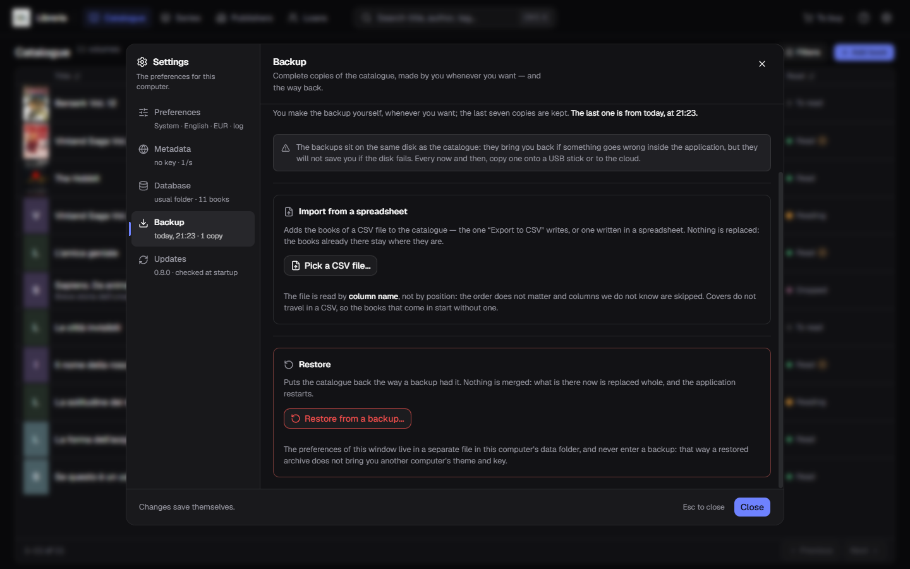

[Italiano](../it/Backup-e-ripristino.md) · **English**

# Backup, export and restore

All under **Settings → Backup**.

**Everything on this page also holds with the catalogue on a server**: backup,
export, import and restore speak to the catalogue you are using right now, here
or over there. Where the two roads part, the page says so.

**With the library's service things change a little**, and the section
[further down](#with-the-librarys-service) says how.


## You ask for the backup

**Back up now** makes one — and it is the only way one is ever made: the
application writes none by itself, neither at startup nor on a schedule of its
own. The copies of the **last seven days** are kept: older ones go on their own, so
the folder does not grow forever.

Each copy is a `.zip` holding the catalogue **and the covers**, named by date:

```
libreria-2026-08-31.zip
```

The name carries the day, so a second backup made **today** overwrites this
morning's one instead of sitting next to it: the seven copies are seven days,
not seven clicks.

The covers go into the zip **wherever they live**: this computer's folder, a
shared folder, an S3 archive or the database itself. If they are far away, the
backup takes longer, because it fetches them one by one.

In the panel on the left of the settings, under «Backup», you can read when the
last one was made and how many copies there are — «no copies», until you have
made one.

**Open folder** opens File Explorer where the files are.

If a backup fails, the reason appears under the buttons, and a warning stays at
the top of the window that **does not dismiss itself**.

### Where they end up

By default in the `backups` folder **inside the catalogue folder**:
`%LOCALAPPDATA%\it.alexkill536ita.gestionale-libreria\backups\` as long as
the catalogue stays where it was born, and next to it if you [move it
elsewhere](Where-the-data-lives.md). **Browse** picks another folder — a USB
stick, a cloud-synced folder.

**With the catalogue on a server the backups stay on this computer**, in the
usual folder: this machine makes the backup and this machine reads it back. A
folder over there could be the same one for several computers, and two backups
from the same day would overwrite each other without a word.

And here is the thing that matters:

> **The backups sit on the same disk as the catalogue.** They bring you back if
> something goes wrong inside the application, but **they will not save you if
> the disk fails.** Every now and then, copy one onto a USB stick or to the
> cloud.

With the catalogue on a server the box is not there, because there it is not
true: the catalogue is over there and the backups here, so a failed server does
not take the backups with it, nor a failed disk here the catalogue. The advice
to keep a copy elsewhere still stands.

Settings **do not go** into the backups: theme, language, currency, API key,
camera, catalogue order and **the connection to the server** stay with this
computer. The reason is in [Where the data lives](Where-the-data-lives.md).

**Passwords and keys are not even in the settings file.** The Google Books key,
the server password and that of an S3 archive are kept by the system keychain —
**Credential Manager** on Windows, **Keychain** on the Mac — under the entry
*Gestionale Libreria - impostazioni*. They stay in `impostazioni.json` only if
the keychain is missing or refuses them, and in that case the program's log says
so with a warning. Into a backup, in any case, they never go.

## Exporting to CSV

**Export to CSV** writes a text file with **twenty-two columns**, one row per
book, and puts it **in the backup folder** named after the day —
`catalogo-2026-08-31.csv`. As with backups, a second export on the same day
overwrites the first.

```
id;titolo;sottotitolo;autori;editore;collana;anno;anno prima edizione;
genere;tag;serie;volume;isbn;lingua;pagine;prezzo;valuta;acquistato;
posizione;stato di lettura;note;aggiunto il
```

Several authors or several tags of the same book share one cell, separated by
` | `: `Terry Pratchett | Neil Gaiman`.

The reading status is written `Da leggere`, `In lettura`, `Letto` or
`Abbandonato`, in Italian like the headers: what the catalogue calls **Dropped**
has its long Italian name in the file.

The file is meant to **open cleanly in Italian Excel**: `;` separator, UTF-8 with
BOM, price with a decimal comma (`980,00`). Double-click and it opens already in
columns, with the accents where they belong.

The headers stay in Italian even with the application in English: it is an
interchange format, and a file that changes its header with the language does not
open the same way twice.

**A CSV is not a backup.** It holds no covers, and on its own it does not put the
catalogue back the way it was: it is for taking the data elsewhere — a
spreadsheet, another application, a printout — and for bringing it **back in**
from just below.

## Importing from a spreadsheet

**Pick a CSV file…** goes the other way: the books in the file are **added** to
the catalogue. Nothing is replaced, and that is the difference from the restore
below.

Before writing anything, the application reads the whole file and tells you what
will happen:

- how many rows and how many columns it read;
- **how many books come in**;
- how many rows carry an ISBN you already have, and are therefore skipped;
- how many rows do not read, with the **first six** named by row number and
  reason;
- which columns we do not know and leave out.

Those numbers are not a guess: the application has already tried the whole
import and then rolled it back. If you confirm with **Add the books**, exactly
that happens. If no book would come in, the button stays off.

**Columns are read by name**, so their order does not matter and extra columns
are skipped. The only one really needed is `titolo`; the other twenty-one are
the ones exported above. A hand-written sheet with four columns — titolo,
autori, editore, isbn — works just as well.

Every row comes in through the same door as a book typed by hand, so:

- if you write “CITTÀ STUDI” and the catalogue already holds “Città Studi”, it
  lands under the latter instead of splitting it in two;
- publisher aliases apply here too;
- a series that was not there is created;
- an impossible price or date drops **that row alone**, and the others come in;
- the reading status is read regardless of case among `da leggere`, `in
  lettura`, `letto` and `abbandonato`. A book put aside halfway is written
  `abbandonato`, the way the export writes it: `Dropped` or `Lasciato` are not
  among the words the sheet knows, and that row does not come in.

**An ISBN you already have is skipped**, even when it shows up twice in the same
sheet. **Books without an ISBN, though, have nothing to be recognised by**, and
come in every time: importing the same file twice doubles exactly those. If you
need to do it again, first remove from the sheet the rows without an ISBN that
are already in.

Two things to know first:

- **covers do not travel in a CSV**, so the books that come in start without
  one. You add them afterwards from the form, one by one or through the
  cascade;
- the file must be saved as **UTF-8**. If you open the export in Excel, edit it
  and save it again, pick “CSV UTF-8” from the format menu: saved in the plain
  format the accents come through wrong, and the application would rather refuse
  the file than fill your catalogue with “Città ”.

The activity log keeps one row per book added, and above them one saying which
file they came from and how many.

## Restoring



**Restore from a backup…** puts the catalogue back the way an archive had it.

**Nothing is merged.** What is there now is **replaced whole**: books added after
that backup are gone, along with their notes, prices and shelves. **The activity
log too** becomes the archive's, and takes the place of the current one.

How it goes:

1. you pick the `.zip` file;
2. the application **reads and checks it** before touching anything, and the
   confirmation — «Replace the whole catalogue with this backup?» — names the
   file with its date, how many books it carries and how much it weighs; then
   how many books you have now and how many take their place, and whether the
   archive's rows add up («All the rows of the archive go back in: …»);
3. if you confirm with **Replace the catalogue**, **it first saves a backup of
   the current state**: if you picked the wrong archive, you can go back;
4. the catalogue is replaced.

That safety backup **never writes over an archive that is already there**: if
today's name is taken — for instance because you are restoring this morning's
backup — it sits next to it, as `libreria-2026-08-31-2.zip`. The archive you
picked stays where it is, and the two files count as a single day among the
seven.

A damaged archive, or one that holds no valid catalogue, is **refused** at the
reading stage: the current catalogue is not touched. And if the safety backup
fails, the restore does not even start.

### On this computer's catalogue

The last step is **the restart**: «Restore started: the application restarts in
a moment.» appears, and the application closes and reopens on its own.

The restart is not a whim: the catalogue is open while you use it, and replacing
it live would corrupt it. The real swap happens at the next startup, before
anything opens it. **The covers are replaced** along with it: the folder goes
back to holding the archive's covers, and only those.

### On a server's catalogue

**Nothing restarts here**, and the prompt and the confirmation say so. The server's catalogue
is emptied and reloaded **in a single operation** — if something breaks halfway,
what was there before stays, not an empty catalogue — and the pages reload
straight away. The outcome is «The catalogue on the server has been replaced
with the one from the archive.»

Two things are different:

- **it is everyone's catalogue.** Every computer connected to that server sees
  the archive's books straight away, and loses whatever it had written there
  since;
- **the archive's covers are added**, and the ones already there are not
  deleted. Those no book names any more are taken away by the automatic
  clean-up of orphan covers, which runs at startup with the catalogue on a
  server too — there after a day's wait, so that an image another computer has
  just written does not look like nobody's.

**An archive travels between the two catalogues**: a backup taken from the
server restores onto this computer's catalogue too, and one taken here restores
onto the server. The format is the same.

### If something goes wrong

The reason appears in the restore box, and nearly always it also says the
catalogue has not been touched. Three worth recognising:

- «The archive's covers cannot be written (…). The catalogue has not been
  replaced.» — the place the covers live refused a file: a full disk, a
  read-only folder;
- «The cover archive does not answer: …» — the covers live on an S3 archive
  that cannot be reached right now;
- «This MongoDB is a standalone server, and the catalogue needs a replica set:
  …» — on MongoDB the catalogue, and the restore with it, needs a replica set.
  How to fix it is in [The catalogue on a server](The-catalogue-on-a-server.md).

## With the library's service

When the catalogue lives on the library's service, **the backup is made by the
service**, on its own disk, and it counts for every connected computer; there too
the last seven copies are kept. The Backup section lists them under **Copies on
the service**, and **Download** brings one to this computer, into the backup
folder: a downloaded copy lives outside the server, and if its disk fails that is
the way back.

**The CSV is put together by the service, and lands on this computer**, in the
same folder. **The restore** is chosen here, as always, and the service runs its
own checks again before replacing everyone's catalogue. Importing from a
spreadsheet works as on this computer's catalogue.

Each of these actions needs its own permission — **Back up the catalogue**,
**Export the catalogue**, **Restore an archive**, **Import from a spreadsheet**
— and whoever lacks it finds the button switched off. Who hands out the
permissions is told in [Working in a library](Working-in-a-library.md).

## If the computer dies

On the new computer:

1. [install the application](Installation.md) and open it once: the
   [first-start guide](Installation.md#first-start) shows up, and you go through
   it keeping the catalogue on this computer, or close it with **Decide later**;
2. Settings → Backup → **Restore from a backup…**;
3. pick the `.zip` you had put aside.

Books and covers come back. Theme, language, currency, API key, camera and the
server connection do **not**: those you set again by hand, in a minute.

If the catalogue lived on a server, the new computer needs no backup: set up the
connection again from Settings → Database, and the books are the ones you had.
The backup is for when the server is what broke.
