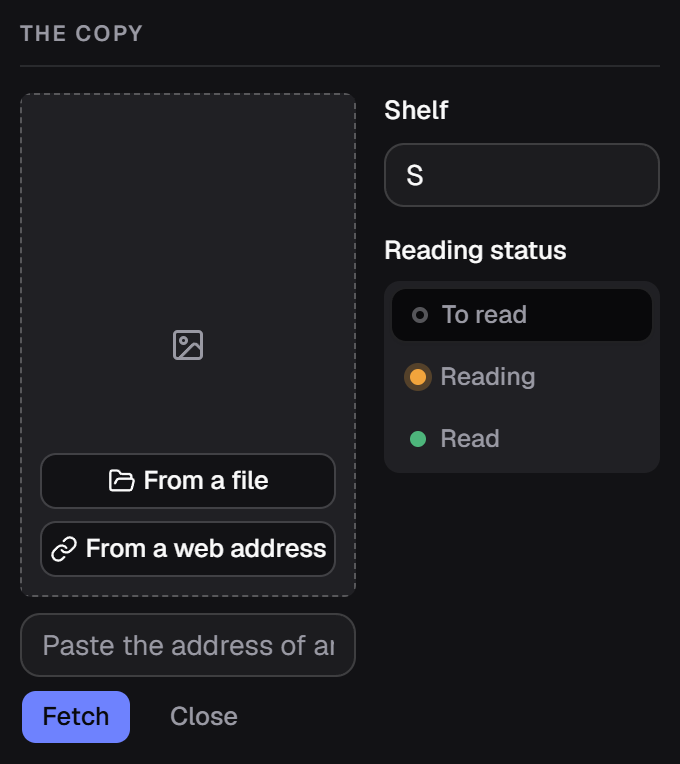
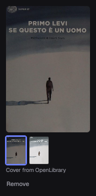
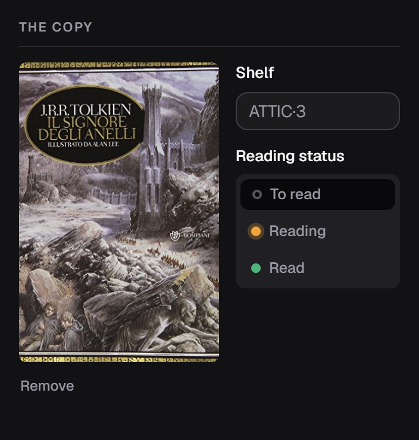

[Italiano](../it/Le-copertine.md) · **English**

# Covers

The dashed box on the left of the form. There are three ways in.

## 1. On its own, while looking up metadata

When the box is empty and [the metadata lookup](Looking-up-metadata.md) finds an
image, it comes down without you pressing anything. This happens with
**OpenLibrary**, with **NiceBooks** and with **AniList** — and the line under the
ISBN always says whose the image is.

If a cover is already there it is not replaced: a line under the ISBN tells you
— *«OpenLibrary has a cover, but the box already holds one»* — and if you do want
it, remove the current one and look up again.

**When the box is empty and the cover found did not go in** — you have just
removed it, or the download failed — **Fetch the cover from …** shows up under the
box, with the name of the source that offered it — OpenLibrary, NiceBooks or
AniList — and asks that source again without redoing the lookup.

### When more than one is found

OpenLibrary and NiceBooks may both have one, and **it is not the same image**.
When that happens, a row of thumbnails appears under the box, one per source: the
ringed one is the cover you see above, and clicking another puts it in its place.
The line under the row says where the current one comes from.

You do not have to choose: **the first one comes down on its own as always**, and
the row is there for when the image that arrived is not the edition you are
holding — typically a manga, or a reprint. With a single source the row does not
appear, because there would be nothing to choose.

It is worth a look even when the image is right: **NiceBooks covers are about
four times larger than OpenLibrary's**, which tops out around 500 pixels tall.
Switching source downloads the new image, and the one you leave behind does not
stay on disk: it goes when you save, and it goes all the same if you leave
without saving — **Cancel**, the `×`, `Esc`, the arrows that move to another
book, «Throw the changes away».

**Google Books images are not downloaded**, even when Google has them: their API
terms do not allow rehosting them. This is not a technical limit and retrying
will not help.

## 2. From a file on disk

**From a file** opens the Windows dialog. It takes a JPEG, a PNG or a WebP and
copies it among the catalogue's covers: from then on it is safe even if you move
or delete the original.

## 3. From a web address

**From a web address** opens a box to paste an image URL into, and **Fetch**
downloads it. It needs a public address: one on your home network is refused.

The file always lands among the catalogue's covers, wherever they live: **the
catalogue keeps no links to other people's images**, so the cover survives even
when that site closes down.

## What goes in and what does not

Whichever the way in, the image has to be a **JPEG, a PNG or a WebP**, no larger
than **12,000 pixels per side**; from a web address, on top of that, no more
than **20 MB**. A file that does not fit stays out and says so under the box:
*«Format not recognised: JPEG, PNG and WebP are accepted.»*, *«The image is too
large.»*, *«The image file is damaged or incomplete.»*.

What goes in is **re-encoded to JPEG** at its original resolution: it is not
shrunk, but a 12 MB PNG does not stay 12 MB. A transparent area turns white.

## Books with no cover

You do not get a hole: the application draws a spine with **the title's first
letter**, on one of eight colours picked **from the publisher**. Two books from
the same publisher get the same colour, which makes an imprint recognisable at a
glance; a book with no publisher gets a neutral grey.

In a series grid a volume you have but with no cover carries its drawn spine,
with the number on it; the volumes you are missing are dashed boxes instead — see
[Series](Series.md).

## When a cover does not show

If an image does not load — the file is gone, or the place where the covers live
does not answer, such as a server that is switched off — **the spine is drawn in
its place**, the same one a book with no cover gets. No broken-image icon shows
up, and that is why at a glance it looks like a book that never had a cover.

**It does not come back on its own** once the problem is solved: it comes back
the next time the view is drawn again, by changing page or reopening that
screen.

### The reduced copies

The catalogue, the rows of loans and of books to buy, the activity log and the
series show **a small copy** of the cover; the publishers' carousel, the card of
a work and the loans strip show a **medium-sized copy**. They are made on their
own the first time they are needed, and then stay **on this computer**, so the
views do not reload the whole image every time.

There is nothing to save: they are made again from the original when they are
missing, and they do not go into backups. **Only the form shows the original**,
because that is where a cover is judged before saving it.

## Removing a cover

**Remove** sits under the image. The file goes when you save, and the same holds
when you **replace** the cover of a book already saved: the old one goes when you
save the new one. If you leave without saving, the book keeps the cover it had.

**A file that someone else needs stays.** If the same image is used by another
book or by a volume [to buy](To-buy.md), removing it here removes it only from
here. The same goes when you delete a book.

## Where they live

One JPEG per book with a random name, **next to the catalogue**: in the `covers`
folder inside the catalogue folder, which unless you moved it is
`%LOCALAPPDATA%\it.alexkill536ita.gestionale-libreria\`. With **Move the
catalogue here** the covers are copied together with the database — see
[Where the data lives](Where-the-data-lives.md).

With the catalogue **on a server** they live where «Where the covers live» says:
**Inside the database**, in a shared **Folder** that every computer reaches, or
in an **S3 archive**. How you choose, and how you carry them from one place to
another with «Move the covers here», is in
[The catalogue on a server](The-catalogue-on-a-server.md).

From any of these places, **the covers go into the backups**, so a restored
archive brings them back with it — see [Backup and restore](Backup-and-restore.md).
