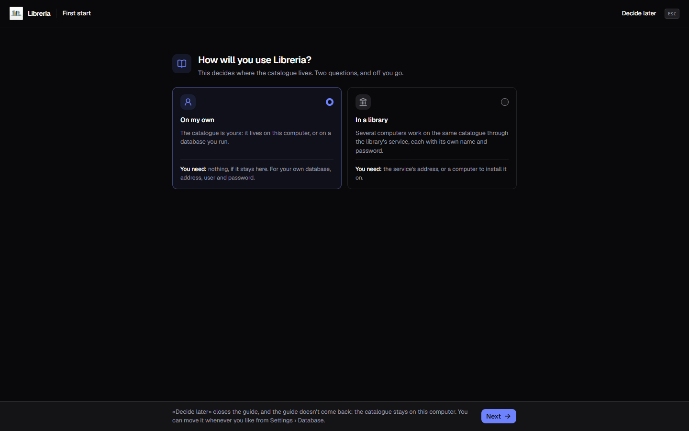

[Italiano](../it/Installazione.md) · **English**

# Installation

The application runs on **Windows 10 and 11**, and since September 2026 on
**macOS** too: every version carries a file of its own, and how to install it is
in [On a Mac](#on-a-mac).

This page is about the app. The **library's service** — the program that
keeps one catalogue for several computers, each with its own sign-in — is
installed separately, and [Installing the service](Installing-the-service.md)
tells how.

On Windows nothing else is needed: the system component that draws the window
(WebView2) is bundled inside the installer, so it is not downloaded during setup.

## Installing on Windows

1. Download `Gestionale Libreria_0.8.0_x64-setup.exe`.
2. Double-click it. The installer first asks for the language, Italian or
   English, proposing the one Windows uses; after that it asks very little.
3. Done: you get a shortcut **on the desktop** and **in the Start menu**.

The install is **for the current user only**: it does not ask for administrator
rights and does not touch the rest of the computer.

## “Windows protected your PC”

The first time you run the installer, Windows shows that blue SmartScreen
screen. It happens because **the program is not code-signed**, and it is not a
sign that the file has been tampered with: a certificate costs a yearly fee and,
on its own, would not even silence the warning.

To go on: **More info** → **Run anyway**.

## On a Mac

The file is `Gestionale Libreria_0.8.0_universal.dmg`, a single one for Intel Macs
and Apple Silicon ones: open it, drag the application into **Applications**, and
start it from there. It has been tried on a Mac, and it works.

The first time you start it, macOS says the application **cannot be verified**,
for the same reason Windows shows SmartScreen: there is no certificate paid for to
Apple. Go to **System Settings → Privacy & Security**, where an **Open Anyway**
button appears. If you prefer the Terminal, the same thing is done with:

```
xattr -dr com.apple.quarantine "/Applications/Gestionale Libreria.app"
```

The first time you open [barcode scanning](Scanning-the-barcode.md), **macOS asks
for permission to use the camera**: grant it, or the viewfinder stays black. If
you refused, it can be turned back on from **System Settings → Privacy &
Security → Camera**.

To **update**, drag the new application into **Applications** and choose to
replace the one already there; to **uninstall**, drag it to the Bin. Either way
the data folder stays where it is.

Your data sits here, and everything the rest of this page says still holds:

```
~/Library/Application Support/it.alexkill536ita.gestionale-libreria/
```

## First start

The first time you open the program, with the catalogue still empty, the
**first-start guide** appears. It has one question: **How will you use
Libreria?**



- **On my own** — the catalogue is yours. The next step, **Where does the
  catalogue live?**, offers **On this computer**, which asks for nothing, or
  **On a database of yours**: host, port, database name, user and password,
  then **Test the connection**, and **Use this database** lights up once the
  database has answered. An empty database is fine: the catalogue is created
  there by itself. The databases that can hold it are the ones in [The
  catalogue on a server](The-catalogue-on-a-server.md);
- **In a library** — several computers work on the same catalogue, through the
  **library's service**, each with its own name. There are two roads, told in
  the paragraph below.

**Decide later**, at any step, closes the guide and leaves the catalogue on this
computer. **The guide does not come back**, however it is closed — with a
choice or with “Decide later” —, and it does not appear at all to whoever
updates from an earlier version with books in the catalogue. The same choices
stay in **Settings → Database**, told in [Where the data
lives](Where-the-data-lives.md).

### In a library

**I'll connect to the library's service** is the road for whoever uses a
service that already runs on another computer. You write the **Address** given
by whoever runs it — always `https://`, with the port — and press **Test the
connection**. The service's fingerprint appears: compare it with the one on the
computer where it runs, and if it is the same press **I trust it**. Then **Sign
in**, or **Create the first administrator** if the service has no users yet. How
you sign in is told in [Ways to sign in](Ways-to-sign-in.md).

**This computer is the library's server** installs the service here, on Windows
or on a Mac; on Linux the road is not there, and a Linux or Docker server is set
up following [Installing the service](Installing-the-service.md), then you come
back here and choose “I'll connect”. You need the password of an administrator
of this computer, and a computer that stays on. The guide takes four steps, and
shows them one under the other:

1. **Downloading the service installer**, of the same version as this app, from
   the releases page;
2. **Checking it's the release's own, with SHA256SUMS**: if the file's SHA-256
   fingerprint is not the published one, the file is deleted and nothing runs;
3. **Installation, in its own window**: on Windows the system asks for
   administrator permission, and you answer “Yes”; the service's setup opens,
   and it must be left open, because its last page shows the **Setup code** and
   the **Certificate fingerprint**. On a Mac the Installer program opens, and if
   macOS says the package cannot be verified you go through **System Settings →
   Privacy & Security → Open Anyway**; code and fingerprint are read from the
   Terminal, with the two commands the guide shows;
4. **Waiting for the service to answer on this computer.**

While it downloads you can cancel, and nothing has been installed. At the end
the guide says **The service is installed** and shows the fingerprint: compare
it by eye with the one on the installation's last page — or with the
Terminal's, on a Mac — and press **I trust it**. Then you create the first
administrator with the setup code.

If Windows does not grant the permission, the guide says so and offers **Try
again**. **Open the downloads page** leads to the files, for whoever would
rather install the service themselves and then come back with “Back” to “I'll
connect”.

> **Not yet tested on a real machine.** Installing the service from the guide
> has been tested on Windows up to the administrator permission request — the
> download, the SHA256SUMS check and the denied permission —, but not an
> installation carried through from here. On a Mac it has never been tested.

## Where your data ends up

On Windows, out of the box, everything of yours sits in one folder:

```
%LOCALAPPDATA%\it.alexkill536ita.gestionale-libreria\
```

Paste that path into the File Explorer address bar and you are there. Inside:

| | |
|---|---|
| `libreria.db` | the catalogue — this is the file that matters |
| `covers\` | the covers, one JPEG per book |
| `miniature\` and `intermedie\` | reduced copies of the covers, for the small views and the large ones: they are remade on their own from the original, and deleting them loses nothing |
| `backups\` | the backups you ask for, unless you picked another folder |
| `impostazioni.json` | theme, language, currency, camera, backup and catalogue folders, the version you skipped, the connection to the server and the one to the library's service. The secrets — the Google Books key, the database password and the S3 storage secret — **are not here** but in the system keychain: why is in [Where the data lives](Where-the-data-lives.md) |

The catalogue — `libreria.db` and `covers\`, with its `backups\` unless you
picked another folder — **can be moved** to another folder, or live **on a
server**: [Where the data lives](Where-the-data-lives.md) and
[The catalogue on a server](The-catalogue-on-a-server.md) tell how.
`impostazioni.json`, `miniature\` and `intermedie\` always stay here instead,
because they belong to this computer.

The **program** itself lives elsewhere, in `%LOCALAPPDATA%\Gestionale Libreria\` —
not in `Program Files`, which is where people usually look for it. Next to the
executable sits `AVVISI-LICENZE.txt`, holding the licences of the thousand-odd
components by other people that the program embeds. There is no need to go
looking for it: the program opens it, from the gear at the top right, entry
**Licence** — which also holds the licence of Gestionale Libreria itself. The
same list is in [Third-party licenses](Third-party-licenses.md).

## Updating

**The application tells you when a new version is out**, but it does not download
it and does not install it: it opens the page the file comes from, and the rest is
up to you. The whole round is in [Updates](Updates.md).

To move to a newer version you **install over the old one**, just like the first
time: **your data stays where it is** and you find all of it again. There is no
need to uninstall first.

## Uninstalling

From **Windows Settings → Apps**, or with `uninstall.exe` in the program folder.

**Uninstalling does not delete your catalogue.** The program, the two shortcuts
and the entry in the apps list go away; the data folder stays put, and
reinstalling brings everything back. If you really want to start from scratch,
that folder has to be emptied by hand — but
[take a backup](Backup-and-restore.md) first and put it somewhere else.
