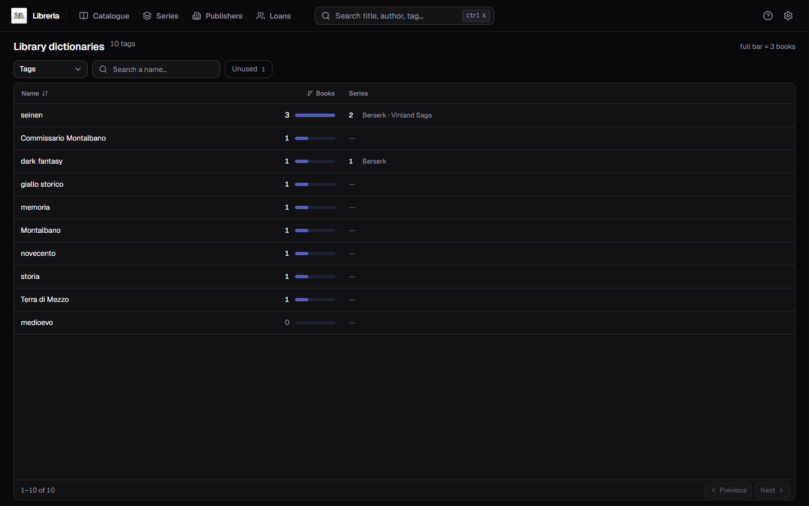
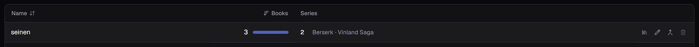
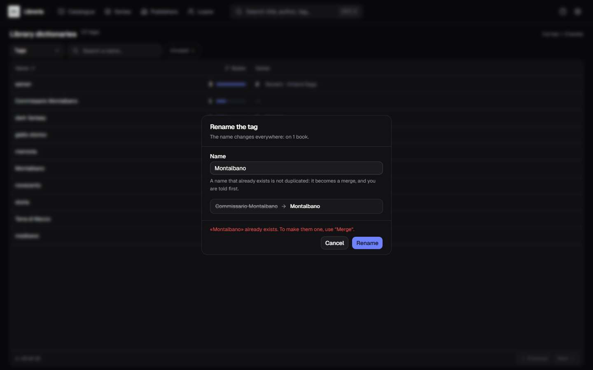
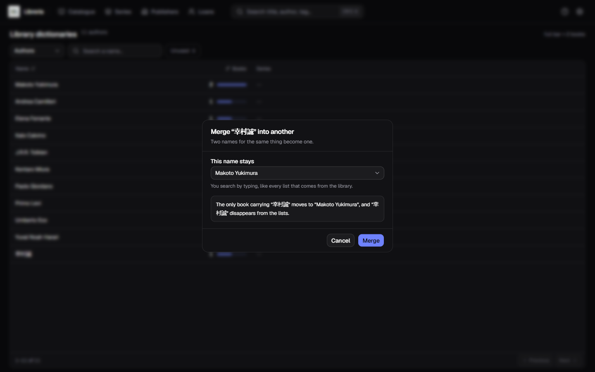
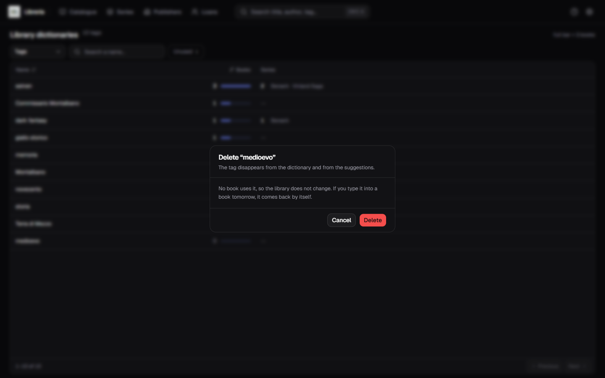

[Italiano](../it/I-dizionari-del-catalogo.md) · **English**

# Library dictionaries

There are values in the catalogue you never typed: the program put them there by
itself, cataloguing a book, accepting an edition from the sources or picking a
work on AniList. They are the **tags**, the **authors**, the **genres**, the
**imprints**, the **shelves** and the **languages** — lists that grow on their
own — and until today there was nowhere to correct them.

This page is that door. **The gear top right is a menu**, and the first entry is
*Library dictionaries*.

## One dictionary at a time

At the top the selector — **Tags**, **Authors**, **Genres**, **Imprints**,
**Shelves**, **Languages**: you look at one list at a time,
the way [Publishers](Publishers.md) looks at one publisher at a time. Next to the
title, the tally of how many entries the one you are looking at has —
*«10 tags»* — which turns into *«3 of 10»* as soon as you filter. The first two
are long and the last three short: a few imprints, a few shelves, two languages.

- the **box** searches without minding case or accents: `citta` finds `Città`
  and `SHONEN` finds `shonen`. A piece of the name is enough;
- the **Unused** toggle keeps only the entries that sit on nothing, and carries
  their tally next to the label. It is the tally of the chosen dictionary —
  1 on tags and 0 on authors, not 1 in all. **It is only on tags and authors**,
  for the reason written further down: a genre, an imprint, a shelf and a
  language are in the list only as long as something carries them;
- the list is sorted from the header, **by use or by name**. It opens on tags in
  order of use, most used first: an alphabetical list is already there in the
  form's suggestions;
- the table pages fifty rows at a time, with the catalogue's own footer.

**The chosen dictionary does not count as a filter**: it says what you are
looking at, it does not narrow it. That is why *«Clear the filters»* empties the
box and switches the toggle off, and does **not** send you back to the tags while
you are correcting the authors.

The dictionary you are looking at is also **in the page's address**, so you come
back to it after a trip through the catalogue, and reloading leaves you where you
were.

## How to read a row

From the left: **the name**, how many **books** carry it, and the **series** that
carry it.

Next to the book count there is a bar, as long as that value is compared to the
most used one in the dictionary you are looking at — the header says so:
*«full bar = 3 books»*. It tells the load-bearing tags from the long tail at a
glance, but above all **a row with no bar is the only one that can be deleted**.

**The two tallies do not add up, and this is the thing to know:**

| | |
|---|---|
| **Books** | how many volumes carry that name |
| **Series** | how many series dictate it, and which ones |

A tag on **no book and one series** is not a value left orphaned: that series
dictates it to the volumes that will join it, and removing it would take it away
from the next volume you catalogue. The bin knows, and stays off.

The series column speaks **on tags, genres and imprints**: they are the values a
series dictates to the volumes that join it. An author does not belong to a
series — it is the book that carries them — and a series has no shelf and no
language, so on those three that column stays a dash. And an author who both
writes **and** draws the same book counts as one book, not two.

The actions appear on the right when you hover the row: **four on tags and
authors**, where the bin is too; **three** on genres, imprints, shelves and
languages.

## Rename

The pencil. The dialog says **where the change will land before making it** —
*«The name changes everywhere: on 1 book.»*, and where the entry also sits on a
series it says so beside it — and under the box it shows the old name struck
through next to the new one.

The name changes for all those books at once, and the search follows: from then
on you find them under the new name, not the old one any more.

**Towards a name another entry already carries it is a refusal, not a silent
merge**, and the refusal says where to go: *«Montalbano» already exists. To make
them one, use “Merge”.* Merging two entries is another gesture, with another
confirmation, and it is not something that should be able to happen because of
the way you typed a name.

**Changing only the capitals of the entry itself does go through**, and it is the
case this box exists for: `shonen` becoming `Shonen` is a spelling fix.

## Merge into another

This is the action no comparison between words can do on its own, and the
catalogue brings the real case: **the Japanese sources write names in Japanese
and the others in Latin letters**, so `Makoto Yukimura` with 2 books and
`幸村誠` with 1 are the same person, on the same series. Same for
`Yusagi Aneko` and `アネコユサギ`, or `Seira Minami` and `弥南せいら`.

The dialog has a single box, *«This name stays»*, and you search by typing —
among all the entries of the dictionary, not only the ones on the page in front
of you. The line below says **what will happen, with the real numbers**:
*«The only book that carries 幸村誠 moves to Makoto Yukimura, and 幸村誠
disappears from the lists»*.

The name you choose is the one that stays. The other one leaves the lists and the
suggestions, and the books that carried it move to the one that stays; a book
that carried both does not turn into two. On tags the series move too.

**It cannot be undone**, so read the sentence again before confirming: it spells
out which way the merge goes.

## Delete

The bin, and **only when the hands are empty**: no books and no series. On a row
in use it is off and says why — *«In use: only a tag nobody uses can be deleted»*
— and even getting there another way, the deletion stops and names the entry.

The dialog does not ask for courage, because none is needed: *«No book uses it,
so the catalogue does not change. If you write it in a book tomorrow, it comes
back by itself»*. What you remove is not a field, it is a list entry.

If nothing is left with **Unused** on, the page says so as the good news it is:
*«There is nothing to remove»*.

### Four dictionaries cannot be deleted from, and that is not a missing feature

On genres, imprints, shelves and languages the bin **is not there**. A tag is a
row in a list, and it can stay there once the last book carrying it is gone; a
genre instead **does not exist anywhere except on a book or on a series** — it is
written in the book's own card, not in a table of its own. So there are no
orphaned entries to remove, and for the same reason the *Unused* toggle does not
show up there.

The only thing a bin could do would be to **empty that field on every book
carrying it**, which is another matter: you would not be removing a list entry,
you would be changing twenty books. That is done from the books, one by one — or
by fixing it with *Rename*, which is almost always what was needed.

## See in the catalogue

The library icon opens [The catalogue](The-catalogue.md) filtered on that tag,
that author, that genre, that imprint, that shelf or that language, with the chip
at the top that comes off like all the others. It is how you answer "which are
these three books, then?" before touching anything.

**It is there on all six.** On imprints it came last, because the catalogue had
no such filter and a button leading to a list that ignores the request is worse
than a button that is not there: now the filter exists, and the button with it.

## Two things that come back on their own

Among the genres you find **the ones in your catalogue**, not the fifteen the
program offers while you type. If you fix a genre that was one of those —
*Manga* becoming *Japanese comics* — the word *Manga* will keep showing up among
the form's suggestions: it is the program offering it, not your catalogue
remembering it.

With languages it goes further, and the dialog tells you before you press
*Rename*: the languages the sources know **come back on their own**. The sources
write `it`, the program turns that into *Italiano* every time it fills a book in,
and that name is back in the list with the first book you catalogue. Renaming
*Italiano* into something else holds for the books you have now, not for the ones
that will arrive.

**The shelf is the one that gains the most.** It is the only one of these values
that nobody but you writes — the program never fills it in — so a fix here holds:
you move a shelf, you rename the entry, and forty books follow in one gesture.

## It stays on the record

Renaming, merging and deleting end up in the [activity
log](The-activity-log.md) when it is on, with the name of the entry and what
happened to it. With the log off that entry is not in the gear's menu, and
*Library dictionaries* and *Settings* are what is left.

Series and their values are corrected from [Series](Series.md), the double
spellings of one publisher from [Publishers](Publishers.md).
