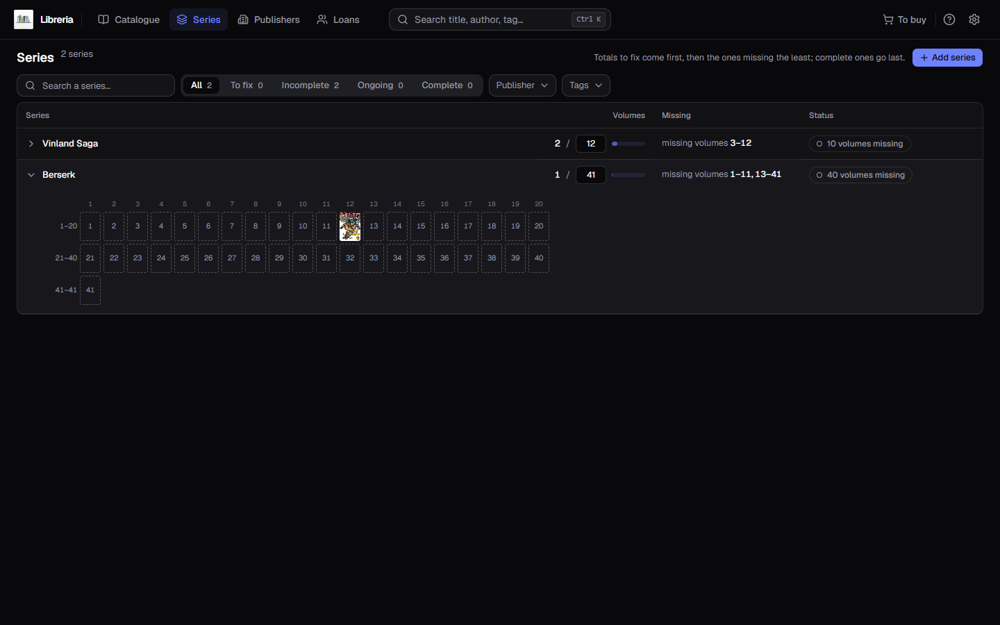
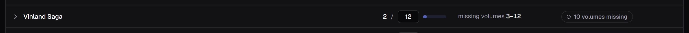
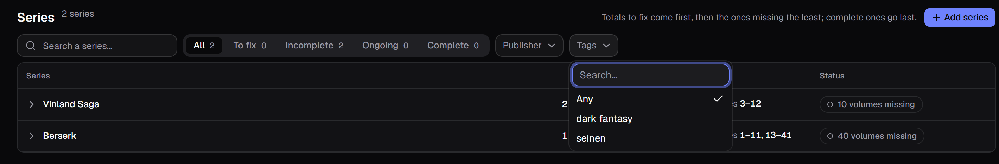
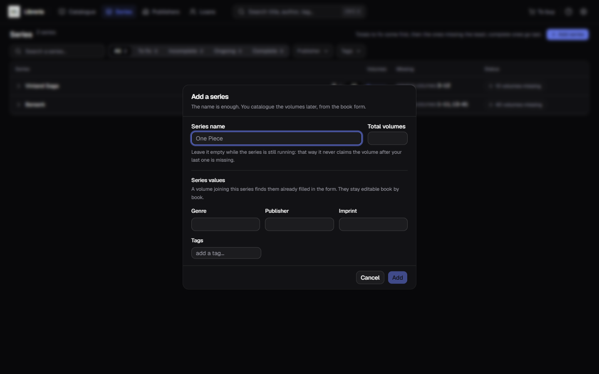
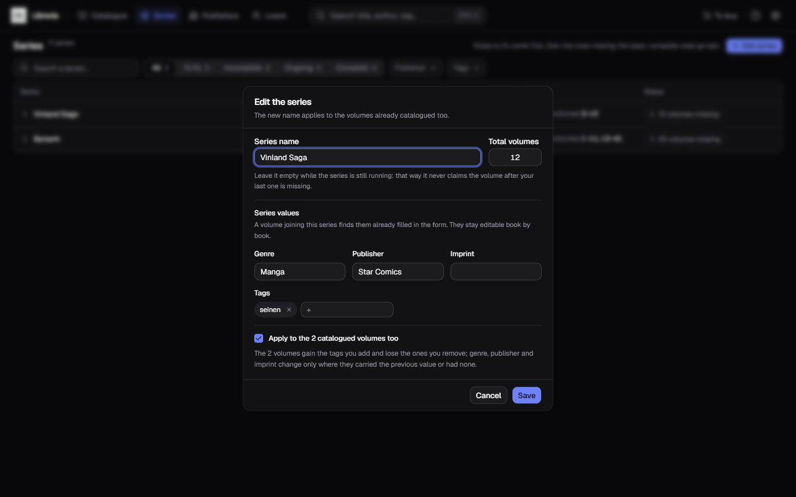
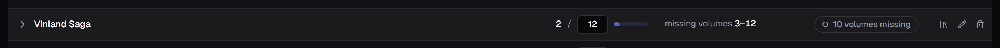
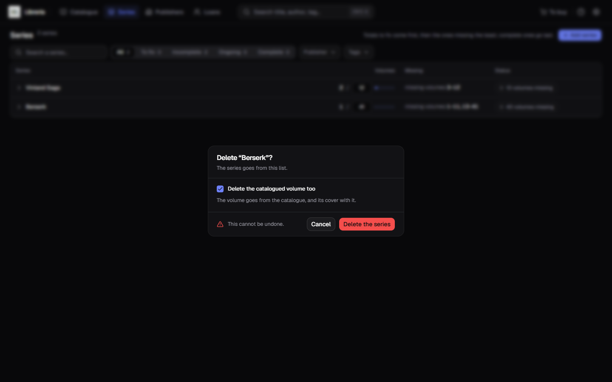

[Italiano](../it/Le-serie.md) · **English**

# Series

The **Series** entry in the bar answers one question: **which volumes am I
missing?**

A series turns up here as soon as you type its name in a book's form. There is
nothing to set up first.

## How to read a row

Every series is a **row that opens**: click it, and the grid of its volumes
appears underneath. You can keep as many open as you like — two series open side
by side are the only way to compare them — and coming back to the page they are
all closed again.

From the left:

- **the name** of the series;
- **how many you have out of how many** — `2 / 12`. The total sits in an editable
  box: correct it right there, it saves itself, and the bar beside it draws the
  same fraction;
- **which ones are missing**, with the gaps merged: `missing 3–12` instead of
  ten numbers in a row;
- the pill with the status: `10 volumes missing`, `series in progress`,
  `complete`, or `total to fix` when you have a volume numbered higher than the
  declared total — volume 14 of a series that claims to have 12;
- on the right, three actions that appear on hover — **see in catalogue**,
  **edit** and **delete**.

## The grid of volumes

Once the row is open, the volumes sit in a **grid twenty columns wide**: the
first one top left, the twenty-first on the next line. To the left of each line
is the band it covers — `1–20`, `21–37` — and along the top the numbers 1 to 20.

Position is the information: **volume 23 is always the third slot of the second
line**, so a gap is found by eye before it is found by counting, and two
different series compare because the step is the same.

- a volume you **have** carries its cover, or a drawn spine if it has none or
  it does not load — [Covers](Covers.md) explains it;
- one that is **missing** is a dashed box with its number;
- past the last expected volume there is **nothing**: volume 24 of a 23-volume
  series does not exist, and dashing it would say “you're missing this”.

Rest the pointer on a slot and it tells you **which volume it is** —
`vol. 9 · My dress up darling. Bisque doll Vol.9`, with the subtitle where there
is one — and on a dashed box, which volume is missing. It earns its keep on long
series, where twenty small covers all look alike.

**A half volume has no position**, and takes none: a `4.5` stays out of the grid,
and the line beside the tally says so — which is where the volume no number names
already lives.

The list is not alphabetical: **wrong totals come first** — the series where you
hold more volumes than the total claims, which is the sign of a wrong total —
then the ones missing the least, and the complete ones last.

This page tells you **which volumes are missing**; getting hold of them is [To
buy](To-buy.md), which does not fill itself from a series: there you add a volume
at a time, looking it up by title or ISBN or writing it by hand, volume number
included.

## Narrowing the list

Under the heading sits a bar that cuts the list while you use it. There is
nothing to confirm: the rows shrink on every keystroke.

- **the box** searches the **series name**, paying no mind to case: `bisque`
  finds *My dress up darling. Bisque doll*;
- **the row of statuses** — **To fix**, **Incomplete**, **Ongoing**,
  **Complete** — holds one at a time, and each carries its own tally beside it.
  **All** takes it back. The four entries **stay in the row even when they are
  worth zero**: a row that changes its number of entries while you pick is
  worse than an entry saying zero;
- **the dropdowns** for the four values of the series — publisher, genre,
  imprint and tags — hold one value at a time, and **Any** takes it back.

**Every dropdown can be typed in.** Open, it has a box at the top: type, and the
entries thin out paying no mind to case or accents either — `citta` finds
`Città Studi`. **Any** stays reachable while you type, so the way out does not
vanish just as you look for it.

**A dropdown only shows up where there is more than one value to choose
between.** If the series you can see are all from the same publisher, the
publisher dropdown is not there: a single choice is no choice. But if the value
you already picked is left as the only one, the dropdown does not go — otherwise
that filter could no longer be removed.

**The tallies beside the statuses look at the other filters, not at the whole
list.** With a publisher already picked, the number beside "Incomplete" says how
many series *of that publisher* are incomplete. So a tally of zero means one
thing only: picking that leaves nothing, and no pill ever promises twelve series
and then gives you none.

With a filter on, the tally at the head of the page changes shape — **1 of 2
series** instead of *2 series* — and **Clear** turns up at the end of the bar,
taking them all off in one go. If no row is left, the panel you get is not the
one for an empty list: it says *"No series match these filters"*, recalls how
many there are in all, and offers **Clear the filters**.

**One thing worth knowing before you see it.** Filter by **To fix**, type the
right total on a row, and a moment later that row goes. It is not a fault: it
has stopped being one to fix, and going is the confirmation that the total now
adds up.

## Adding a series

**Add series**, top right.

The name is enough. The total can be left empty, and it is worth doing while the
series is still running: with no total, the application will never tell you that
the volume after your last one is missing.

Underneath sit the four values of the section below — tags, genre, publisher and
imprint — which you can fill in right away or let the series learn on its own.

The volumes get catalogued later, from a book's form, by typing that name in the
Series field.

## The series' values

Besides the name and the total, a series carries four things of its own: **tags,
genre, publisher and imprint**. There is nothing to declare: **the series learns
them from the volumes you assign to it.**

- **tags** add up — each volume's tags join the series, and never leave it on
  their own;
- **genre, publisher and imprint** are set by the **first volume that carries
  one**, and no volume saved later moves them. Without that rule the series would
  chase the last book you touched, and the publisher would wobble on every save.

From there they come back. **A book that joins that series finds them already
filled in on the form**, and carefully so:

- **tags** are added to the ones you already put in;
- **genre, publisher and imprint** are filled in **only where they were empty** —
  what you typed is never touched;
- a tag you removed **does not come back** while you stay in that series.

If the series filled something under **More details**, that panel opens by
itself: you get to see it, instead of finding out after saving.

## Correcting the values by hand

The pencil opens the dialog, where the four values sit under the name and the
total. They are boxes like the form's, with the same suggestions.

When editing, a checkbox turns up too, **ticked**: *«Apply to the N catalogued
volumes as well»*. It is how you fix forty volumes in one go, and it is **not a
replacement**:

| What you change in the dialog | What happens to the volumes |
|---|---|
| You add a tag | it lands on all of them |
| You remove a tag | it leaves every volume that had it |
| You change genre, publisher or imprint | it is written **only** where the volume carried the previous value, or carried none |
| You **clear** a box | **nothing**: it means "the series no longer dictates it", not "delete it from the books" |

The last two rows are why this is not a blunt replacement: the volume reprinted
by another publisher is not flattened onto the others, and a box cleared by
accident does not take a field away from forty books.

**On removed tags, though, look twice before saving.** Since the series has
already learnt the tags of *all* its volumes, what you take out of the box really
does leave every volume that had it — even one you had put there yourself, on a
single volume. It is intended, but it is the thing you notice afterwards.

Unticking the box leaves the catalogued volumes as they are, and the values will
only apply to the ones you add later. When you create a new series there is no
checkbox: there are no volumes to touch yet.

## Editing and deleting

Hover a row: three buttons appear on the right — the first opens the **catalogue
filtered** on that series, then the pencil and the bin.

The name of the series is not a link: clicking it opens the grid of volumes,
which is the page's main gesture, and the catalogue lives in that first button.

The pencil opens the dialog above. The bin asks first:

Mind the checkbox, which is **ticked by default**:

- **ticked** — the catalogued volumes go too, covers and all;
- **unticked** — the volumes stay in the catalogue and only lose their series and
  number.

It cannot be undone. A series with no volumes shows no checkbox, because there is
nothing to take along.

**If a volume of the series is on loan, deleting with the box ticked stops** and
says who has it: a book sitting in somebody's house cannot vanish from the
catalogue. Either get it back — the round is in [Loans](Loans.md) — or untick the
box, and the series goes leaving the volumes where they are.

## The total volumes: two routes

The same number can be touched in two places, and they do not do the same thing:

| Where | What clearing the box does |
|---|---|
| **Here, in `/serie`** | the total really goes |
| In a book's form | **nothing**: the total stays |

The difference is deliberate. That number belongs to the series, not to the
single copy: if clearing the box in the form reset it, saving *one* volume would
wipe the total for all the others. The box in the form is there because that is
where the total arrives from AniList without you having to type it.

## An empty series does not vanish

A series added by hand stays in the list even with no volumes, and even after a
restart. If you do not want it any more, its bin removes it.
