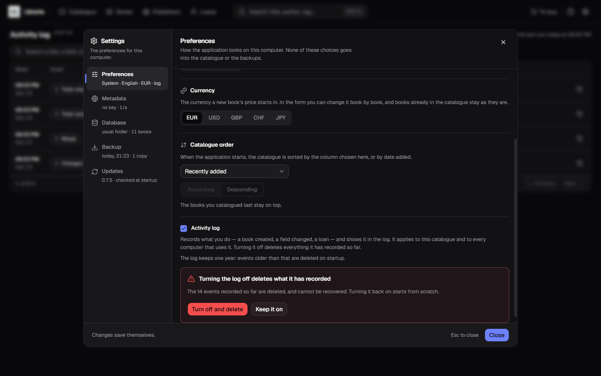
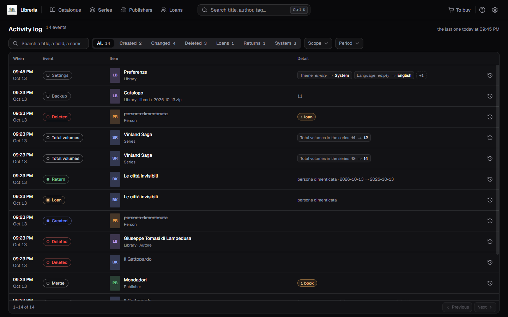
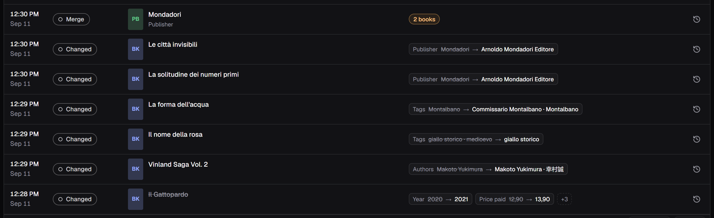
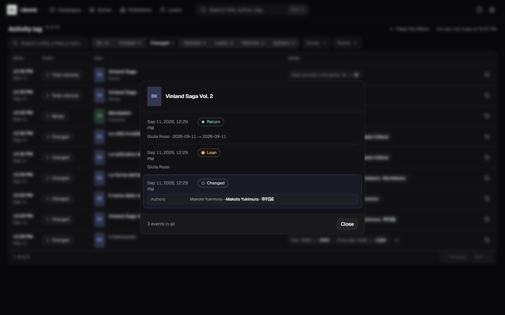
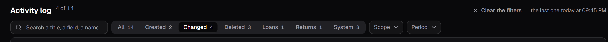

[Italiano](../it/Lo-storico-delle-azioni.md) · **English**

# The activity log

It answers one question: **what changed, and when?** A book catalogued, a price
corrected, a loan recorded, two publishers merged — every gesture that touches
the catalogue leaves a row, most recent first.

**It starts off**, and while it is off it records nothing.

## Turning it on, and what turning it off means

The **Activity log** checkbox lives in [Settings](Settings.md), under
**Preferences**. Turn it on and from then on what you do gets recorded: the first
event in the log is the switch-on itself.

| What you do | What happens |
|---|---|
| You **turn on** the checkbox | recording begins, no questions asked: nothing is taken away |
| You **turn off** the checkbox | the tick **does not move** until you confirm |

**Turning it off deletes what it has recorded**, and that is the most important
thing on this page. A question appears under the checkbox — *«Turning the log off
deletes what it has recorded»* — and it says **how many events it is about to
take away**: *«The 21 events recorded so far are deleted, and cannot be
recovered. Turning it back on starts from scratch.»* The two buttons are **Turn
off and delete** and **Keep it on**.

"Off" here means that nothing is left of what you did, not that it stops writing
on top of a pile that stays. If you turn it off by mistake, the way back is
[restoring a backup](Backup-and-restore.md) taken earlier — which brings back
*the whole* catalogue, though, not just the log.

## The log keeps one year

Events older than one year are deleted **when the program starts**, and the line
under the checkbox says so before it happens: *"The log keeps one year: events
older than that are deleted on startup."*

The cap is **fixed**: there is no box to make it longer or shorter, and that is a
choice rather than something missing — a number to pick would be one more
question for an answer that never changes. It is needed because the log **grows
faster than the catalogue it describes**: every edit is one event plus one row
per changed field, and an evening spent cataloguing leaves a few hundred behind.

It is the only thing that takes events away on its own. Everything else —
emptying it by turning the checkbox off, replacing it with a restore — is
something you do.

**The trimming applies over there too.** With the
[catalogue on a server](The-catalogue-on-a-server.md), the server's log is
trimmed every time the catalogue opens, by the same year counted on this
computer's clock.

## How to get there

The **gear** at the top right is a menu, and it holds four entries:
[Library dictionaries](Library-dictionaries.md), **Activity log** and, under the
separator, **Settings** and **Licence**.

With the log off **that entry is not there**, and three are left: there is no log
to open.

## How to read the table

Top left, the tally of events — `21 events` — and on the right, when the last
one landed: *«the last one today at 12:57 PM»*.

| Column | What it shows |
|---|---|
| When | the time above, the day below |
| Event | the action pill: `Created`, `Changed`, `Deleted`, `Loan`, `Return`, `Backup`… — the full list is below |
| Item | the cover with the title, and underneath the line that tells it apart |
| Detail | what changed |
| History | the button that opens the full history of that item |

Rows come **fifty to a page**, with **Previous** and **Next** at the foot of the
card as in [the catalogue](The-catalogue.md). Change page and the list goes back
to the top by itself.

Every pill belongs to one of the six verbs you [filter](#filtering) by, and
carries its colour:

| Filter verb | Pills |
|---|---|
| Created | `Created` — a book, a series, a person |
| Changed | `Changed`, `Total volumes`, `Merge` (of two publishers or two dictionary entries), `Renamed` |
| Deleted | `Deleted`, `Alias removed` |
| Loans | `Loan` |
| Returns | `Return` |
| System | `Backup`, `Restore`, `Export`, `Import`, `Settings`, `Catalogue moved`, `Database configured`, `Catalogue brought to the server` |

A pill too long for the column — `Catalogue brought to the server` — is cut
with an ellipsis: **rest the pointer on it** and you read it in full.

The cover is read **now**, so it is there for books still in the catalogue. For
everything else — a series, a publisher, a person, the library itself — a
coloured tile with the initials of what it is takes its place.

## What changed

A **Changed** row says it field by field, and that is why this page exists: in a
box you get the field name, the previous value struck through, the arrow, and the
new value — `Price paid · 12,90 → 13,90`.

- **two pairs** fit in the cell, and the rest becomes a `+3`. Rest the pointer on
  it and you read them all;
- a value that was not there before reads *empty* in italics. An empty box would
  look like lost data, and it is not;
- the field names are **the form's own**, so `Publisher` here is `Publisher`
  where you typed it, and a very long value is cut with an `…`.

**A mass event states the number instead of becoming that many rows**: `2 books`
next to a merge of two publishers, `3 volumes` next to a series deleted along
with its volumes.

Where there is nothing to compare, the detail carries a note: the ISBN of the
book just created, the name of whoever borrowed a book, the file of a backup.

## The events of the Database section

**`Database configured` is born at every save of the Database section** of
[Settings](Settings.md), and there changes save themselves while you type: filling
in a server's address therefore leaves more than one event, one for every pause
in your typing. Each one says field by field what changed — host, port, user,
engine, where the covers live — and **a password never shows up**: the row says
`set` or `not set`, as for the Google Books key. The same event records the
switch between **On this computer** and **On a database of yours**.

**`Catalogue brought to the server`** is the transfer of this computer's
catalogue into the server's database: under the item's name it carries the
destination address, in the form `user@host:port/database`, and beside it how
many books went across.

## With the catalogue on a server

With the [catalogue on a server](The-catalogue-on-a-server.md) the page shows
**the server's log**: what you do to books, series and loans, and the backups
and exports of that catalogue, are written over there, next to the data they
describe.

**What comes out of Settings stays in this computer's log instead** —
`Settings`, `Database configured`, `Catalogue moved` and `Catalogue brought to
the server` — because it is about this computer and not about the catalogue.
While you are looking at the server you do not see those events: they show up
again when you go back to this computer's catalogue.

## The full history of an item

The button at the end of every row opens the whole history of that book — or of
that series, that publisher, that person. There the details read **in full**,
with no `+N`, and the row you came from is marked, so you do not lose it among
seven events.

**That history does not go through the page's filters**, because "full" means
full: with **Returns** on, the table shows two rows in all, and the history of
one of those two volumes shows three — the return you filtered for, the loan
that came before it and the change before that.

## Filtering

Above the table:

- the **search box** looks in the titles, in the notes and **inside the changed
  fields** — so "Einaudi" also finds the event where the publisher became
  Einaudi;
- the **row of seven states** — **All** plus the six verbs: Created, Changed,
  Deleted, Loans, Returns, System — each with its own tally;
- **Scope** narrows to Book, Series, Publisher, Person or Library;
- **Period** offers Today, Last 7 days and Last 30 days. **Any** removes the
  filter.

**The tallies look at the other filters, not at the whole log.** A tally of zero
does not say that kind of event never happened: it says that *choosing this, with
the filters you have now, nothing is left*. The seven states stay in line even
when they read zero: a row that changes its number of entries while you filter is
worse than an entry that says zero.

With a filter on, the tally at the top becomes `9 of 21`, and **Clear the
filters** turns up beside it and removes them all in one go.

## A deleted book stays readable

The title appears **struck through**, with the tile in place of the cover; open
its full history and a pill says it: *«No longer in the library»*.

That works because the event carries a **copy** of the title, not a pointer to a
book that has to still exist. Without that copy the log would go mute the day
after a deletion, which is precisely the day you go and read it.

## What never enters the log

- **the Google Books key never lands in it.** If you change it, the row says
  `set` or `not set` and nothing more: a secret does not belong anywhere that
  gets copied and pasted;
- **description and notes record only the fact that they changed.** They change a
  thousand characters at a time, and what you need to know is *that* it happened:
  the field shows up, and both values stay *empty*;
- **importing a cover is not an action.** It writes a file and does not touch the
  catalogue, and you might never save that book. A changed cover reads as the
  `Cover` field inside the book's change, which is when it really happens.

## A restore replaces the log too

**It is right that it does** — that log described *that* catalogue — but it has
to be said beforehand rather than found out after, and the restore confirmation
says it in full: *«The activity log is replaced along with the catalogue: the
archive's log takes the place of the current one.»* The round is in
[Backup and restore](Backup-and-restore.md).

## When the page has no rows

They are three different things, and the page tells them apart:

| What you read | What it means |
|---|---|
| **The log is off** | the checkbox under Preferences is not on: from here on nothing gets recorded |
| **Nothing here yet** | it is on, and you have not done anything worth recording yet |
| **No event matches these filters** | the events are there, but these filters let none of them through: remove one |
