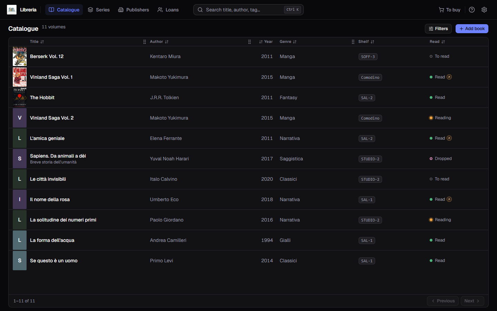
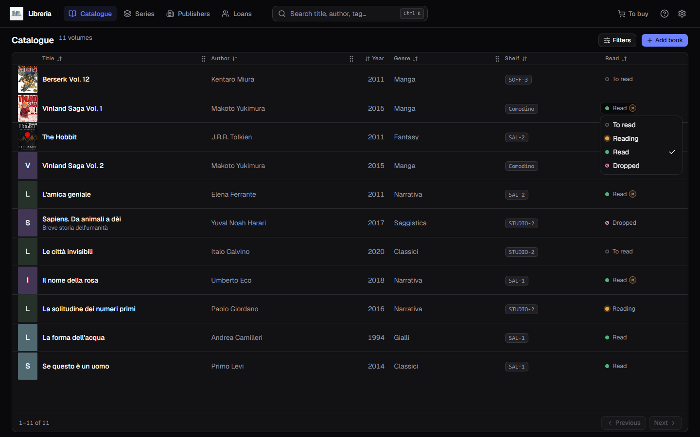
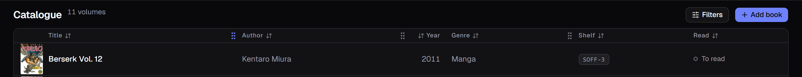
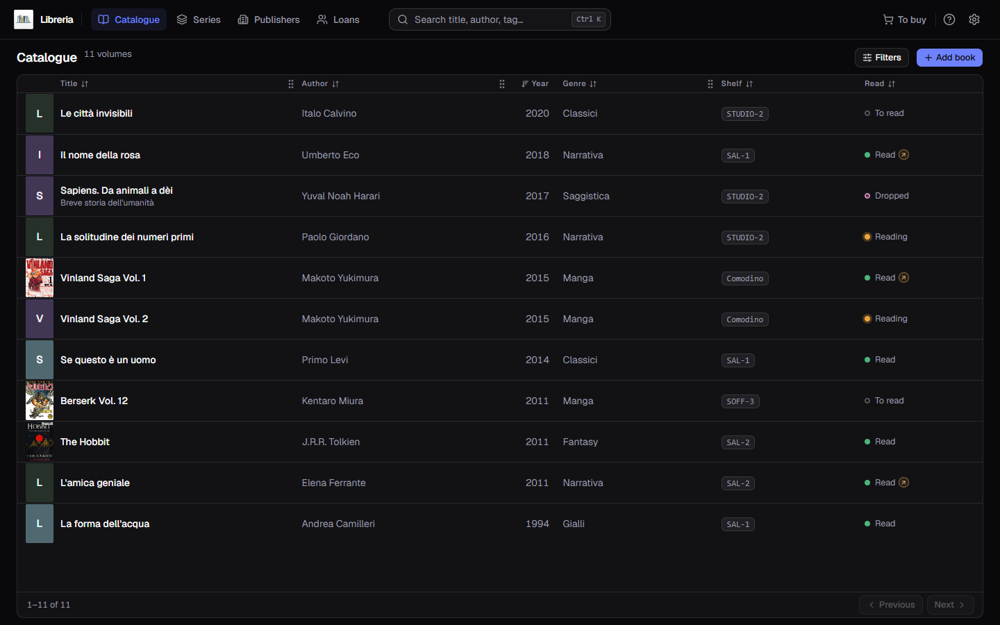
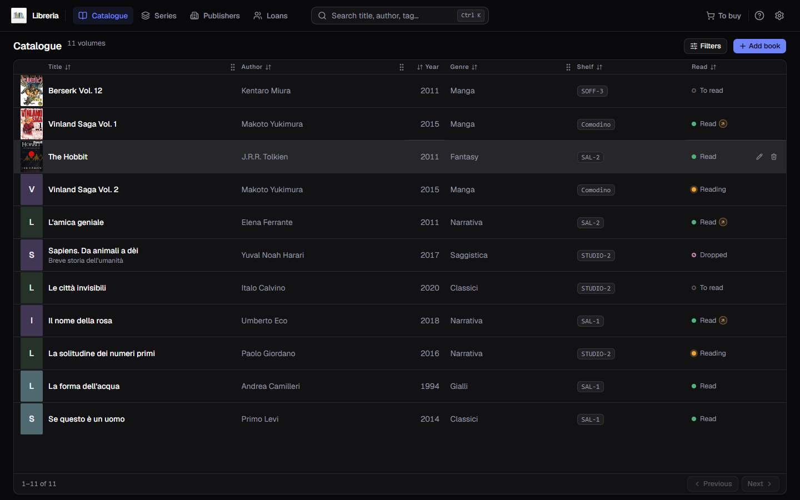
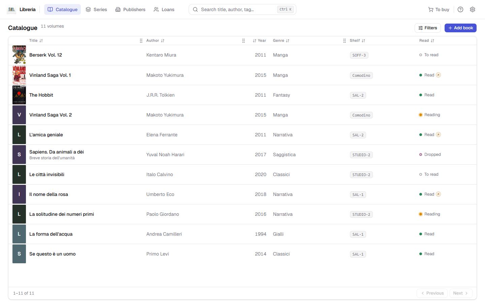

[Italiano](../it/Il-catalogo.md) · **English**

# The catalogue

This is the screen that opens on startup: one row per volume, seven columns.

Top left, the count tells you how many books you are looking at — `11 volumes`
when nothing is active, `3 results` once a search or a filter has narrowed
things down.

Here are the books you **have**: the ones you want to buy sit in [To
buy](To-buy.md), and they come in here from there with one click.

## The columns

| Column | What it shows |
|---|---|
| Cover | the thumbnail, or a spine drawn in the publisher's colour — also when the image does not load (see [Covers](Covers.md)) |
| Title | in bold, with the **subtitle** below it in small, where there is one |
| Author | every author of the book, comma separated |
| Year | the year of **this** edition, not of the first one |
| Genre | just one, the one you typed in the form |
| Shelf | where the book physically is: `SAL-1`, `STUDIO-2`, `Comodino` |
| Read | `To read`, `Reading`, `Read` or `Dropped`, with a mark in front: an empty ring, a dot with a halo, a solid dot, a struck-through ring |

**A book that is away from home is announced by the «Read» cell.** A mark shows
up next to the reading state, and resting the pointer on it reads out everything
there is to know: *“Luca Ferraro · lent on Sep 4, 2026 (today)”*. It is not an
extra column because there is no room for one — the widths are tuned to the pixel
— and it is the mark that explains why that volume is not on the shelf where it
should be. The rest is in [Loans](Loans.md).

A dash `—` means the field is empty: not an error, just a field you have not
filled in. Books with no subtitle do not leave an empty line: every row is the
same height, and the title centres itself.

**If a column cuts something off, rest the pointer on it.** After a moment the
whole value appears — the title with its subtitle, the author, the year, the
genre, the shelf — with no need to widen the column. On the cover you get the
title of the book, which is written nowhere there. The exception is **Read**,
which already has its word on screen.

## Changing the reading status

**The status changes from the «Read» cell, without opening the book.** A click
on the cell opens a menu with the four states — **To read**, **Reading**,
**Read** and **Dropped**, that is a book you started and put aside — and the
current one carries the tick. Pick another and the catalogue saves it at once,
with no confirmation: it is the same save you would make by reopening the book
in the form and pressing **Save**.

The loan mark, if the book is away from home, **stays next to** the status: the
cell is just one, and carries both things.

If the catalogue lives on a service, everyone has their own readings and the
menu carries a few more entries: [Working in a library](Working-in-a-library.md)
tells the story.

## Resizing the columns

The right edge of **Title**, **Author** and **Genre** carries a **grip**, the six
grey dots always visible next to the header. It can be dragged: hover it and the
grip takes on colour, the pointer turns into a double arrow and the hint
*«Drag to resize, or use ← →»* shows up.

Whatever one column takes, the ones to its right give up, so the table **always
fills the card** and there is never anything to scroll sideways. No column goes
below a minimum width: once there, the others stop giving and the handle goes no
further.

It works **from the keyboard** too: `Tab` after the header moves the focus onto
the handle, and `←` and `→` move it one step at a time.

**Year and Read stay narrow and cannot be resized.** They take the minimum their
header and their longest word (`To read`) need, and they carry no handle: they
are two short fields, and the room they save goes to the titles, which are not
short. The same holds for the cover and for the two icons at the end.

The width you choose **survives a restart**. It does not go into backups: it is a
preference of this window, not a piece of the catalogue.

## Sorting

Click a column header to sort. **Six columns out of seven are sortable** — all
but the cover.

Next to the name of every sortable column there is always an icon: a double
arrow while the column sorts nothing, and the arrow of the direction when it
does.

Each header cycles through **three states**: first click ascending, second
descending, third back to the order books were added in. **Year does the
opposite**: the first click puts the most recent editions on top, the second the
oldest.

**That click counts for now, and is not remembered.** Next time you open it the
catalogue starts again from the order chosen in [Settings](Settings.md), which
with nothing chosen is the most recent addition: the books you catalogued last
stay on top. Not even the third click takes you back there — that one returns to
the order books were added in, which is the same thing only if you chose nothing
in Preferences.

**By title the order follows the numbers, not the digits.** `Vol. 2` comes
before `Vol. 10`, instead of landing between `Vol. 1` and `Vol. 19` the way an
alphabetical order would put it. It does one thing only, and it is the one that
counts when you catalogue a series: the run of volumes reads in the order you
read them. Leading zeroes change nothing — `Vol. 007` still comes before
`Vol. 8`.

On the other columns the order is alphabetical and case does not count, while
accented letters go last.

## Editing and deleting

Hover a row: two icons appear on the right.

- **the pencil** reopens the book in the form, with every field already filled;
- **the bin** deletes it, after a confirmation. The cover goes with it, unless
  the same image is also used by another book or by a volume to buy.

Deleting **cannot be undone**. If you get it wrong, the way back is
[restoring a backup](Backup-and-restore.md) — which brings back the *whole*
catalogue, though, not just that book.

**A book that is on loan cannot be deleted.** The bin refuses and names whoever
has it: get it back first, then remove it. The same goes for the tick in
[Series](Series.md) that takes the volumes away.

## Paging

**Previous** and **Next** sit at the bottom of the window, with the count on the
left (`1–11 of 11`); with a single page they are switched off.

A page holds **100 rows**. When there are more books, **Rows per page** shows up
next to the count, and chooses between `100 rows`, `250 rows` and `500 rows`.
The choice **survives a restart**, and changing it takes you back to the first
page.

The footer stays **pinned to the bottom of the window** whether you have ten
books or two hundred: only the table scrolls, and the column headers stay in
view while it does.

**Turning the page starts the list from the top again**: press **Next** at the
bottom of the list and the new rows show from the first one, not from halfway
down.

## The light theme

Everything here exists in light too — you switch from [Settings](Settings.md).

