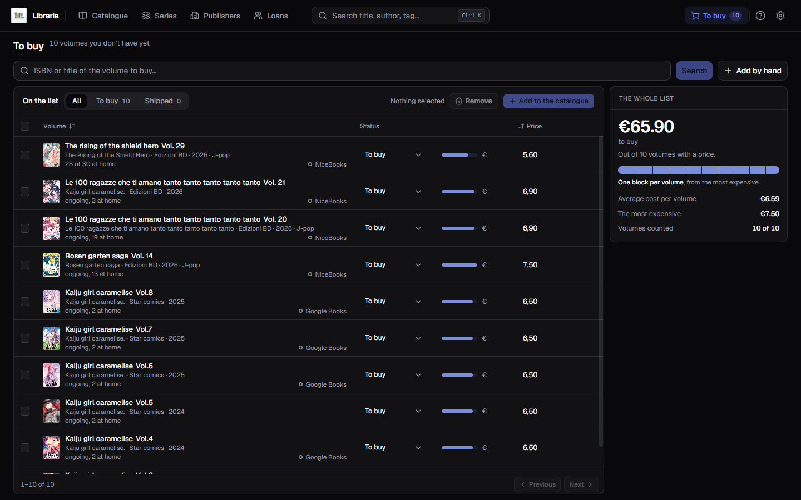
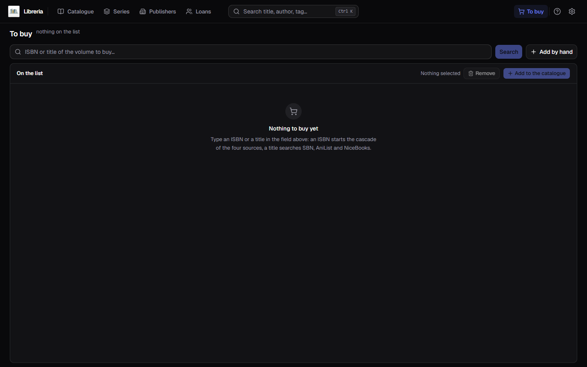
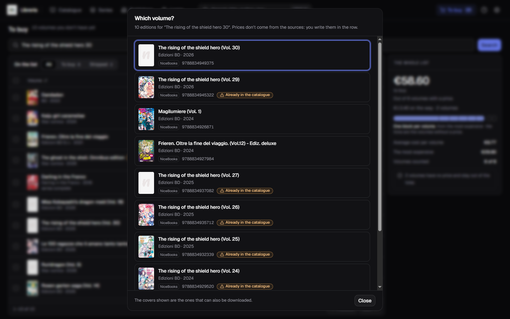
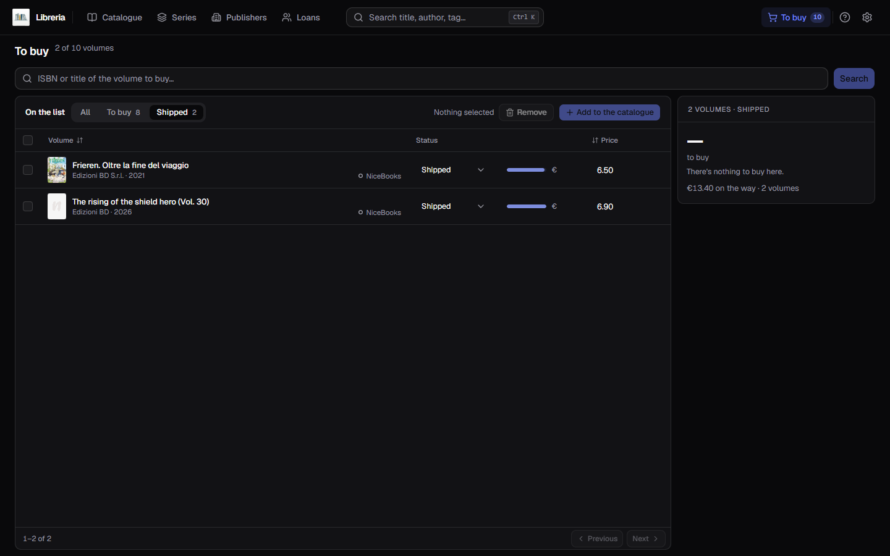
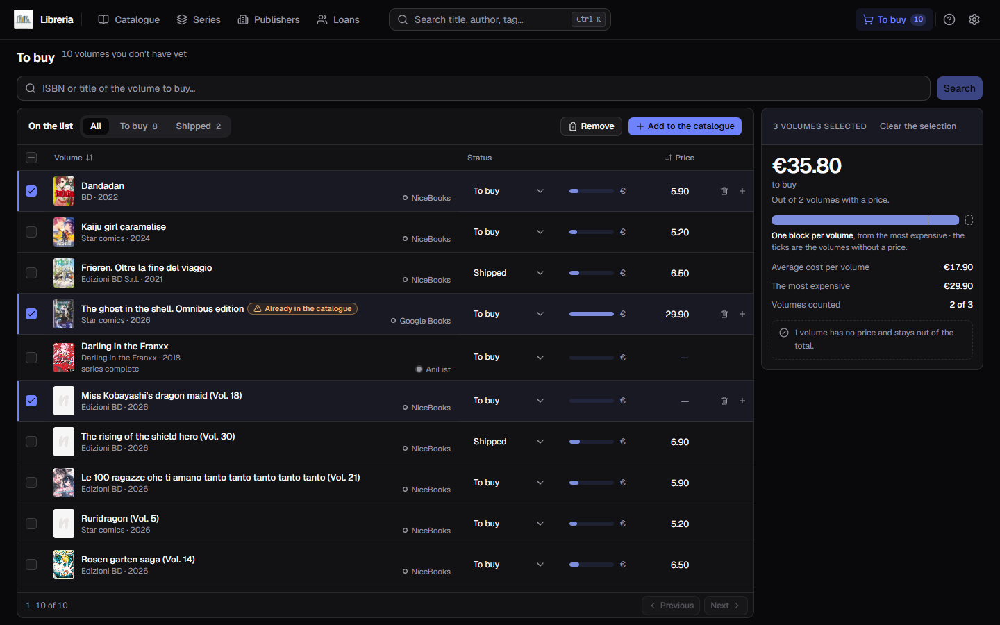

[Italiano](../it/Da-acquistare.md) · **English**

# To buy

The **To buy** entry in the bar answers one question: **how much will it cost me
to finish what I am reading?**

It is the only page that talks about books you **do not have**. It sits to the
right of the search box and carries the number of volumes you have put on it:
what you see there is not in the catalogue, and it does not get there until you
say so.

The list starts empty and fills up by **searching**, one volume at a time, from
the field at the top.

## Putting a volume on the list

That field takes **an ISBN or a title**, and works out on its own which of the
two you gave it:

- with **thirteen digits** it starts the cascade of the four sources, the same
  one the form uses — the round is in [Looking up
  metadata](Looking-up-metadata.md);
- with a **title** it searches SBN, AniList and NiceBooks.

If there is only one answer, the volume joins the list and the field clears. If
there is more than one, **Which volume?** opens: a row of editions with the
cover, the publisher, the year, the source that offered it and the ISBN. The
heading says **Which edition?** instead when every offer carries the same title,
because then the choice is between two printings of the same volume. In the
dialog's footer a note says where the pictures come from: *“The covers shown are
the ones that can also be downloaded.”*

**The editions you already have are marked**, with `Already in the catalogue`. It
is not a ban: pick one anyway and it joins the list — *“you already have one with
this ISBN”* holds here as it does in the form, because a second copy is a
legitimate thing to own.

If **no source knows anything** — about a title, an ISBN or an edition —
**Add it to the list by hand** appears next to the line, and it opens the form
with what you searched for already inside: in the title if it was a title, in the
**ISBN** if it was thirteen digits. It shows up on all three outcomes: a code
nobody knew used to be a dead end, because the line said so and there was no way
to put it on the list.

## Adding by hand, with no search at all

Next to **Search** there is **Add by hand**, and it is always there: it is for
the volume you know and no source does — an announcement just out, a second-hand
copy, a printing the catalogues do not carry.

**It is not a form of its own: it is the same one as “Add book”** in the
catalogue, opened in a context that switches off what makes no sense here. So you
keep everything that form already does — the suggestions for publisher, imprint
and series taken from your own catalogue, the **authors as rows** with their
role, the cover box, and the button that **queries the sources** if an ISBN turns
up after all. Only the title is required.

What you will **not** find in there are the fields that speak of a book you are
holding: the **shelf location**, the **reading status**, the **purchase date** —
and the **price**, which has its box in the row. Gone as well are *Delete* and
*Duplicate*, which speak of a book in the catalogue, *Save and add another*,
which is the gesture of someone cataloguing a pile, and **barcode scanning**: a
code is read off the spine of a book you are holding, and these are the books you
do not have.

Of the series you write **the name and the volume number**: if you are buying the
third one, you know that 3 as you type it, and it stays with the row all the way
into the catalogue. The **total** number of volumes is not there, because it
belongs to the series and not to this volume: you correct it in
[Series](Series.md).

## Correcting a row

The **pencil**, first of the row icons, reopens that same form with what the row
carries already in it. It is where you fix a publisher a source spelled wrong, or
add a note.

**A box left empty clears that value**, and that is on purpose: it is the only
way to remove something wrong. **Status and price are not in there** — they have
their own boxes in the row — so correcting a title does not lose you the price
you had written, nor send the row back to *To buy*.

## How to read a row

From the left the tick box, then the **cover** — the real one where the source
had it, otherwise the card with the title — the title of the volume, and under it
**series, publisher, year and imprint**, whichever are there: `The Rising of the
Shield Hero · Edizioni BD · 2026 · J-pop`. On the right sits the source that
offered it: `NiceBooks`, `Google Books`, `AniList`.

Where the row carries **a series** — because the source said so or because you
typed it — and that name is a series in your catalogue, a third line shows
**where you stand with that work**: `series complete`, `ongoing, 2 at home`,
`28 of 30 at home`. It is the count of the volumes you have **in the
catalogue**, not of the ones on the list. The line is missing where the row has
no series, or where that series is not in the catalogue yet.

Then the **status**, the **price**, and — as the pointer crosses the row — the
three icons at the end: correct, remove from the list, add to the catalogue.

## The price is yours to write

**None of the sources gives a price.** A row is always born without one, and the
box in the row is the only place that number gets written: it saves itself a
moment after you stop typing, with nothing to confirm. Beside the box a small bar
says how much that volume weighs against the most expensive one you are looking
at.

**A volume with no price is not worth zero: it stays out of the count.** It is
the only honest thing to do — a price you do not know is not free — and it is why
the summary is not just a sum and always declares how many volumes it was made
of. In the shot above they all have a price, and indeed it says `Volumes counted
10 of 10`; with three volumes picked, one of them without a price, it says `2 of
3`, and below it *“1 volume has no price and stays out of the total.”* — you can
see it [further down](#the-summary-follows-what-you-are-looking-at).

That number does not stay here: when the volume joins the catalogue it becomes
the book's **Price paid**.

## The status, and what “on the way” means

There are **two** statuses: `To buy`, which a row is born with, and `Shipped`,
which you set once you have ordered it. You change it from the drop-down in the
row, and the pills above the table hold one status at a time, each with its own
tally — **All** takes them off.

**What has already left does not add to the total**: it is money already spent,
and the summary keeps it in a count of its own — `€13.40 on the way · 2 volumes`
— under the big number. So filtering on *Shipped* the big number may well say
there is nothing to buy here, and it is right: those two are paid for.

With a pill pressed the tally in the heading changes shape — `2 of 10 volumes` —
and if you move a row onto a status the filter does not show, that row leaves
under your fingers: a line in the heading says which one and where it went. If a
pill has nothing left in it, the box is not the one of an empty list: it says the
pill is what is narrowing, and **All** opens it again.

## The summary follows what you are looking at

In the side panel on the right sits the count of what you have in front of you,
and it **always follows the selection**: with nothing ticked it talks about the
whole list, and the moment you tick one it talks about those alone.

- **the big number** is what it costs to buy what you are looking at, and under
  it is written how many volumes it is made of;
- **the block bar** is its signature: **one block per volume**, as wide as its
  share of the total, from the most expensive. Rest the pointer on a block and it
  reads out which volume it is and how much it weighs, while its row lights up in
  the table. The empty **ticks** at the end are the volumes without a price, the
  ones that are not in the sum;
- below, the **average cost per volume**, **the most expensive** one, and **how
  many volumes** made it into the count.

When there are too many volumes for each to have its own block, the bar becomes a
single one and the fill says how much of the list you are buying.

If the window is narrow the summary no longer sits beside the table: it lies down
in a band above it, with the same counts.

## Picking several volumes at once

The tick box in the column header takes or leaves the whole page. When only some
of the rows are picked it **carries a dash and not a tick**: it says “some of
them”, which is a different thing from “all”.

The two buttons at the top — **Remove** and **Add to the catalogue** — work on
what you have picked, and until you pick something they stay off with
`Nothing selected` written beside them. The same two actions sit on every row,
for when the volume is only one.

## Adding to the catalogue

This is the gesture the list exists for. The volume **becomes a book straight
away**, without going through the form, and it carries everything the row had:
title, subtitle, authors with their roles, publisher, imprint, year, series and
**volume number**, ISBN, genre, language, pages, first edition, description,
notes, tags, the cover the source had offered and the price you had written. The
row leaves the list, and **See in the catalogue** appears in the heading.

All that is left to add afterwards is what the list could not know — **where it
goes on the shelf** and **whether you have read it** — reopening the book with
the pencil in [the catalogue](The-catalogue.md).

## Removing from the list

The bin, on one row or on all the ones you have picked. The confirmation says in
full what happens: **they leave here and the catalogue does not change**, because
those volumes were never in the catalogue and there is nothing to delete there.

**What you had written yourself goes with the row** — the price, the notes, the
tags, the volume number. Put the same volume back on the list tomorrow and you
type those again: the sources can say the rest over, not those.

## Sorting and paging

You sort by **Volume** and by **Price**, one click for the direction and another
to turn it round. By title the order follows the numbers and not the digits —
`Vol. 2` before `Vol. 10` — as in the catalogue. By price, **the volumes without
one stay at the bottom both ways round**: they are neither the dearest nor the
cheapest. With no click at all the list sits in the order it was filled, the last
one searched on top.

At the bottom there is the catalogue's own footer, **fifty rows at a time**, and
turning the page brings the list back to the top.

## Two things the list does not do

**It does not tell you which volume you are missing.** The line under the title
says where you stand with the work — `ongoing, 20 at home` — and stops there.
None of the public catalogues says **what number** the volume you are looking at
carries, and pulling it out of the title would mean getting it silently wrong on
the first title typed crooked: a line that says less is better than one that says
the wrong thing. Which volumes you are missing, with the gaps grouped together,
is what [Series](Series.md) tells you; here you look them up by name, one at a
time.

The number **you type yourself** in the form is another matter and the row keeps
it: what the program does not do is **read it off a title**.

**It does not fill itself from a series.** There is no “add the volumes I am
missing from this work” button, and it is for the same reason as above: the
volume number comes from no source, so there is nothing to build that list out
of. You add one volume at a time — looking it up by title or by ISBN, which is
also the moment you get to see which edition you are buying, or writing it by
hand when you already know it.
