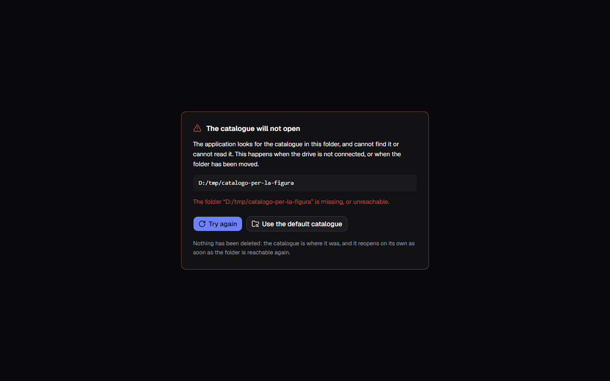

[Italiano](../it/Dove-stanno-i-dati.md) · **English**

# Where the data lives

To start with, the catalogue is a file on your disk, and it can live on a server
too. **Settings → Database** is the place that says where it is, how much it
weighs, and how to take it somewhere else.

The section has three roads in two groups, and the radio in front of each says
**which one is used**. In the **On your own** group:

- **On this computer** — the database and the covers live in a folder on this
  computer. It is what you start with;
- **On a database of yours** — the data lives on a database that answers over
  the network, and the covers wherever you say. How it works is further down
  this page.

In the **In a library** group:

- **With the library's service** — this computer talks to the program the
  library keeps on its server. It is at the bottom of this page.

**All the roads stay usable**, whichever radio is on: the choice says which
system is in use, not which one you are allowed to touch.

## What is in the catalogue folder

| | |
|---|---|
| `libreria.db` | the catalogue: books, series, loans, log |
| `covers\` | the covers, one file per book |

These two are one thing and **they move together**. Under the path box, a line
says how many books are in there and how much the catalogue weighs.

The other two do not move, and that is not an oversight:

| | |
|---|---|
| `impostazioni.json` | the preferences, the API key, where the catalogue lives and the server connection |
| `backups\` | the backups, which have a folder of their own |

Preferences belong to **this** computer — the API key is in there too — and the
backups go wherever you want from their own section, told in
[Backup and restore](Backup-and-restore.md).

**`impostazioni.json` always stays in the starting folder**, even when the
catalogue moves: it is the note that says where the catalogue went, and a note
is not put inside the thing it has to find. It does not go into the backups, and
**it is not to be shared**: besides the API key, it holds the server password
and the secret of the covers archive, if you gave them.

The starting folder also holds two more folders, which are not data:

| | |
|---|---|
| `miniature\` | reduced copies of the covers, for the small views |
| `intermedie\` | medium-sized copies, for the large views |

**They rebuild themselves** from the real covers, the first time they are
needed, and that is why they do not go into the backups and do not travel with
the catalogue. If you delete them you lose nothing: the images take a moment
longer to appear, the first time.

To start with, the catalogue folder is
`%LOCALAPPDATA%\it.alexkill536ita.gestionale-libreria\`, the same one you find
in [Installation](Installation.md).

## Moving the catalogue somewhere else

**Browse** opens the system window, and you pick **a folder, not a file**:
database and covers travel together, and a catalogue that looks for its images
somewhere else is a catalogue of broken covers.

Once the folder is picked, a box says **what is in it**, and therefore what is
about to happen:

- the folder is empty, or has files but no catalogue → **Move the catalogue
  here** or **Start a new catalogue**;
- the folder already has a catalogue → **Open this catalogue**, with the line
  above saying how many books and how many covers are in there;
- the folder is the current one, or cannot be written to → there is nothing to
  do, and the line says so.

**Cancel** closes the box without touching anything. Until you press one of
those buttons, nothing has happened.

### Moving copies, and deletes nothing

**Move the catalogue here** copies the database and the covers into the new
folder. The old ones **stay where they were, untouched**: if the new folder
disappoints — an awkward memory stick, a slow disk, a path you cannot find again
— you reopen yesterday's from this very screen.

The price is that for a while you have two copies. You delete the second one by
hand, once you are sure.

**No restart needed.** The new catalogue opens straight away, the pages reread
themselves, and the line under the box gives the new count.

From a folder other than the default you come back with **Back to the default**,
next to the line warning you that the catalogue is not where it is born.

### Opening a catalogue that already exists

This is for when the catalogue is already somewhere else: after a reinstall, on
an external disk, or simply because you keep more than one.

**Open this catalogue** points the application there and nothing more: it
**copies nothing and moves nothing**, and the current catalogue stays where it
is — you come back to it from here whenever you want.

Two things are refused, and the message says which: what is in the folder is not
a catalogue of this application, or it is a catalogue written by a **newer
version** of the program. In the second case the way out is to update the
application, not to force the file.

### Starting a new catalogue

In a free folder, **Start a new catalogue** puts an empty catalogue there and
you work inside it. The old one stays where it is: they are two separate
catalogues, and the application opens the one you tell it to.

### If a restore is waiting

If you have just asked for a [restore](Backup-and-restore.md), moving is
refused:

> A restore is waiting for the next start: restart the application before moving
> the catalogue.

The replacement is already prepared in the folder you are leaving, and it has to
be finished there. Restart, let the restore finish, and then move.

## If that folder is gone at the next start

Memory stick unplugged, external disk switched off, folder renamed by somebody
else. The application **does not start on an empty catalogue** and recreates
nothing: it stops on a screen that names the folder it was looking for and says
why it cannot get to it.

There are two ways out of it:

- **Try again** — once the stick is back in or the disk is on again, it reopens
  the catalogue **without restarting**;
- **Use the default catalogue** — takes the application back to the starting
  folder, and only appears if that is not the one already.

And there is one line that is the most important thing on that screen:
**nothing has been deleted.** The catalogue is where it was, and it reopens on
its own as soon as the folder is reachable again, with all its books.

An empty catalogue in place of yours would be the wrong answer, and it is why
that screen exists: two hundred books that look gone with no error at all are
worse than an error.

**With the catalogue on a server, the screen has a face of its own**: “The
catalogue on the server will not open”, which also shows up in the middle of
your work if the server stops answering. The ways out are **Try again** and
**Use the catalogue on this computer**, and there too nothing has been deleted,
neither over there nor here. The rest is in
[The catalogue on a server](The-catalogue-on-a-server.md).

## Network folders and synced folders

**A network folder is refused**, and it is not excessive caution:

> “`\\nas\shared`” is on a network folder, and a catalogue there gets damaged.
> Choose one on a disk of this computer.

The database is written to constantly, and on a network share those writes
damage one another: it does not get corrupted the day you choose it, it gets
corrupted a month later.

**A synced folder, on the other hand, is accepted — out loud.** If the path goes
through OneDrive, Dropbox, Google Drive or iCloud, a warning appears above the
buttons:

> This folder is synced by OneDrive: keep the catalogue open on one computer at
> a time, or two writes at once will damage it.

It is allowed because finding the catalogue again on another computer is
probably half the reason you are moving it. There is one rule, and you have to
keep it by hand: **one computer at a time.** Close the application on the first,
let the sync finish, open it on the second.

If you would rather not, the safe road is still the other one: sync the
**backups** and [restore them](Backup-and-restore.md) where you need them,
instead of keeping the catalogue file open in two places.

## On a database of yours

The second road puts the catalogue on a database that answers over the network,
so that more than one computer can work on the same books. **Four engines can
hold a catalogue**: PostgreSQL, MySQL, SQL Server and MongoDB. The section can
also test MariaDB and an SQLite file reached over the network, but a catalogue
cannot be kept there.

The covers go wherever you choose: **inside the database**, **in a folder**
shared so that every computer reaches it, or **in an S3 archive**.

**Choosing the “On a database of yours” radio opens the catalogue over there, straight away
and without restarting**: the pages reread themselves, and from then on every
read and every write goes to the server. On an empty database it starts a new
one. The catalogue on this computer stays as it was, and you go back to it by
choosing “On this computer” again. To take the books you already have to the
server there is **Bring this computer's catalogue here**, which sends a copy
over and deletes nothing.

The connection, the test, the three places for the covers, the move and what
happens when the server does not answer are in
[The catalogue on a server](The-catalogue-on-a-server.md).

## With the library's service

The third road does not talk to a database: it talks to the **service**, the
program the library keeps on its server. It is the only one that sees the
database, and that is why no database password is needed here.

### The address

There is one field, **Address**, and it always starts with `https://`, followed
by the computer the service runs on and the port — for example
`https://192.168.1.20:7878`. An address starting with `http://` is refused
before trying: the field is marked and **Test the connection** stays off.

**Test the connection** says in how many milliseconds the service answered and
on which database engine; how many books it holds it says once this computer has
signed in, and a service that has no users yet says that too. If something else
answers at that address — the database's own port, for example — it says so,
and points you to “On a database of yours”. **Writing the address does not
switch catalogue**: to use it, choose the radio.

### The service's fingerprint

On the first connection the section says “This is the first time this computer
talks to this service” and shows the **Fingerprint of the service**, a string of
letters and numbers that belongs to it and nobody else. The service prints the
same fingerprint every time it starts, on the machine it runs on: compare them,
and if they are the same press **I trust it**. **Until you trust it, this
computer sends it nothing**, neither a name nor a password. From then on the
section shows **Fingerprint confirmed**.

If one day the fingerprint is no longer the same, “The fingerprint of the service
has changed” appears, with **The one it trusted** and **The one it sends now**,
and the connection stays stopped. It happens when the service has been
reinstalled or has changed its certificate: press **Trust the new fingerprint**
only if whoever runs the service confirms they changed it. An address that leads
to another service also starts over: the previous fingerprint and this
computer's session are forgotten.

There is a third case: “A program on this computer reads the connection to the
service”, with the name of whoever signed the certificate that arrives. It is
usually an antivirus with HTTPS scanning on, which sits in the middle and
presents a certificate of its own. There is nothing to confirm here, because the
fingerprint you would see would be its own: the remedy is to exclude the
service's address from that program's HTTPS scanning, then test the connection
again.

### Signing in to the service

You sign in to the service with a name and a password, given by whoever runs the
service. They are not written in the settings: when the catalogue is on the
service and this computer has not signed in yet, the **Sign in to the service**
dialog opens by itself, with the address and the confirmed fingerprint at the
top, **Name** and **Password**.

If you close it, “The service asks you to sign in” stays underneath, with **Sign
in** to open it again. Who is signed in shows in the top bar, with their name:
their menu holds the role, the service's address and **Sign out**, which ends the
session and opens the dialog again.

- **The session stays on this computer**, in the system keychain and not in
  `impostazioni.json`: reopening the program does not sign you in again.
- **It ends after thirty days without use**, or when whoever runs the service
  closes it. Then the dialog opens again by itself.
- **After five wrong attempts** on the same name you have to wait a minute
  before trying again.
- **The catalogue on this computer stays without sign-in**: the name and
  password only hold on the service.

Managing the other users will come later.

### The first administrator

A freshly installed service has no users, and then the dialog is **Create the
first administrator**: it asks for the **Setup code**, then **Name**,
**Password** and **Repeat the password**, and the button is **Create the
administrator**. The service writes the code in its log and in the file
`codice-di-configurazione.txt`, next to its data, and **it works only once**:
once the administrator exists, it is no longer needed.

Whoever lost the administrator's password makes a new code on the service's
machine, by starting the service program with the `--nuovo-codice` option: it
writes the code in the same file, prints it and stops, without starting to
serve.

### With the catalogue on the service

- **where the covers live is up to the service**, and this computer only opens
  them. If they are in an online archive, you can put a key of your own here; if
  the service keeps them inside the database, for now they show as spines;
- **backup, CSV export, restore and Bring this computer's catalogue here** are
  visible but switched off, with a sentence saying they come later. Importing
  from a CSV spreadsheet does work;
- **if the service stops answering**, “The catalogue on the service will not
  open” appears, with **Try again** and **Use the catalogue on this computer**.
  Nothing is deleted.
