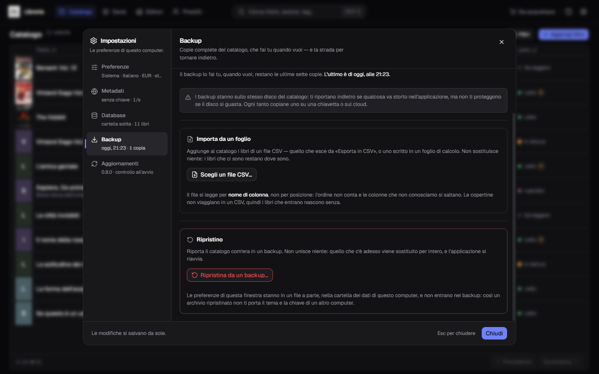

**Italiano** · [English](../en/Backup-and-restore.md)

# Backup, esportazione e ripristino

Tutto in **Impostazioni → Backup**.

**Tutto quello che c'è in questa pagina vale anche col catalogo su un server**:
backup, esportazione, import e ripristino parlano al catalogo che stai usando
adesso, di qua o di là. Dove le due strade si separano, la pagina lo dice.

**Col servizio della biblioteca le cose cambiano un poco**, e la sezione
[più sotto](#col-servizio-della-biblioteca) dice come.


## Il backup lo chiedi tu

**Crea backup adesso** ne fa uno — ed è l'unico modo che ha di nascere:
l'applicazione non ne scrive nessuno da sé, né all'avvio né a un orario suo.
Restano le copie degli **ultimi sette giorni**: le più vecchie se ne vanno da
sé, quindi la cartella non cresce all'infinito.

Ogni copia è un file `.zip` con dentro il catalogo **e le copertine**, chiamato
per data:

```
libreria-2026-08-31.zip
```

Il nome porta il giorno, quindi un secondo backup fatto **oggi** riscrive quello
di stamattina invece di mettersi accanto: le sette copie sono sette giorni, non
sette clic.

Le copertine entrano nello zip **da qualunque posto stiano**: la cartella di
questo computer, una cartella condivisa, un archivio S3 o il database stesso.
Se sono lontane, il backup ci mette di più, perché va a prenderle una per una.

Nel riquadro a sinistra delle impostazioni, sotto «Backup», leggi quando è
stato fatto l'ultimo e quante copie ci sono — «nessuna copia», finché non ne
hai fatto uno.

**Apri cartella** apre Esplora risorse dove sono i file.

Se un backup fallisce, il motivo compare sotto i pulsanti, e in cima alla
finestra resta un avviso che **non si chiude da solo**.

### Dove finiscono

Di partenza nella cartella `backups` **dentro la cartella del catalogo**:
`%LOCALAPPDATA%\it.alexkill536ita.gestionale-libreria\backups\` finché il
catalogo resta dove nasce, e accanto a lui se lo [sposti
altrove](Dove-stanno-i-dati.md). Con **Sfoglia** si sceglie un'altra cartella —
una chiavetta, una cartella sincronizzata sul cloud.

**Col catalogo su un server i backup restano su questo computer**, nella
cartella di sempre: il backup lo fa questa macchina e lo rilegge questa
macchina. Una cartella di là potrebbe essere la stessa per più computer, e due
backup dello stesso giorno si sovrascriverebbero senza dirlo.

E qui va detta la cosa importante:

> **I backup stanno sullo stesso disco del catalogo.** Ti riportano indietro se
> qualcosa va storto nell'applicazione, ma **non ti proteggono se il disco si
> guasta.** Ogni tanto copiane uno su una chiavetta o sul cloud.

Col catalogo su un server il riquadro non c'è, perché lì non è vero: il
catalogo sta di là e i backup di qua, quindi un guasto del server non si porta
via i backup, né un guasto di questo disco il catalogo. Il consiglio di
tenerne una copia altrove resta buono comunque.

Le impostazioni **non entrano** nei backup: tema, lingua, valuta, chiave API,
fotocamera, ordine del catalogo e **il collegamento al server** restano di questo
computer. Il perché sta in [Dove stanno i dati](Dove-stanno-i-dati.md).

**Le password e le chiavi non stanno nemmeno nel file delle impostazioni.** La
chiave di Google Books, la password del server e quella di un archivio S3 le
tiene il portachiavi del sistema — **Gestione credenziali** su Windows,
**Portachiavi** sul Mac — sotto la voce *Gestionale Libreria - impostazioni*.
Restano in `impostazioni.json` solo se il portachiavi manca o le rifiuta, e in
quel caso il registro del programma lo dice con un avviso. In un backup, in ogni
caso, non entrano mai.

## Esportare in CSV

**Esporta in CSV** scrive un file di testo con **ventidue colonne**, una riga
per libro, e lo mette **nella cartella dei backup** con il nome del giorno —
`catalogo-2026-08-31.csv`. Come per i backup, un secondo export dello stesso
giorno riscrive il primo.

```
id;titolo;sottotitolo;autori;editore;collana;anno;anno prima edizione;
genere;tag;serie;volume;isbn;lingua;pagine;prezzo;valuta;acquistato;
posizione;stato di lettura;note;aggiunto il
```

Più autori o più tag dello stesso libro stanno nella stessa cella, separati da
` | `: `Terry Pratchett | Neil Gaiman`.

Lo stato di lettura si scrive `Da leggere`, `In lettura`, `Letto` o
`Abbandonato`: quello che nel catalogo si chiama **Lasciato**, nel file ha il
nome lungo.

Il file è pensato per **aprirsi bene in Excel italiano**: separatore `;`,
codifica UTF-8 con BOM, prezzo con la virgola decimale (`980,00`). Doppio clic e
si apre già in colonne, con gli accenti al loro posto.

Le intestazioni restano in italiano anche con l'applicazione in inglese: è un
formato di scambio, e un file che cambia intestazione con la lingua non si apre
due volte allo stesso modo.

**Il CSV non è un backup.** Non contiene le copertine, e da solo non riporta il
catalogo com'era: serve a portare i dati altrove — un foglio di calcolo,
un'altra applicazione, una stampa — e a farli **rientrare** da qui sotto.

## Importare da un foglio

**Scegli un file CSV…** fa il percorso inverso: i libri del foglio si
**aggiungono** al catalogo. Non sostituisce niente, ed è la differenza con il
ripristino qui sotto.

Prima di scrivere, l'applicazione legge il file per intero e ti dice cosa
succederà:

- quante righe e quante colonne ha letto;
- **quanti libri entrano**;
- quante righe portano un ISBN che hai già, e che quindi si saltano;
- quante righe non si leggono, con le **prime sei** nominate per numero di riga
  e motivo;
- quali colonne non conosciamo e restiamo fuori.

Quei numeri non sono una previsione: l'applicazione ha già provato l'import per
intero e poi l'ha annullato. Se confermi con **Aggiungi i libri**, succede
esattamente quello. Se non entrerebbe nessun libro, il pulsante resta spento.

**Le colonne si leggono per nome**, quindi l'ordine non conta e le colonne in
più si saltano. L'unica che serve davvero è `titolo`; le altre ventuno sono
quelle dell'esportazione qui sopra. Un foglio scritto a mano con quattro colonne
— titolo, autori, editore, isbn — funziona benissimo.

Ogni riga entra dalla stessa porta di un libro scritto a mano, quindi:

- se scrivi «CITTÀ STUDI» e nel catalogo c'è già «Città Studi», finisce sotto
  quest'ultima invece di sdoppiarla;
- gli alias degli editori valgono anche qui;
- una serie che non c'era viene creata;
- un prezzo o una data impossibili fanno saltare **quella riga sola**, e le
  altre entrano;
- lo stato di lettura si legge senza badare alle maiuscole fra `da leggere`, `in
  lettura`, `letto` e `abbandonato`. Un libro lasciato a metà va scritto
  `abbandonato`, come lo scrive l'esportazione: `Lasciato` non è fra le parole
  che il foglio conosce, e quella riga non entra.

**Un ISBN che hai già si salta**, anche se compare due volte nello stesso
foglio. **I libri senza ISBN invece non hanno niente con cui riconoscersi**, e
rientrano ogni volta: importare due volte lo stesso file raddoppia proprio
quelli. Se devi rifarlo, togli prima dal foglio le righe senza ISBN che sono già
entrate.

Due cose da sapere prima:

- **le copertine non viaggiano in un CSV**, quindi i libri che entrano nascono
  senza. Le aggiungi dopo dal modulo, una per una o con la cascata;
- il file dev'essere salvato in **UTF-8**. Se apri l'esportazione in Excel, la
  modifichi e la risalvi, scegli «CSV UTF-8» dal menu dei formati: salvandola
  nel formato normale gli accenti arrivano storti, e l'applicazione preferisce
  rifiutare il file piuttosto che riempirti il catalogo di «Città ».

Nello storico delle azioni resta una riga per ogni libro aggiunto, e sopra di
loro una che dice da quale file e quanti.

## Ripristinare



**Ripristina da un backup…** riporta il catalogo com'era in un archivio.

**Non unisce niente.** Quello che c'è adesso viene **sostituito per intero**: i
libri aggiunti dopo quel backup spariscono, con le loro note, i prezzi e le
posizioni. **Anche lo storico delle azioni** diventa quello dell'archivio, e
prende il posto di quello di adesso.

Come va:

1. scegli il file `.zip`;
2. l'applicazione lo **legge e lo controlla** prima di toccare qualsiasi cosa, e
   la conferma — «Sostituire tutto il catalogo con questo backup?» — nomina il
   file con la sua data, quanti libri porta e quanto pesa; poi quanti libri hai
   adesso e quanti ne prendono il posto, e se le righe dell'archivio tornano
   («Le righe dell'archivio si rimettono tutte: …»);
3. se confermi con **Sostituisci il catalogo**, **prima di cominciare salva un
   backup dello stato attuale**: se hai scelto l'archivio sbagliato, si torna
   indietro;
4. il catalogo viene sostituito.

Quel backup di sicurezza **non scrive mai sopra un archivio che c'è già**: se
il nome di oggi è preso — per esempio perché stai ripristinando proprio il
backup di stamattina — si mette accanto, come `libreria-2026-08-31-2.zip`.
L'archivio che hai scelto resta dov'è, e i due file contano come un giorno solo
fra i sette.

Un archivio danneggiato, o che non contiene un catalogo valido, **viene
rifiutato** in fase di lettura: il catalogo di adesso non viene toccato. E se
il backup di sicurezza non riesce, il ripristino non comincia nemmeno.

### Sul catalogo di questo computer

L'ultimo passo è **il riavvio**: compare «Ripristino avviato: l'applicazione si
riavvia fra un istante.», e l'applicazione si chiude e si riapre da sola.

Il riavvio non è un capriccio: il catalogo è aperto mentre lo usi, e sostituirlo
a caldo lo corromperebbe. La sostituzione vera avviene al riavvio successivo,
prima che qualcuno lo apra. **Le copertine si sostituiscono** insieme a lui: la
cartella torna a contenere quelle dell'archivio, e solo quelle.

### Sul catalogo di un server

**Qui non si riavvia niente**, e l'invito e la conferma lo dicono. Il catalogo del server si
svuota e si ricarica **in un'operazione sola** — se qualcosa si interrompe a
metà resta quello di prima, non un catalogo vuoto — e le pagine si rileggono
subito. L'esito è «Il catalogo sul server è stato sostituito con quello
dell'archivio.»

Due cose sono diverse:

- **è il catalogo di tutti.** Ogni computer collegato a quel server vede da
  subito i libri dell'archivio, e perde quello che ci aveva scritto dopo;
- **le copertine dell'archivio si aggiungono**, e quelle che c'erano non si
  cancellano. Quelle che nessun libro nomina più le porta via la pulizia
  automatica delle copertine orfane, che gira all'avvio anche col catalogo su un
  server — lì dopo un giorno di attesa, perché un'immagine appena scritta da un
  altro computer non sembri di nessuno.

**Un archivio viaggia fra i due cataloghi**: un backup preso dal server si
ripristina anche sul catalogo di questo computer, e uno preso qui si ripristina
sul server. Il formato è lo stesso.

### Se qualcosa va storto

Il motivo compare nel riquadro del ripristino, e quasi sempre dice anche che il
catalogo non è stato toccato. Tre che vale la pena riconoscere:

- «Non riesco a scrivere le copertine dell'archivio (…). Il catalogo non è
  stato sostituito.» — il posto delle copertine non ha accettato un file: un
  disco pieno, una cartella in sola lettura;
- «L'archivio delle copertine non risponde: …» — le copertine stanno su un
  archivio S3 che in quel momento non si raggiunge;
- «Questo MongoDB è un server solo, e il catalogo ha bisogno di un replica set:
  …» — su MongoDB il catalogo, e con lui il ripristino, vuole un replica set.
  Come si sistema sta in [Il catalogo su un server](Il-catalogo-su-un-server.md).

## Col servizio della biblioteca

Quando il catalogo sta sul servizio della biblioteca, **il backup lo fa il
servizio**, sul suo disco, e vale per tutti i computer collegati; anche lì
restano le ultime sette copie. La sezione Backup le elenca sotto **Le copie sul
servizio**, e **Scarica** ne porta una su questo computer, nella cartella dei
backup: una copia scaricata sta fuori dal server, e se il suo disco si guasta da
lì si torna indietro.

**Il CSV lo compone il servizio, e nasce su questo computer**, nella stessa
cartella. **Il ripristino** si sceglie qui, come sempre, e il servizio rifà i suoi
controlli prima di sostituire il catalogo di tutti. L'import da un foglio
funziona come sul catalogo di questo computer.

Ognuno di questi gesti vuole il suo permesso — **Fare un backup del catalogo**,
**Esportare il catalogo**, **Ripristinare un archivio**, **Importare da un
foglio** — e chi non ce l'ha trova il pulsante spento. Chi assegna i permessi lo
racconta [Lavorare in biblioteca](Lavorare-in-biblioteca.md).

## Se il computer si rompe

Sul computer nuovo:

1. [installa l'applicazione](Installazione.md) e aprila una volta: compare la
   [guida al primo avvio](Installazione.md#il-primo-avvio), che attraversi
   lasciando il catalogo su questo computer, o chiudi con **Decido dopo**;
2. Impostazioni → Backup → **Ripristina da un backup…**;
3. scegli lo `.zip` che avevi messo da parte.

Tornano libri e copertine. **Non** tornano tema, lingua, valuta, chiave API,
fotocamera e collegamento al server: quelle si rimettono a mano in un minuto.

Se il catalogo stava su un server, sul computer nuovo il backup non serve:
basta rifare il collegamento da Impostazioni → Database, e i libri sono quelli
di prima. Il backup serve se a rompersi è stato il server.
