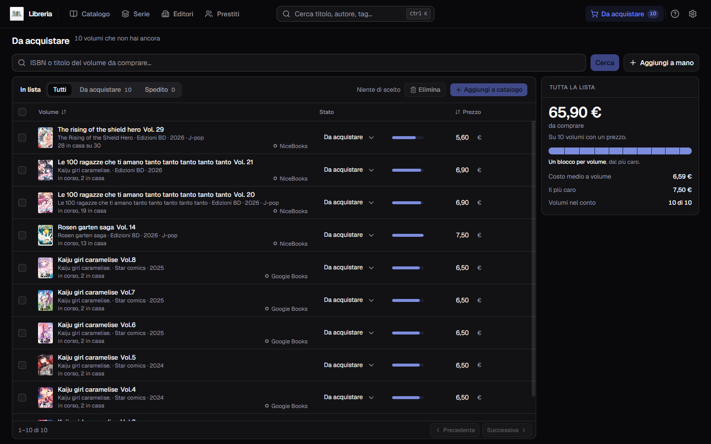
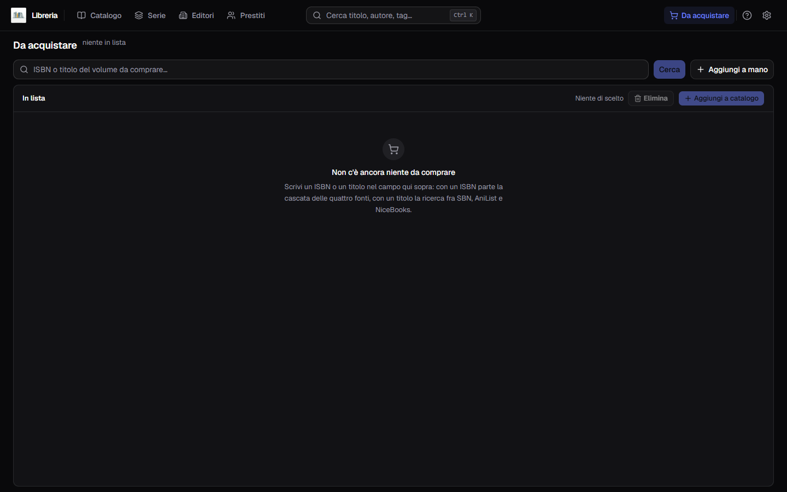
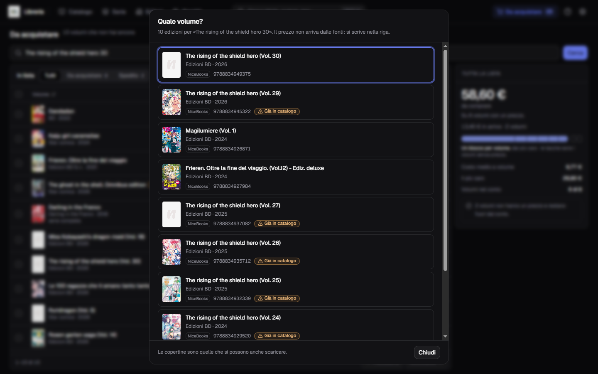
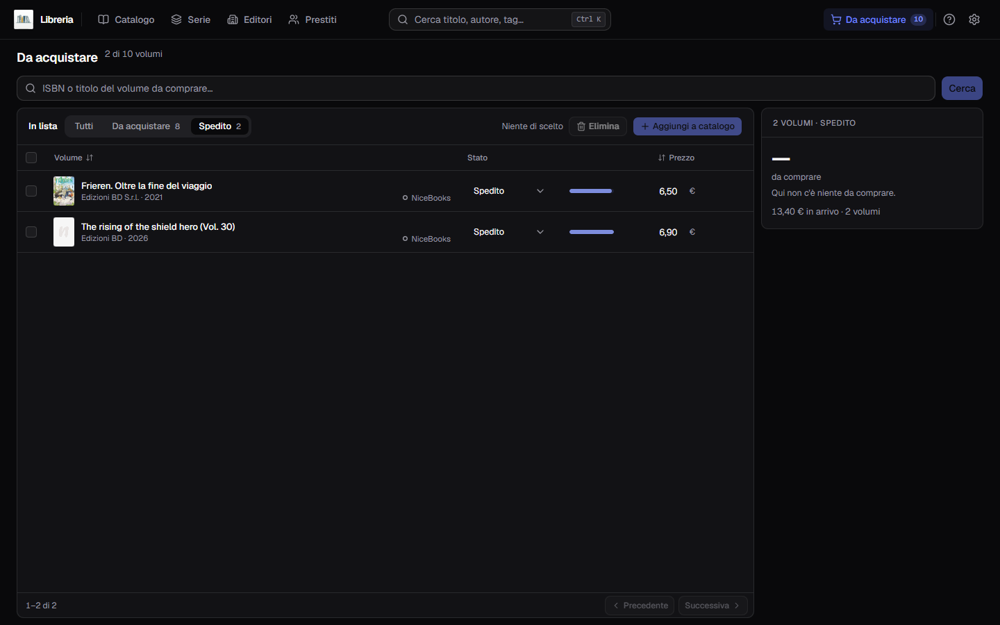
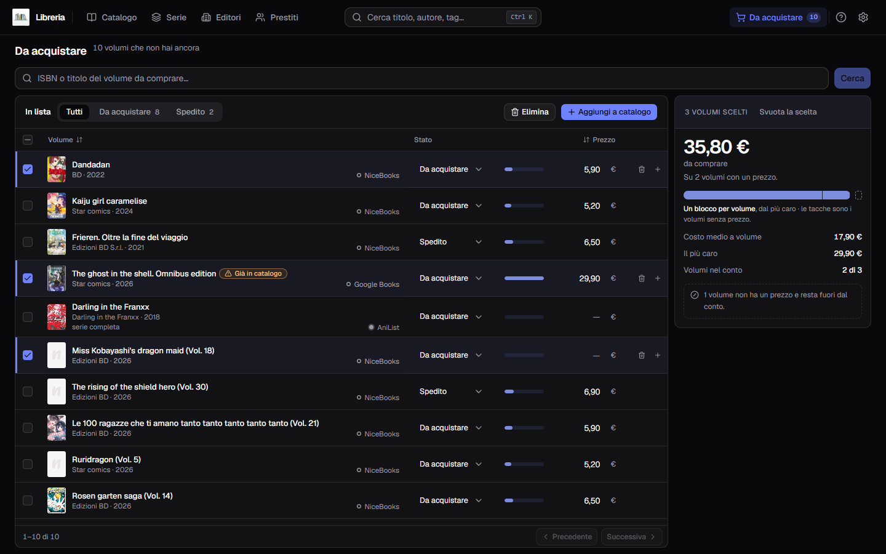

**Italiano** · [English](../en/To-buy.md)

# Da acquistare

La voce **Da acquistare** nella barra risponde a una domanda sola: **quanto mi
costa finire quello che sto leggendo?**

È l'unica pagina che parla di libri che **non hai**. Sta a destra della casella
di ricerca, e porta con sé il numero di volumi che ci hai messo dentro: quello
che vedi lì non è nel catalogo, e non ci finisce finché non lo dici tu.

La lista comincia vuota e si riempie **cercando**, un volume per volta, dal campo
in cima.

## Mettere un volume in lista

Quel campo prende **un ISBN o un titolo**, e capisce da sé quale dei due gli hai
dato:

- con **tredici cifre** parte la cascata delle quattro fonti, la stessa del
  modulo — il giro è in [Cercare i metadati](Cercare-i-metadati.md);
- con un **titolo** si cerca fra SBN, AniList e NiceBooks.

Se la risposta è una sola, il volume entra in lista e il campo si svuota. Se sono
più d'una si apre **Quale volume?**: una fila di edizioni con la copertina,
l'editore, l'anno, la fonte che l'ha proposta e l'ISBN. La testata dice invece
**Quale edizione?** quando le proposte portano tutte lo stesso titolo, perché
allora la scelta è fra due stampe dello stesso volume. Nel piede del dialogo una
nota dice da dove vengono le immagini: *«Le copertine sono quelle che si possono
anche scaricare.»*

**Le edizioni che hai già sono marcate**, con `Già in catalogo`. Non è un
divieto: se la scegli lo stesso, entra — *«ne hai già uno con questo ISBN»* vale
qui come nel modulo, perché un secondo esemplare è legittimo.

Se **nessuna fonte sa niente** — di un titolo, di un ISBN o di un'edizione —
accanto alla frase compare **Mettilo in lista a mano**, e apre il modulo con
dentro già quello che avevi cercato: nel titolo se era un titolo, **nell'ISBN**
se erano tredici cifre. Vale su tutti e tre gli esiti: prima un codice che
nessuno conosceva era un vicolo cieco, perché la frase lo diceva e non c'era
nessun modo di metterlo in lista.

## Aggiungere a mano, senza cercare niente

Accanto a **Cerca** c'è **Aggiungi a mano**, e c'è sempre: serve quando il volume
lo conosci tu e non lo conosce nessuna fonte — un annuncio appena uscito, un
usato, una stampa che i cataloghi non hanno.

**Non è un modulo suo: è lo stesso di «Aggiungi libro»** del catalogo, aperto in
un contesto che spegne quello che qui non ha senso. Quindi ti porti dietro tutto
quello che quel modulo sa già fare — i suggerimenti su editore, collana e serie
presi dal tuo catalogo, gli **autori come righe** con il loro ruolo, il riquadro
della copertina, e il pulsante che **interroga le fonti** se poi un ISBN salta
fuori. Obbligatorio il solo titolo.

Quello che là dentro **non** trovi sono i campi che parlano di un libro che hai
in mano: la **posizione** sullo scaffale, lo **stato di lettura**, la **data di
acquisto** — e il **prezzo**, che ha la sua casella nella riga. Via anche
*Elimina* e *Duplica*, che parlano di un libro del catalogo, *Salva e aggiungi un
altro*, che è il gesto di chi cataloga una pila, e **la scansione del codice a
barre**: un codice si legge dal dorso di un libro che tieni in mano, e questi
sono i libri che non hai.

Della serie si scrivono **il nome e il numero di volume**: se stai comprando il
terzo, quel 3 lo sai mentre lo scrivi, e resta attaccato alla riga fino al
catalogo. Il **totale** dei volumi invece non c'è, perché è della serie e non di
questo volume: si corregge in [Le serie](Le-serie.md).

## Correggere una riga

La **matita**, in testa alle icone di riga, riapre lo stesso modulo con dentro
quello che la riga porta. È il posto dove si aggiusta un editore che una fonte
aveva scritto male, o si aggiunge una nota.

**Una casella lasciata vuota cancella quel dato**, ed è voluto: è l'unico modo di
togliere un valore sbagliato. **Stato e prezzo non stanno là dentro** — hanno le
loro caselle nella riga — quindi correggere un titolo non ti fa perdere il prezzo
che avevi scritto né riporta la riga su *Da acquistare*.

## Come si legge una riga

Da sinistra la spunta, poi la **copertina** — quella vera dove la fonte ne aveva
una, altrimenti la tessera col titolo — il titolo del volume, e sotto **editore e
anno**. A destra del titolo sta la fonte che l'ha proposto: `NiceBooks`,
`Google Books`, `AniList`.

Dove la fonte ha detto anche **la serie**, e quel nome è una serie del tuo
catalogo, compare una terza riga che dice **a che punto sei con quell'opera**:
`serie completa`, `in corso, 20 in casa`, `3 in casa su 12`. È il conto dei
volumi che hai **in catalogo**, non di quelli in lista. La frase manca dove la
fonte la serie non la porta, e la porta quasi solo AniList.

Poi lo **stato**, il **prezzo**, e passando il puntatore sulla riga le tre icone
in fondo: correggi, togli dalla lista, aggiungi a catalogo.

## Il prezzo lo scrivi tu

**Nessuna delle fonti dà un prezzo.** Una riga nasce sempre senza, e la casella
nella riga è l'unico posto dove quel numero si scrive: si salva da sé un attimo
dopo che hai smesso di digitare, senza niente da confermare. Accanto alla casella
una barretta dice quanto quel volume pesa rispetto al più caro che stai
guardando.

**Un volume senza prezzo non vale zero: resta fuori dal conto.** È la sola cosa
onesta da fare — un prezzo che non conosci non è gratis — ed è la ragione per cui
il resoconto non si limita a una somma e dichiara sempre su quanti volumi l'ha
fatta: `Volumi nel conto  6 di 8`, e sotto *«2 volumi non hanno un prezzo e
restano fuori dal conto»*.

Quel numero non resta lì: quando il volume entra nel catalogo diventa il
**Prezzo pagato** del libro.

## Lo stato, e cosa vuol dire «in arrivo»

Gli stati sono **due**: `Da acquistare`, con cui una riga nasce, e `Spedito`, che
metti quando l'hai ordinato. Si cambia dalla tendina nella riga, e le pastiglie
sopra la tabella tengono uno stato per volta, ognuna col suo conto — **Tutti** le
ritira.

**Quello che è già partito non si somma al totale**: è spesa fatta, e il
resoconto lo tiene in un conto suo — `13,40 € in arrivo · 2 volumi` — sotto il
numero grande. Filtrando su *Spedito* il numero grande può quindi dire che qui
non c'è niente da comprare, ed è giusto: quei due li hai già pagati.

Con una pastiglia premuta il conteggio in testa cambia forma — `2 di 10 volumi` —
e se sposti una riga su uno stato che il filtro non mostra, quella riga se ne va
sotto le dita: una frase in testata dice quale e dov'è andata. Se in una pastiglia
non resta niente, il riquadro non è quello di una lista vuota: dice che è la
pastiglia a restringere, e **Tutti** la riapre.

## Il resoconto segue quello che guardi

Nel fianco a destra c'è il conto di quello che hai davanti, e **segue sempre la
selezione**: a spunte vuote parla di tutta la lista, e appena ne spunti una parla
solo di quelle.

- **il numero grande** è quanto ti costa comprare quello che stai guardando, e
  sotto sta scritto su quanti volumi è fatto;
- **la barra a blocchi** è la sua firma: **un blocco per volume**, largo quanto
  la sua parte del totale, dal più caro. Fermandoci sopra il puntatore si legge
  di che volume si tratta e quanto pesa, e intanto la sua riga si accende nella
  tabella. Le **tacche** vuote in coda sono i volumi senza prezzo, quelli che
  nella somma non ci sono;
- sotto, **costo medio a volume**, **il più caro** e **quanti volumi** sono
  entrati nel conto.

Quando i volumi sono troppi perché ognuno abbia il suo blocco, la barra diventa
una sola e il pieno dice quanta parte della lista stai comprando.

Se la finestra è stretta il resoconto non sta più a fianco: si corica in una
fascia sopra la tabella, con gli stessi conti.

## Scegliere più volumi insieme

La spunta in testa alla colonna prende o lascia tutta la pagina. Quando solo
alcune righe sono scelte **porta un trattino e non una spunta**: dice «qualcuna
sì», che è un'altra cosa da «tutte».

I due pulsanti in alto — **Elimina** e **Aggiungi a catalogo** — valgono per
quello che hai scelto, e finché non scegli niente restano spenti con scritto
accanto `Niente di scelto`. Le stesse due azioni stanno su ogni riga, per quando
il volume è uno solo.

## Aggiungere a catalogo

È il gesto per cui la lista esiste. Il volume **diventa un libro subito**, senza
passare dal modulo, e si porta dietro tutto quello che la riga aveva: titolo,
sottotitolo, autori con i loro ruoli, editore, collana, anno, serie e **numero di
volume**, ISBN, genere, lingua, pagine, prima edizione, descrizione, note, tag,
la copertina che la fonte aveva proposto e il prezzo che avevi scritto. La riga
esce dalla lista, e in testata compare **Vedi in catalogo**.

Resta da aggiungere dopo solo quello che la lista non poteva sapere — **dove lo
metti sullo scaffale** e **se l'hai letto** — riaprendo il libro con la matita nel
[catalogo](Il-catalogo.md).

## Togliere dalla lista

Il cestino, su una riga o su tutte quelle che hai scelto. La conferma dice per
intero cosa succede: **escono da qui e il catalogo non cambia**, perché in
catalogo quei volumi non ci sono mai stati e non c'è niente da eliminare là.

**Quello che avevi scritto tu se ne va con la riga** — il prezzo, le note, i tag,
il numero del volume. Se rimetti in lista lo stesso volume domani, quelle cose le
riscrivi: le fonti sanno ridire il resto, non quelle.

## Ordinare e sfogliare

Si ordina da **Volume** e da **Prezzo**, un clic per il verso e un altro per
girarlo. Per titolo l'ordine segue i numeri e non le cifre — `Vol. 2` prima di
`Vol. 10` — come nel catalogo. Per prezzo, **i volumi che un prezzo non ce
l'hanno restano in fondo in tutti e due i versi**: non sono né i più cari né i
più economici. Senza nessun clic la lista sta in ordine di entrata, l'ultimo
cercato in cima.

In fondo c'è il piede del catalogo, **cinquanta righe per volta**, e voltando
pagina la lista riparte dall'alto.

## Due cose che la lista non fa

**Non ti dice quale volume ti manca.** La frase sotto il titolo dice a che punto
sei con l'opera — `in corso, 20 in casa` — e si ferma lì. Nessuno dei cataloghi
pubblici dice **che numero** ha il volume che stai guardando, e tirarlo fuori dal
titolo vorrebbe dire sbagliare in silenzio al primo titolo scritto storto: una
frase che dice meno è meglio di una che dice la cosa sbagliata. Quali volumi ti
mancano, con i buchi accorpati, lo dice [Le serie](Le-serie.md); qui li cerchi
per nome, uno alla volta.

Il numero che **scrivi tu** nel modulo è un'altra cosa e la riga se lo tiene:
quello che il programma non fa è **leggerlo da un titolo**.

**Non si riempie da una serie.** Non c'è un pulsante «aggiungi i volumi che mi
mancano di quest'opera», ed è la stessa ragione di sopra: il numero del volume
non arriva da nessuna fonte, quindi non c'è niente da cui costruire quella lista.
Si aggiunge un volume per volta — cercandolo col titolo o con l'ISBN, ed è anche
il momento in cui guardi che edizione stai comprando, oppure scrivendolo a mano
quando lo conosci già.
