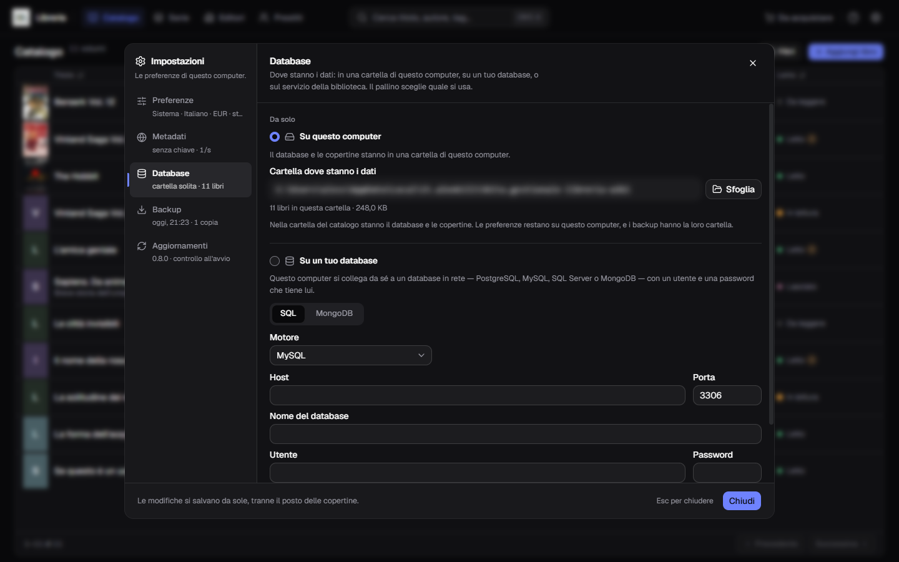
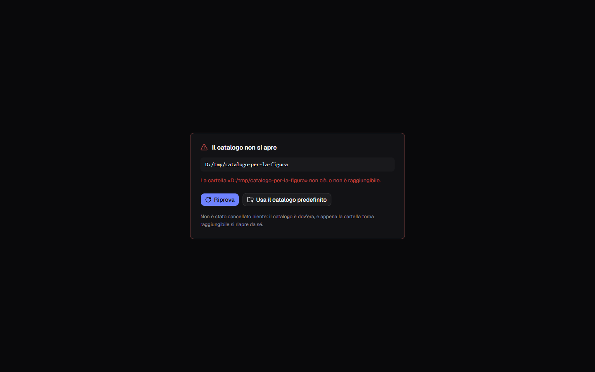
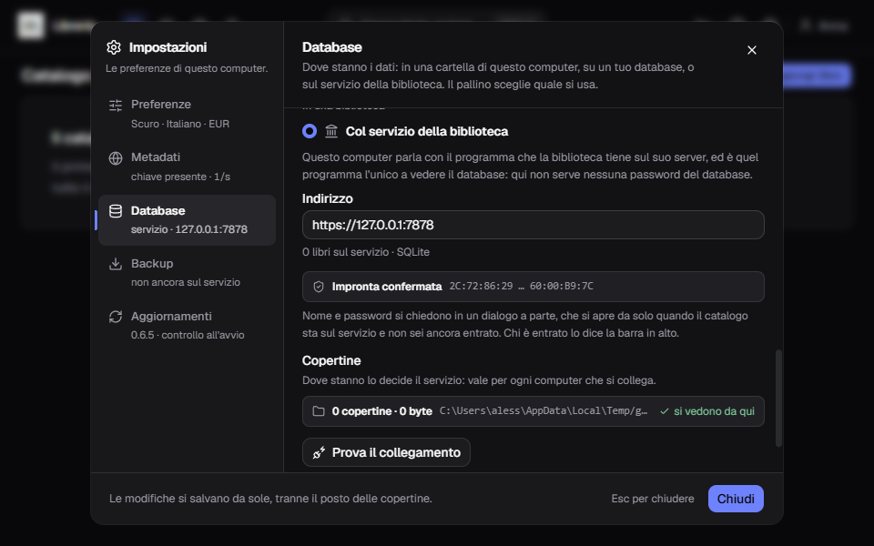
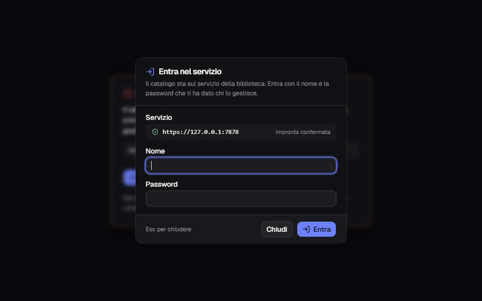

**Italiano** · [English](../en/Where-the-data-lives.md)

# Dove stanno i dati

Di partenza il catalogo è un file sul tuo disco, e può stare anche su un
server. **Impostazioni → Database** è il posto che dice dove sta, quanto pesa e
come portarlo altrove.

La sezione ha tre strade in due gruppi, e il pallino davanti a ciascuna dice
**quale si usa**. Nel gruppo **Da solo**:

- **Su questo computer** — il database e le copertine stanno in una cartella di
  questo computer. È la scelta di partenza;
- **Su un tuo database** — i dati stanno su un database che risponde in rete, e
  le copertine dove dici tu. Come funziona sta più in basso in questa pagina.

Nel gruppo **In una biblioteca**:

- **Col servizio della biblioteca** — questo computer parla al programma che la
  biblioteca tiene sul suo server. Sta in fondo a questa pagina.

**Le strade restano utilizzabili tutte**, qualunque sia il pallino acceso: la
scelta dice quale sistema si usa, non quale si può toccare.

## Cosa c'è nella cartella del catalogo

| | |
|---|---|
| `libreria.db` | il catalogo: libri, serie, prestiti, storico |
| `covers\` | le copertine, un file per libro |

Queste due cose sono una cosa sola e **si spostano insieme**. Sotto la casella
del percorso una riga dice quanti libri ci sono dentro e quanto pesa il
catalogo.

Non si spostano invece le altre due, e non è una dimenticanza:

| | |
|---|---|
| `impostazioni.json` | le preferenze, dove sta il catalogo, il collegamento al server e quello al servizio |
| `backups\` | i backup, che hanno una cartella loro |

Le preferenze sono di **questo** computer, e i backup si mandano dove vuoi dalla
loro sezione, raccontata in
[Backup e ripristino](Backup-e-ripristino.md).

**`impostazioni.json` resta sempre nella cartella di partenza**, anche quando il
catalogo si sposta: è il foglietto che dice dov'è andato, e un foglietto non si
mette dentro la cosa che deve ritrovare. Non entra nei backup.

**I segreti non stanno lì dentro, ma nel portachiavi del sistema** — Gestione
credenziali su Windows, Portachiavi su un Mac —, sotto la voce «Gestionale
Libreria - impostazioni». Sono tre: la chiave di Google Books, la password del
database e il segreto dell'archivio S3 delle copertine, se li hai dati. Nel file
resta il resto del collegamento, compresa la chiave d'accesso dell'archivio, che
è un nome e non un segreto. Un segreto rimasto nel file da una versione
precedente passa da solo nel portachiavi la prima volta che si legge.

Solo se il portachiavi manca o li rifiuta i segreti restano in
`impostazioni.json`, e il programma lo annota nel suo registro. Per questo il
file **non va condiviso** lo stesso, né allegato a una segnalazione.

Nella cartella di partenza stanno anche altre due cartelle, che non sono dati:

| | |
|---|---|
| `miniature\` | copie ridotte delle copertine, per le viste piccole |
| `intermedie\` | copie di media grandezza, per le viste grandi |

**Si rifanno da sole** partendo dalle copertine vere, la prima volta che servono,
e per questo non entrano nei backup e non viaggiano con il catalogo. Se le
cancelli non perdi niente: le immagini ci mettono un attimo in più a comparire,
la prima volta.

Di partenza la cartella del catalogo è
`%LOCALAPPDATA%\it.alexkill536ita.gestionale-libreria\`, la stessa che trovi in
[Installazione](Installazione.md).

## Spostare il catalogo altrove

**Sfoglia** apre la finestra di sistema, e si sceglie **una cartella, non un
file**: database e copertine viaggiano insieme, e un catalogo che cerca le sue
immagini da un'altra parte è un catalogo di copertine rotte.

Scelta la cartella, un riquadro dice **cosa c'è dentro**, e quindi cosa sta per
succedere:

- la cartella è vuota, o ha dei file ma nessun catalogo → **Sposta qui il
  catalogo** oppure **Comincia un catalogo nuovo**;
- la cartella ha già un catalogo → **Apri questo catalogo**, e la riga sopra
  dice quanti libri e quante copertine ci sono dentro;
- la cartella è quella di adesso, oppure non ci si può scrivere → non c'è
  niente da fare, e la riga lo dice.

**Annulla** chiude il riquadro senza toccare niente. Finché non premi uno di
quei pulsanti, non è successo nulla.

### Spostare copia, e non cancella

**Sposta qui il catalogo** copia il database e le copertine nella cartella
nuova. Quelli di prima **restano dov'erano, intatti**: se la cartella nuova
delude — una chiavetta scomoda, un disco lento, un percorso che non ritrovi più
— si riapre quello di ieri da questa stessa schermata.

Il prezzo è che per un po' hai due copie. La seconda la cancelli a mano, quando
sei sicuro.

**Non serve riavviare.** Il catalogo nuovo si apre subito, le pagine si
rileggono da sole, e la riga sotto la casella dice il conto nuovo.

Da una cartella diversa dalla predefinita si torna indietro con **Torna alla
predefinita**, accanto alla riga che avvisa che il catalogo non sta dove nasce.

### Aprire un catalogo che c'è già

Serve quando il catalogo sta già da un'altra parte: dopo una reinstallazione,
su un disco esterno, o semplicemente perché ne tieni più d'uno.

**Apri questo catalogo** punta l'applicazione lì e basta: **non copia e non
sposta niente**, e il catalogo di adesso resta dov'è — ci si torna da qui
quando vuoi.

Due cose vengono rifiutate, e la frase dice quale: quello che c'è nella cartella
non è un catalogo di questa applicazione, oppure è un catalogo scritto da una
**versione più nuova** del programma. Nel secondo caso la strada è aggiornare
l'applicazione, non forzare il file.

### Cominciare un catalogo nuovo

In una cartella libera, **Comincia un catalogo nuovo** ci mette un catalogo
vuoto e ci lavori dentro. Quello di prima resta dov'è: sono due cataloghi
distinti, e l'applicazione apre quello che le dici.

### Se un ripristino è in attesa

Se hai appena chiesto un [ripristino](Backup-e-ripristino.md), lo spostamento
si rifiuta:

> C'è un ripristino che aspetta il prossimo avvio: riavvia l'applicazione prima
> di spostare il catalogo.

La sostituzione è già preparata nella cartella di partenza e va portata a
termine lì. Riavvia, lascia finire il ripristino, e poi sposta.

## Se al riavvio quella cartella non c'è più

Chiavetta staccata, disco esterno spento, cartella rinominata da qualcun altro.
L'applicazione **non parte su un catalogo vuoto** e non ricrea niente: si ferma
su una schermata che nomina la cartella che cercava e dice perché non ci
riesce.

Da lì si esce con due pulsanti:

- **Riprova** — rimessa la chiavetta o riacceso il disco, riapre il catalogo
  **senza riavviare**;
- **Usa il catalogo predefinito** — riporta l'applicazione alla cartella di
  partenza, e compare solo se non è già quella.

E c'è una riga che è la cosa più importante della schermata: **non è stato
cancellato niente.** Il catalogo è dov'era, e appena la cartella torna
raggiungibile si riapre da sé, con tutti i suoi libri.

Un catalogo vuoto al posto del tuo sarebbe la risposta sbagliata, ed è la
ragione per cui quella schermata esiste: duecento libri che sembrano spariti
senza un errore sono peggio di un errore.

**Con il catalogo su un server la schermata ha un volto suo**: «Il catalogo sul
server non si apre», che compare anche a lavoro iniziato se il server smette di
rispondere. Le vie d'uscita sono **Riprova** e **Usa il catalogo di questo
computer**, e anche lì non si è cancellato niente, né di là né di qua. Il resto
sta in [Il catalogo su un server](Il-catalogo-su-un-server.md).

## Cartelle di rete e cartelle sincronizzate

**Una cartella di rete si rifiuta**, e non è prudenza eccessiva:

> «`\\nas\condivisa`» sta su una cartella di rete, e un catalogo lì dentro si
> danneggia. Scegline una su un disco di questo computer.

Il database viene scritto di continuo, e su una condivisione di rete quelle
scritture si danneggiano a vicenda: non si corrompe il giorno che lo scegli, si
corrompe il mese dopo.

**Una cartella sincronizzata invece si accetta, dicendolo.** Se il percorso
passa da OneDrive, Dropbox, Google Drive o iCloud, sopra i pulsanti compare
l'avviso:

> Questa cartella la sincronizza OneDrive: tieni il catalogo aperto su un
> computer per volta, o due scritture insieme lo danneggiano.

È permesso perché ritrovare il catalogo su un altro computer è probabilmente
metà del motivo per cui lo stai spostando. La regola è una sola, e va rispettata
a mano: **un computer per volta.** Chiudi l'applicazione sul primo, lascia
finire la sincronia, apri sul secondo.

Se non te la senti, la strada sicura resta l'altra: sincronizza i **backup** e
[ripristinali](Backup-e-ripristino.md) dove servono, invece di tenere il file
del catalogo aperto in due posti.

## Su un tuo database

La seconda strada mette il catalogo su un database che risponde in rete, così che
più computer lavorino sugli stessi libri. **Fanno da catalogo quattro motori**:
PostgreSQL, MySQL, SQL Server e MongoDB. MariaDB e un file SQLite raggiunto per
rete la sezione li sa provare, ma non ci si può tenere un catalogo.

Le copertine stanno dove scegli tu: **dentro il database**, **in una cartella**
condivisa che ogni computer raggiunge, oppure **in un archivio S3**.

**Scegliere il pallino «Su un tuo database» apre il catalogo di là, subito e senza
riavviare**: le pagine si rileggono, e da quel momento ogni lettura e ogni
scrittura va al server. Su un database vuoto ne comincia uno nuovo. Il catalogo
di questo computer resta com'era, e ci torni scegliendo di nuovo «Su questo
computer». Per portare sul server i libri che hai già c'è **Porta qui il
catalogo di questo computer**, che ne manda di là una copia e non cancella
niente.

Il collegamento, la prova, i tre posti delle copertine, il trasloco e cosa
succede quando il server non risponde stanno in
[Il catalogo su un server](Il-catalogo-su-un-server.md).

## Col servizio della biblioteca

La terza strada non parla a un database: parla al **servizio**, il programma
che la biblioteca tiene sul suo server. È lui l'unico a vedere il database, e per
questo qui non serve nessuna password del database.

### L'indirizzo

Il campo è uno, **Indirizzo**, e comincia sempre con `https://`, seguito dal
computer dove gira il servizio e dalla porta — per esempio
`https://192.168.1.20:7878`. Un indirizzo che comincia con `http://` si rifiuta
prima di provarci: il campo si segna e **Prova il collegamento** resta spento.

**Prova il collegamento** dice in quanti millisecondi ha risposto il servizio e
su quale motore di database; quanti libri tiene lo dice quando questo computer è
già entrato, e un servizio che non ha ancora nessun utente lo dice anche lui. Se
a quell'indirizzo risponde qualcos'altro — per esempio la porta del database
stesso — lo dice, e rimanda a «Su un tuo database». **Scrivere l'indirizzo non
cambia catalogo**: per usarlo scegli il pallino.

### L'impronta del servizio

Al primo collegamento la sezione dice «È la prima volta che questo computer
parla con questo servizio» e mostra l'**Impronta del servizio**, una fila di
lettere e numeri che è sua e di nessun altro. Il servizio stampa la stessa
impronta ogni volta che si avvia, sulla macchina dove gira: confrontale, e se
sono uguali premi **Mi fido**. **Finché non ti fidi, questo computer non gli
manda niente**, né un nome né una password. Da lì in poi la sezione mostra
**Impronta confermata**.

Se un giorno l'impronta non è più quella, compare «L'impronta del servizio è
cambiata», con **Quella di cui si fidava** e **Quella che manda adesso**, e il
collegamento resta fermo. Succede quando il servizio è stato reinstallato o ha
cambiato certificato: premi **Fidati della nuova impronta** solo se chi gestisce
il servizio ti conferma di averlo cambiato. Anche un indirizzo che porta a un
altro servizio fa ripartire da capo: l'impronta di prima e la sessione di questo
computer si dimenticano.

C'è un terzo caso: «Un programma di questo computer legge il collegamento col
servizio», con il nome di chi ha firmato il certificato che arriva. Di solito è
un antivirus con la scansione HTTPS accesa, che si mette in mezzo e presenta un
certificato suo. Qui non c'è niente da confermare, perché l'impronta che si
vedrebbe sarebbe la sua: il rimedio è escludere l'indirizzo del servizio dalla
scansione HTTPS di quel programma, e poi provare di nuovo il collegamento.

### Entrare nel servizio

Sul servizio si entra col proprio nome, e chi lo gestisce decide come: con la
password del servizio, con l'account del dominio (Active Directory), da un
fornitore di accesso come Keycloak, o con Kerberos. Niente di questo si scrive
nelle impostazioni: quando il catalogo sta sul servizio e questo computer non è
ancora entrato, si apre da solo il dialogo **Entra nel servizio**, con
l'indirizzo e l'impronta confermata in testa e i campi del modo acceso — con la
password, **Nome** e **Password**. Ogni modo è raccontato in
[I modi di entrare](I-modi-di-entrare.md).

Se lo chiudi, sotto resta «Il servizio chiede di entrare», con **Entra** per
riaprirlo. Chi è entrato si vede nella barra in alto, col suo nome: nel suo menu
ci sono il ruolo, l'indirizzo del servizio, **I miei prestiti…**, **Cambia la
password…** per chi entra con la password del servizio, ed **Esci**, che chiude
la sessione e riapre il dialogo.

- **La sessione resta su questo computer**, nel portachiavi del sistema e non in
  `impostazioni.json`: riaprendo il programma non serve rientrare, finché la
  sessione è viva.
- **Con la password del servizio finisce dopo trenta giorni senza usarla**; dal
  dominio, da un fornitore di accesso o con Kerberos **dodici ore dopo
  l'accesso**, anche se la stai usando. Finisce prima se chi gestisce il servizio
  la chiude. Allora il dialogo si riapre da solo.
- **Dopo cinque tentativi sbagliati** sullo stesso nome bisogna aspettare: un
  minuto con la password del servizio, un quarto d'ora con un nome del dominio.
- **Il catalogo di questo computer resta senza accesso**: i nomi valgono solo
  sul servizio.

Gli utenti si gestiscono da **Utenti e gruppi…**, nello stesso menu, per chi è
amministratore o ha il permesso di gestirli: lo racconta
[Utenti, gruppi e permessi](Utenti-gruppi-e-permessi.md). Cosa cambia per chi
lavora sul catalogo senza essere amministratore sta in
[Lavorare in biblioteca](Lavorare-in-biblioteca.md).

### Il primo amministratore

Un servizio appena installato non ha nessun utente, e allora il dialogo è **Crea
il primo amministratore**: chiede il **Codice di configurazione**, poi **Nome**,
**Password** e **Ripeti la password**, e il pulsante è **Crea
l'amministratore**. Il codice lo scrive il servizio nel suo log e nel file
`codice-di-configurazione.txt`, accanto ai suoi dati, e **vale una volta sola**:
creato l'amministratore, non serve più.

Chi ha perso la password dell'amministratore fa nascere un codice nuovo sulla
macchina del servizio, avviando il programma del servizio con l'opzione
`--nuovo-codice`: lo scrive nello stesso file, lo stampa e si ferma, senza
mettersi a servire.

### Col catalogo sul servizio

- **le copertine le serve il servizio.** Dove stanno lo decide lui — in una
  cartella, nel database o in un archivio S3 —, e le manda a ogni computer che
  si collega: su questo computer non serve nessuna chiave. La chiave
  dell'archivio, se c'è, la tiene il servizio nel suo `servizio.json`. Scegliere
  il servizio toglie da questo computer la password del database e la chiave
  dell'archivio di «Su un tuo database»: tornando lì, la password si riscrive;
- **i gesti sul catalogo intero passano dal servizio**, ciascuno col suo
  permesso. **Crea backup adesso** fa il backup sul disco del servizio, che tiene
  le ultime sette copie e vale per tutti i computer collegati; **Scarica** ne
  porta una copia su questo computer. **Esporta in CSV** lo compone il servizio,
  e il file nasce qui. Il **ripristino** si sceglie da qui, e prima di sostituire
  il servizio salva un backup dello stato di adesso fra le sue copie. **Porta qui
  il catalogo di questo computer** porta il catalogo di qua su un servizio
  ancora vuoto. L'import da un foglio CSV aggiunge i libri al catalogo del
  servizio. Il giro è in [Backup e ripristino](Backup-e-ripristino.md), i
  permessi in [Utenti, gruppi e permessi](Utenti-gruppi-e-permessi.md);
- **se il servizio smette di rispondere** compare «Il catalogo sul servizio non
  si apre», con **Riprova** e **Usa il catalogo di questo computer**. Non si
  cancella niente.
