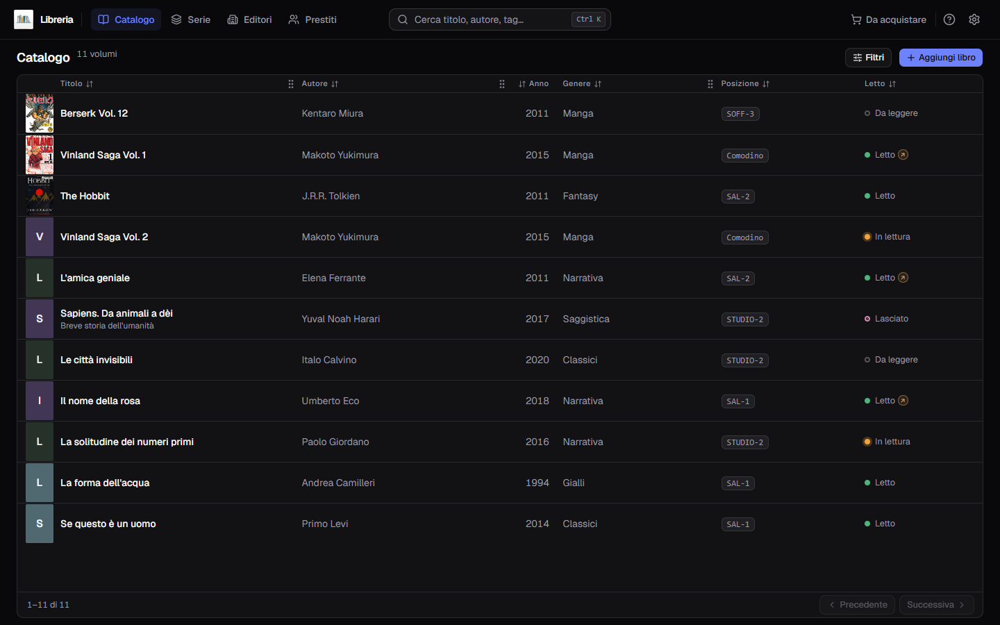

**Italiano** · [English](../en/Home.md)

# Gestionale Libreria

Catalogo personale di libri di carta per Windows e macOS. Non chiede un
account, e di partenza sta su questo computer e funziona senza rete — tranne
quando vai a cercare i dati di un libro, che arrivano da cinque cataloghi
pubblici. Se vuoi, il catalogo può stare invece **su un database in rete**, e
allora la rete serve per tutto: lo racconta
[Il catalogo su un server](Il-catalogo-su-un-server.md).

Da settembre 2026 gira anche su **macOS**: ogni versione porta un file suo, e
come si installa sta in [Installazione](Installazione.md).

## Che cosa sa fare

| | |
|---|---|
| **[Il catalogo](Il-catalogo.md)** | La tabella dei tuoi libri: ordinare, sfogliare, modificare, eliminare |
| **[Aggiungere un libro](Aggiungere-un-libro.md)** | Il modulo, i venti campi, cosa è obbligatorio (poco) |
| **[Cercare i metadati](Cercare-i-metadati.md)** | Un pulsante riempie la scheda da OpenLibrary, Google Books, SBN, NiceBooks e AniList |
| **[Le copertine](Le-copertine.md)** | Scendono da sole, oppure le metti tu da un file o da un indirizzo |
| **[Cercare e filtrare](Cercare-e-filtrare.md)** | La barra in alto, gli undici filtri, il ripiego quando sbagli a scrivere |
| **[Le serie](Le-serie.md)** | Quali volumi ti mancano, e i valori che una serie passa ai suoi volumi |
| **[Gli editori](Gli-editori.md)** | Un editore per volta: le sue opere in un carosello, e la regola che tiene insieme i suoi nomi diversi |
| **[I prestiti](I-prestiti.md)** | Chi ha quale libro, da quanto, e come te lo fai ridare |
| **[Da acquistare](Da-acquistare.md)** | I volumi che non hai ancora: quanto costano in tutto, e come entrano in catalogo con un clic |
| **[Scansionare il codice a barre](Scansionare-il-codice-a-barre.md)** | La webcam legge l'ISBN dalla quarta di copertina |
| **[Lo storico delle azioni](Lo-storico-delle-azioni.md)** | Cosa hai cambiato e quando, se lo accendi — e cosa succede quando lo spegni |
| **[I dizionari del catalogo](I-dizionari-del-catalogo.md)** | Tag, autori, generi, collane, posizioni e lingue: rinominarli, unire due nomi della stessa cosa, togliere quelli che non usa nessuno |
| **[Impostazioni](Impostazioni.md)** | Le cinque voci del binario: Preferenze, Metadati, Database, Backup e Aggiornamenti |
| **[Dove stanno i dati](Dove-stanno-i-dati.md)** | La cartella del catalogo, come si sposta senza perdere niente, e il collegamento a un server |
| **[Il catalogo su un server](Il-catalogo-su-un-server.md)** | Quando il server diventa il catalogo in uso: i motori che lo sanno fare, dove vanno le copertine, come ci porti quello che hai già |
| **[Installare il servizio](Installare-il-servizio.md)** | Il catalogo della biblioteca su un computer solo, e gli altri che ci entrano con nome e password: Windows, Mac, Linux e Docker |
| **[Backup e ripristino](Backup-e-ripristino.md)** | Una copia quando la chiedi, l'esportazione in CSV, l'import da un foglio, la strada per tornare indietro |
| **[Aggiornamenti](Aggiornamenti.md)** | Ti avvisa se esce una versione nuova, e non installa niente da sé |
| **[Domande frequenti](Domande-frequenti.md)** | Quando qualcosa non torna |
| **[Licenze dei componenti](Licenze-dei-componenti.md)** | Di chi è il codice che il programma incorpora, e con quale licenza |

Queste pagine si aprono **dal programma**: il punto interrogativo in alto a
destra, accanto all'ingranaggio, porta qui nella lingua che stai usando.

## Il giro completo, in quattro mosse

1. **[Installa](Installazione.md)** e apri: il catalogo parte vuoto.
2. Premi **Aggiungi libro**. Se hai il libro in mano, premi **Scansiona** e
   inquadra il codice a barre; altrimenti scrivi l'ISBN, o anche solo il titolo.
3. Premi **Cerca i metadati**: titolo, autori, editore, anno, pagine e copertina
   arrivano da soli. Dove due fonti dicono cose diverse, sotto il campo compare
   una pastiglia e scegli tu.
4. Aggiungi quello che le fonti non possono sapere — dove sta il libro sullo
   scaffale, quanto l'hai pagato, se l'hai letto — e **Salva**.

## Due cose da sapere subito

**Il titolo è l'unico campo obbligatorio.** Tutto il resto si può lasciare vuoto
e riempire dopo.

**I dati sono tuoi e stanno dove dici tu.** Di partenza — **Su questo
computer** — sul tuo disco: niente account, niente sincronia, niente cloud. Se
scegli **Su un tuo database**, sul database che hai indicato, e da nessun'altra parte.
Il rovescio è che se quel disco si guasta il catalogo se ne va con lui, e nessun
backup nasce da sé: ogni tanto fanne uno e copialo su una chiavetta — lo spiega
[Backup e ripristino](Backup-e-ripristino.md).

## Una nota sulla lingua

L'interfaccia parla italiano e inglese, e cambia all'istante dalle
[Impostazioni](Impostazioni.md). **I dati del tuo catalogo non si traducono**:
generi, tag, posizioni e lingue dei libri restano scritti come li hai inseriti.
Lo stesso vale per le intestazioni delle colonne del CSV — un file che cambia
intestazione con la lingua non si riapre due volte allo stesso modo.
