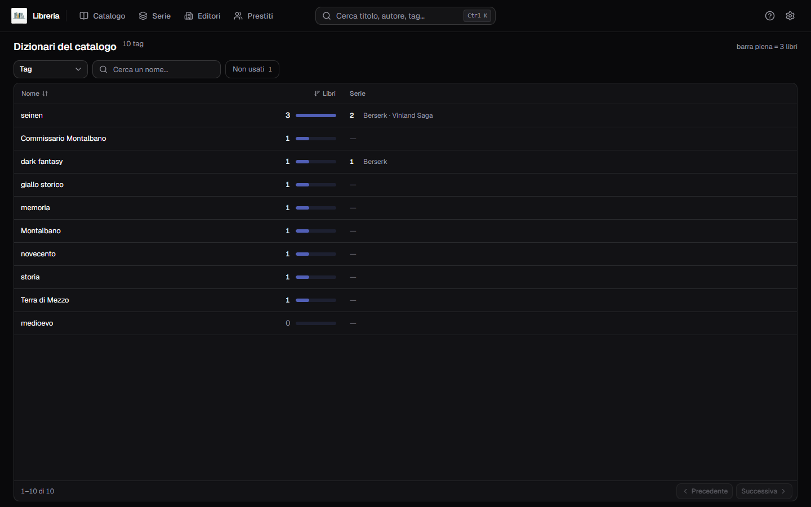
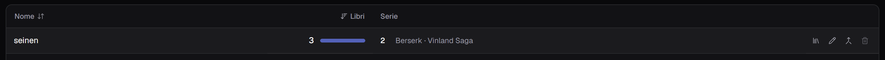
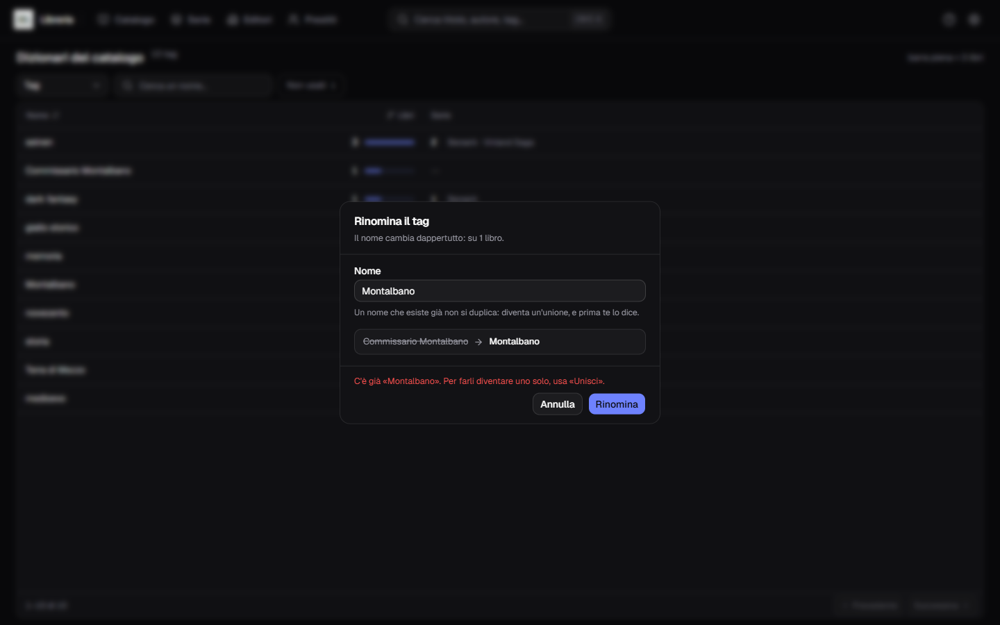
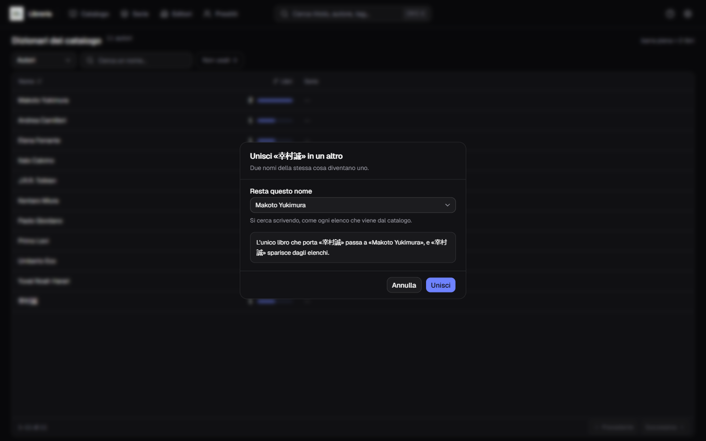
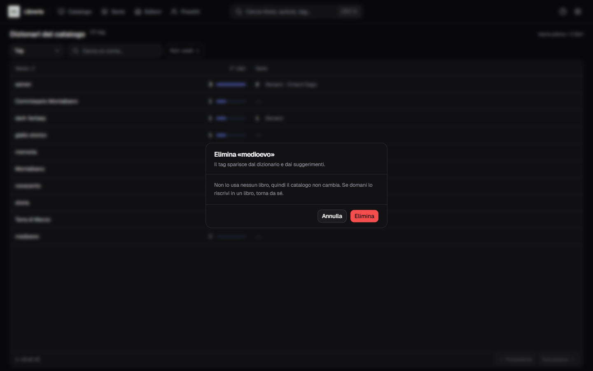

**Italiano** · [English](../en/Library-dictionaries.md)

# I dizionari del catalogo

Nel catalogo ci sono valori che non hai mai digitato: li ha messi dentro il
programma da sé, catalogando un libro, accettando un'edizione dalle fonti o
scegliendo un'opera su AniList. Sono i **tag**, gli **autori**, i **generi**, le
**collane**, le **posizioni** e le **lingue** — elenchi che crescono da soli — e
fino a oggi non si potevano correggere da nessuna parte.

Questa pagina è quella porta. **L'ingranaggio in alto a destra è un menu**, e la
prima voce è *Dizionari del catalogo*.

## Un dizionario per volta

In alto il selettore — **Tag**, **Autori**, **Generi**, **Collane**,
**Posizioni**, **Lingue**: si guarda un elenco per volta, come
[Gli editori](Gli-editori.md) guarda un editore per volta. Accanto al titolo il
conto di quante voci ha quello che stai guardando — *«10 tag»* — che diventa
*«3 di 10»* appena filtri. I primi due sono lunghi e gli ultimi tre corti:
qualche collana, qualche posizione, due lingue.

- la **casella** cerca senza distinguere maiuscole né accenti: `citta` trova
  `Città` e `SHONEN` trova `shonen`. Basta un pezzo del nome;
- l'interruttore **Non usati** tiene solo le voci che non stanno su niente, e
  porta il loro conto accanto all'etichetta. È il conto del dizionario scelto —
  1 sui tag e 0 sugli autori, non 1 in tutto. **C'è solo sui tag e sugli
  autori**, per la ragione scritta più sotto: un genere, una collana, una
  posizione e una lingua stanno nell'elenco solo finché qualcuno li porta;
- l'elenco si ordina dall'intestazione, **per uso o per nome**. Apre sui tag in
  ordine di uso, dal più usato: un elenco alfabetico ce l'hai già nei
  suggerimenti del modulo;
- la tabella pagina a **cinquanta righe**, con lo stesso piede del catalogo.

**Il dizionario scelto non conta come filtro**: dice cosa stai guardando, non
restringe quello che guardi. Per questo *«Azzera i filtri»* svuota la casella e
spegne l'interruttore, e **non** ti riporta sui tag mentre stai correggendo gli
autori.

Il dizionario che stai guardando sta anche **nell'indirizzo** della pagina,
quindi ci torni sopra dopo essere passato dal catalogo, e ricaricando resti dove
eri.

## Come si legge una riga

Da sinistra: **il nome**, quanti **libri** lo portano, e le **serie** che lo
portano.

Accanto al numero dei libri c'è una barra, lunga in proporzione al valore più
usato del dizionario che stai guardando — la testata lo dichiara: *«barra piena
= 3 libri»*. Serve a distinguere in un colpo d'occhio i tag portanti dalla coda
lunga, ma soprattutto **una riga senza barra è l'unica che si può eliminare**.

**I due conti non si sommano, e questa è la cosa da sapere:**

| | |
|---|---|
| **Libri** | quanti volumi portano quel nome |
| **Serie** | quante serie lo dettano, e quali |

Un tag su **zero libri e una serie** non è un valore rimasto orfano: quella serie
lo detta ai volumi che le entreranno, e togliendolo lo toglieresti al prossimo
volume che catalogherai. Il cestino lo sa, e resta spento.

La colonna delle serie parla **sui tag, sui generi e sulle collane**: sono i
valori che una serie detta ai volumi che le entrano. Un autore non appartiene a
una serie — è il libro a portarlo — e una serie non ha una posizione né una
lingua, quindi su quei tre quella colonna resta un trattino. E un autore che
sullo stesso libro scrive **e** disegna vale un libro, non due.

Le azioni compaiono a destra passando il puntatore sulla riga: **quattro sui tag
e sugli autori**, dove c'è anche il cestino; **tre** su generi, collane,
posizioni e lingue.

## Rinomina

La matita. Il dialogo dice **dove arriverà il cambio prima di farlo** — *«Il nome
cambia dappertutto: su 1 libro»*, e dove la voce sta anche su una serie lo dice
accanto — e sotto la casella mostra il vecchio nome sbarrato accanto al nuovo.

Il nome cambia per tutti quei libri insieme, e la ricerca lo segue: da lì in
avanti li trovi col nome nuovo, non più con quello vecchio.

**Verso un nome che un'altra voce già porta è un rifiuto, non una fusione
silenziosa**, e il rifiuto dice dove andare: *C'è già «Montalbano». Per farli
diventare uno solo, usa «Unisci».* Unire due voci è un altro gesto, con un'altra
conferma, e non è una cosa che deve poter succedere per il modo in cui hai
scritto un nome.

**Cambiare le sole maiuscole di se stessa invece si fa**, ed è il caso per cui
questa casella esiste: `shonen` che diventa `Shonen` è una correzione di grafia.

## Unisci in un altro

È l'azione che nessun confronto fra parole può fare da sé, e il caso vero lo
porta il catalogo: **le fonti giapponesi scrivono i nomi in giapponese e le altre
in caratteri latini**, quindi `Makoto Yukimura` con 2 libri e `幸村誠` con 1
sono la stessa persona, sulla stessa serie. Così `Yusagi Aneko` e `アネコユサギ`,
o `Seira Minami` e `弥南せいら`.

Il dialogo ha una casella sola, *«Resta questo nome»*, e si cerca scrivendo — fra
tutte le voci del dizionario, non solo quelle della pagina che hai davanti. La
riga sotto dice **cosa succederà, con i numeri veri**: *«L'unico libro che porta
幸村誠 passa a Makoto Yukimura, e 幸村誠 sparisce dagli elenchi»*.

Il nome che scegli è quello che resta. L'altro se ne va dagli elenchi e dai
suggerimenti, e i libri che lo portavano passano a quello che resta; un libro che
li portava tutti e due non si sdoppia. Sui tag passano anche le serie.

**Non si annulla**, quindi rileggi la frase prima di confermare: dice per intero
in che direzione va la fusione.

## Elimina

Il cestino, e **solo a mani vuote**: zero libri e zero serie. Su una riga in uso
è spento e dice perché — *«In uso: si può eliminare solo un tag che non usa
nessuno»* — e anche arrivandoci per un'altra strada l'eliminazione si ferma
nominando la voce.

Il dialogo non chiede coraggio, perché non serve: *«Non lo usa nessun libro,
quindi il catalogo non cambia. Se domani lo riscrivi in un libro, torna da sé»*.
Quello che togli non è un dato, è una voce d'elenco.

Se con **Non usati** acceso non resta niente, la pagina lo dice come la buona
notizia che è: *«Non c'è niente da togliere»*.

### Quattro dizionari non si eliminano, e non è una funzione che manca

Su generi, collane, posizioni e lingue il cestino **non c'è**. Un tag è una riga
di un elenco, e può restare lì quando l'ultimo libro che lo portava se ne va; un
genere invece **non esiste da nessuna parte se non addosso a un libro o a una
serie** — è scritto nella scheda del libro, non in una tabella a parte. Quindi
non ci sono voci rimaste orfane da togliere, e per la stessa ragione
l'interruttore *Non usati* lì non compare.

L'unica cosa che un cestino potrebbe fare sarebbe **svuotare quel campo su tutti
i libri che lo portano**, che è un'altra cosa: non toglieresti una voce
d'elenco, cambieresti venti libri. Quello si fa dai libri, uno per uno — oppure
si corregge con *Rinomina*, che è quasi sempre quello che serviva.

## Vedi in catalogo

L'icona della libreria apre [Il catalogo](Il-catalogo.md) filtrato su quel tag,
su quell'autore, su quel genere, su quella collana, su quella posizione o su
quella lingua, con il chip in cima che si toglie come tutti gli altri. È il modo
di rispondere a «ma quali sono, questi tre libri?» prima di toccare qualcosa.

**C'è su tutti e sei.** Sulle collane è arrivata per ultima, perché il catalogo
non aveva quel filtro e un pulsante che porta a un elenco che ignora la richiesta
è peggio di un pulsante che non c'è: adesso il filtro c'è, e con lui il pulsante.

## Due cose che rientrano da sole

Fra i generi trovi **quelli del tuo catalogo**, non i quindici che il programma
propone mentre scrivi. Se correggi un genere che era uno di quelli — *Manga* che
diventa *Fumetto giapponese* — la parola *Manga* continuerà a comparire fra i
suggerimenti del modulo: è il programma che la propone, non il tuo catalogo che
se la ricorda.

Con le lingue succede di più, e il dialogo te lo dice prima di farti premere
*Rinomina*: le lingue che le fonti conoscono **rientrano da sé**. Le fonti
scrivono `it`, il programma lo traduce in *Italiano* ogni volta che riempie un
libro, e quel nome torna nell'elenco al primo libro che catalogherai. Rinominare
*Italiano* in qualcos'altro vale per i libri che hai adesso, non per quelli che
arriveranno.

**La posizione è quella che ci guadagna di più.** È l'unico di questi valori che
scrivi solo tu — il programma non la riempie mai — quindi una correzione qui
tiene: sposti uno scaffale, rinomini la posizione, e quaranta libri seguono in un
gesto.

## Resta scritto

Rinominare, unire ed eliminare finiscono nello [storico delle
azioni](Lo-storico-delle-azioni.md) quando è acceso, col nome della voce e cosa
le è successo. Con lo storico spento quella voce nel menu dell'ingranaggio non
c'è, e restano *Dizionari del catalogo* e *Impostazioni*.

Le serie e i loro valori si correggono da [Le serie](Le-serie.md), i nomi doppi
di uno stesso editore da [Gli editori](Gli-editori.md).
