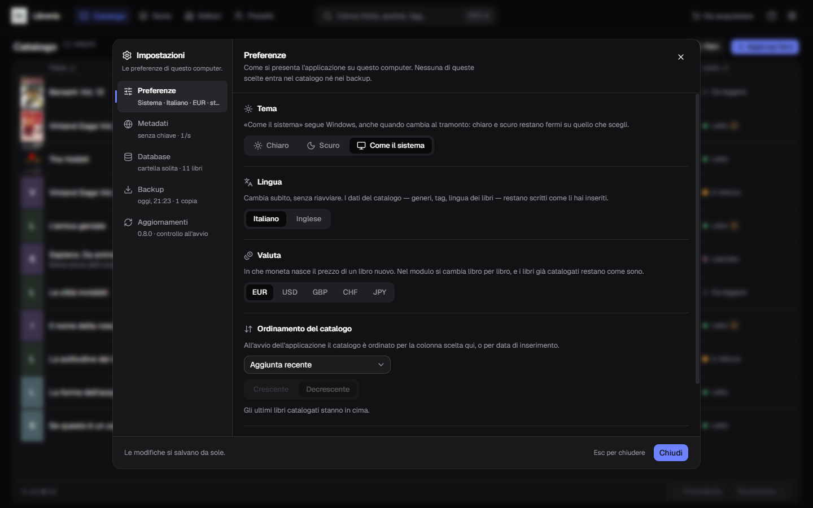
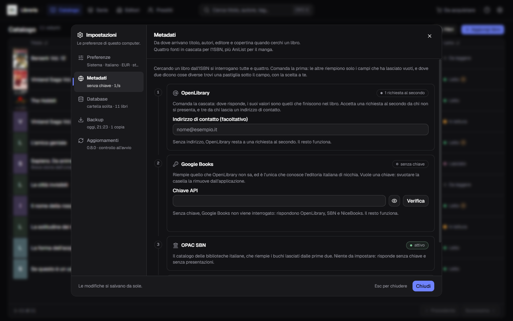
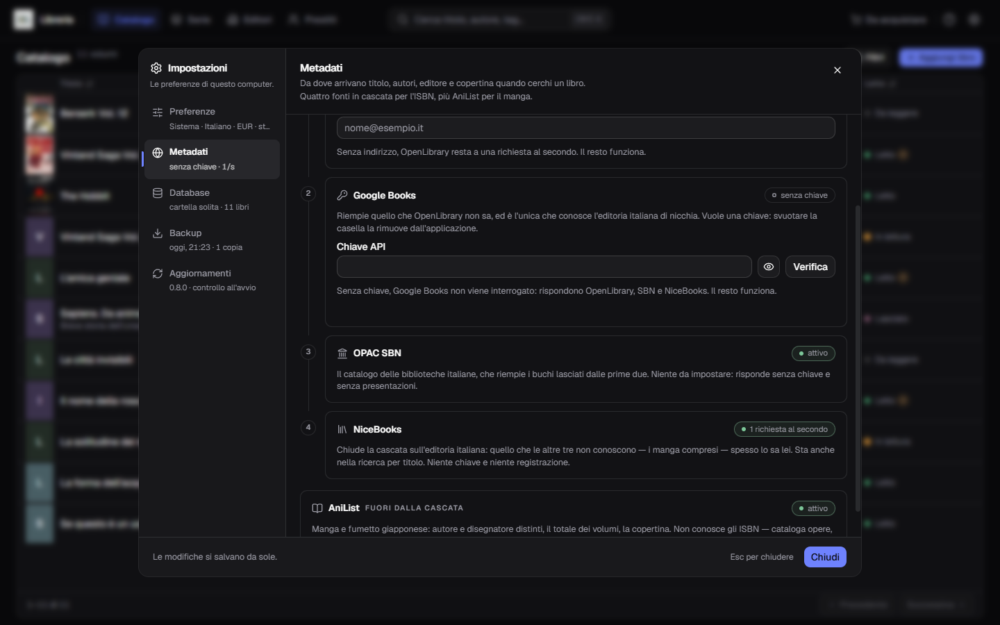
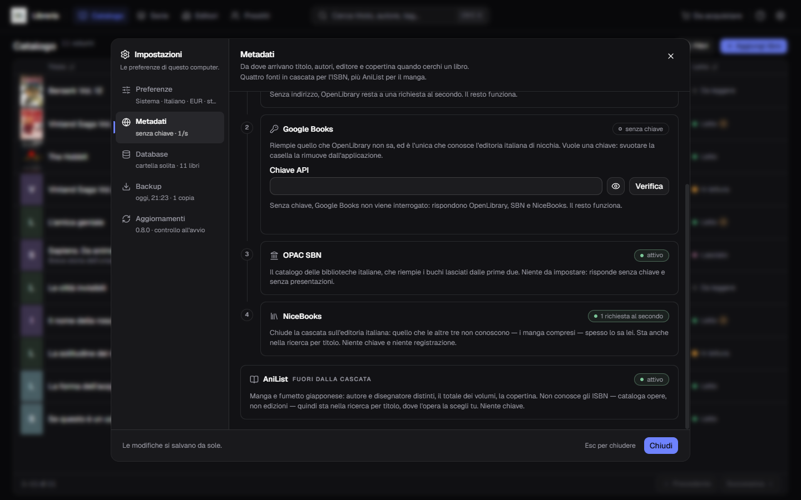
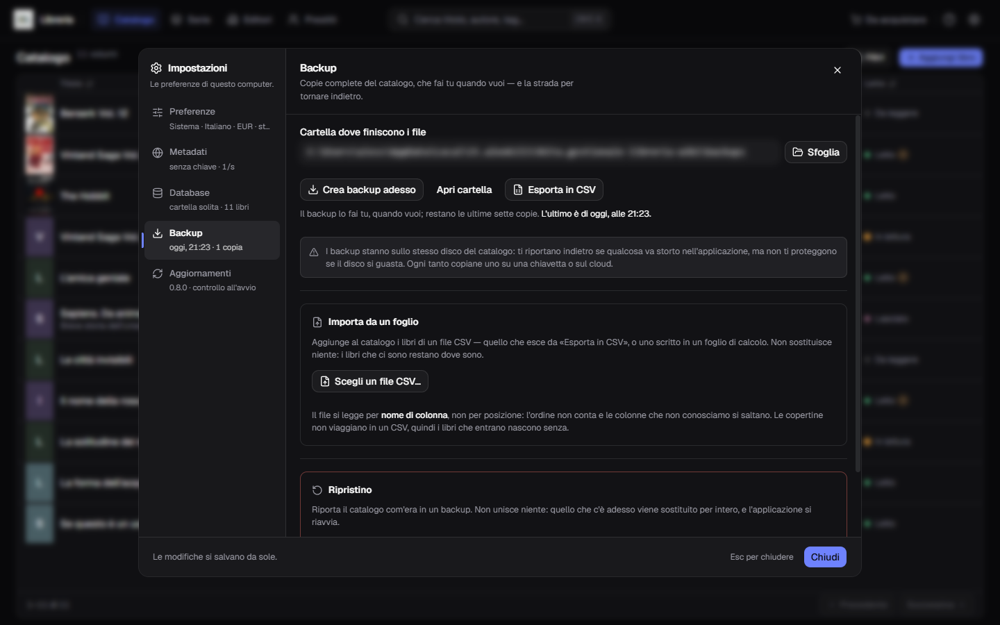
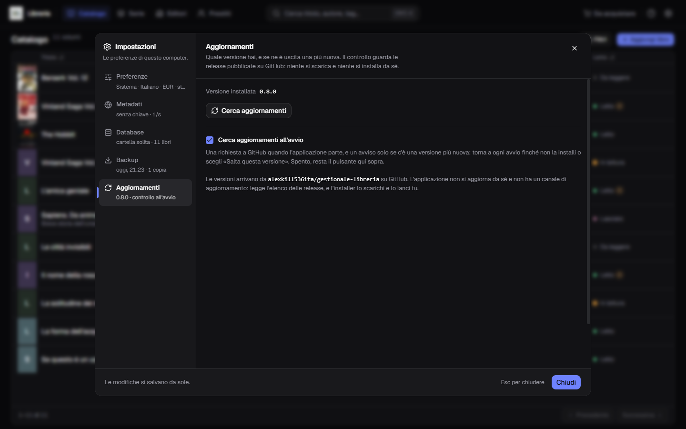

**Italiano** · [English](../en/Settings.md)

# Impostazioni

**L'ingranaggio in alto a destra apre un menu**, sempre: «Dizionari del
catalogo», «Storico delle azioni» quando è acceso, e sotto un separatore
**Impostazioni**, che apre questa finestra, e **Licenza**. Le due pagine hanno un
capitolo loro — [I dizionari del catalogo](I-dizionari-del-catalogo.md) e
[Lo storico delle azioni](Lo-storico-delle-azioni.md); sopra il separatore stanno
le voci che portano altrove, sotto quelle che aprono una finestra.

## La finestra

Cinque sezioni su un binario a sinistra: «Preferenze», «Metadati», «Database»,
«Backup» e «Aggiornamenti».

**Le modifiche si salvano da sole**, senza un pulsante Salva. La conferma non è
una parola: è la riga sotto ogni voce del binario, che riassume lo stato di
adesso — `Scuro · Italiano · EUR`, `chiave presente · 1/s`, `cartella solita ·
227 libri`, `oggi, 12:41 · 4 copie`, `0.1.0 · controllo all'avvio` — e si
riscrive appena cambi qualcosa,
anche da un'altra sezione. Con lo storico acceso, la riga delle Preferenze
prende `· storico` in coda.

**La riga sotto «Database» parla sempre di questo computer**: nomina la cartella
del catalogo di qui e conta i libri che ci sono dentro, anche quando stai
lavorando sul server.

## Preferenze

**Tema** — Chiaro, Scuro, oppure **Come il sistema**, che segue Windows anche
quando cambia al tramonto. Chiaro e scuro invece restano fermi.

**Lingua** — italiano o inglese. Cambia subito, senza riavviare, e vale anche
per i messaggi di errore. **Non** cambiano i dati che hai scritto tu: generi,
tag, posizioni e la lingua dei libri restano come li hai inseriti.

**Valuta** — EUR, USD, GBP, CHF, JPY. È la moneta con cui **nasce** un libro
nuovo: nel modulo si cambia libro per libro, e i libri già catalogati restano
come sono.

**Ordinamento del catalogo** — dice **da dove parte** il catalogo quando si
apre, non dov'è adesso. Una tendina con sette voci: «Aggiunta recente» più le
sei colonne ordinabili — Titolo, Autore, Anno, Genere, Posizione, Letto — e
accanto la pista **Crescente** / **Decrescente**.

Cliccando l'intestazione di una colonna del catalogo l'ordine cambia **per
quella sessione**, e non torna qui: alla prossima apertura si riparte da questa
scelta. Senza sceglierne una vale «Aggiunta recente», che è quello che il
catalogo ha sempre fatto — e allora la pista del verso è spenta, perché gli
ultimi libri catalogati stanno in cima e quel verso non si negozia.

**Storico delle azioni** — una casella, e nasce spenta. Accesa, registra quello
che fai — un libro creato, un campo cambiato, un prestito — e lo mostra nella
pagina che l'ingranaggio aggiunge al suo menu: il resto sta in
[Lo storico delle azioni](Lo-storico-delle-azioni.md).

**Spegnerla cancella quello che ha registrato**, e prima te lo chiede: sotto la
casella compare la domanda, che dice quanti eventi porta via, con **Spegni e
cancella** e **Lascia acceso**. La spunta non si muove finché non confermi —
spegnere e cancellare sono lo stesso gesto, e una casella già spenta direbbe che
è cosa fatta. Accendere invece non chiede niente, perché non porta via niente.

Sotto la casella c'è anche la riga che dice **quanto indietro arriva lo storico**:
tiene un anno, e gli eventi più vecchi vengono cancellati all'avvio. Quel tetto è
fisso e non si sceglie.

Nessuna di queste scelte entra nel catalogo né nei backup: stanno in un file a
parte, su questo computer.

Gli eventi che lo storico registra sono un'altra cosa: quelli stanno nel
catalogo, quindi entrano nei backup, e un ripristino sostituisce anche loro.

## Metadati

Le fonti nell'ordine della cascata, numerate.

### 1 · OpenLibrary

Comanda la cascata: dove risponde, i suoi valori sono quelli che finiscono nel
libro.

C'è una casella sola, **Indirizzo di contatto**, ed è facoltativa. OpenLibrary
accetta **una richiesta al secondo** da chi non si presenta e **tre** da chi
lascia un indirizzo. Senza, funziona tutto lo stesso, solo più piano.

### 2 · Google Books

Riempie quello che OpenLibrary non sa, ed è **l'unica che conosce l'editoria
italiana di nicchia**. Vuole una chiave API, che si prende gratis dalla Google
Cloud Console.

- la chiave si scrive nella casella e resta **mascherata**; l'occhio la mostra;
- **Verifica** prova a usarla e dice subito se funziona;
- **svuotare la casella rimuove la chiave** dall'applicazione. Senza chiave,
  Google Books viene semplicemente saltato.

Le quote gratuite sono 1.000 richieste al giorno e 100 al minuto, e la ricerca
di un libro ne spende **una**: catalogando a mano non le si raggiunge.

### 3 · OPAC SBN

Il catalogo delle biblioteche italiane. **Niente da impostare**: risponde senza
chiave e senza presentazioni.

### 4 · NiceBooks

Ultima a riempire i buchi, ed è quella che tiene su **l'editoria italiana che le
altre non conoscono** — manga compresi. **Niente da impostare**: nessuna chiave,
nessuna registrazione, un ritmo di una richiesta al secondo fissato nel
programma.

Per ogni libro fa **due richieste** invece di una, quindi è anche la ragione per
cui una ricerca per ISBN ci mette un paio di secondi in più. È il prezzo della
copertura: sta in fondo, quindi lavora solo dove le altre tre non hanno saputo
rispondere.

### AniList — fuori dalla cascata

Manga e fumetto giapponese. Non conosce gli ISBN, quindi non entra nella cascata
e compare solo nella ricerca per titolo. Nessuna chiave, nessuna impostazione.

## Database

«Dove stanno i dati: in una cartella di questo computer, su un tuo database, o
sul servizio della biblioteca. Il pallino sceglie quale si usa.» Le strade sono
tre, in due gruppi: **Da solo** tiene **Su questo computer** e **Su un tuo
database**, **In una biblioteca** tiene **Col servizio della biblioteca**.

**Su questo computer** dice in quale cartella sono il database e le copertine, e
permette di portarli altrove: spostare il catalogo — che **copia e non
cancella** —, aprirne uno che c'è già, cominciarne uno nuovo, tornare alla
cartella predefinita. Il giro per esteso, la schermata che compare quando quella
cartella non c'è più, e le cartelle di rete che si rifiutano stanno in
[Dove stanno i dati](Dove-stanno-i-dati.md).

**Su un tuo database** mette il catalogo su un database in rete — PostgreSQL, MySQL,
SQL Server o MongoDB — con le copertine dentro il database, in una cartella
condivisa o in un archivio S3. **Scegliere quel pallino apre il catalogo di là,
senza riavviare**, e da lì in poi le pagine leggono e scrivono sul server; il
catalogo di questo computer resta com'era, e ci si torna con l'altro pallino.
Collegamento, prova, copertine e **Porta qui il catalogo di questo computer**
stanno in [Il catalogo su un server](Il-catalogo-su-un-server.md).

**Col servizio della biblioteca** parla al programma che la biblioteca tiene
sul suo server, l'unico a vedere il database: qui basta il suo **Indirizzo**,
che comincia con `https://` ed è quello del computer dove gira il servizio. Al
primo collegamento la sezione mostra l'impronta del servizio e chiede **Mi
fido**: prima si confronta con quella che il servizio stampa quando si avvia, e
finché non ti fidi questo computer non gli manda niente. Nome e password non
stanno qui: li chiede un dialogo che si apre da solo quando serve, e chi è
entrato si vede nella barra in alto. Col catalogo sul servizio backup, esportazione, ripristino e **Porta qui il catalogo di
questo computer** restano spenti finché non arrivano, mentre l'import da un
foglio funziona; il resto sta in
[Dove stanno i dati](Dove-stanno-i-dati.md#col-servizio-della-biblioteca).

## Backup

Tutto quello che c'è qui è raccontato per esteso in
[Backup e ripristino](Backup-e-ripristino.md). In breve:

- **la cartella** dove finiscono i file, cambiabile con Sfoglia;
- **Crea backup adesso**, **Apri cartella**, **Esporta in CSV**;
- il blocco **Importa da un foglio**: **Scegli un file CSV…** legge un foglio —
  quello che esce da «Esporta in CSV», o uno scritto a mano — e prima di
  scrivere dice quanti libri entrerebbero e quali righe restano fuori. Aggiunge
  e non sostituisce: i libri che ci sono restano dove sono;
- il blocco **Ripristino**, cerchiato di rosso perché sostituisce tutto.

Backup, esportazione, importazione e ripristino lavorano sul catalogo che stai
usando, che stia su questo computer o sul server.

## Aggiornamenti

La versione installata, un pulsante per **cercare subito** una versione nuova, e
la spunta **Cerca aggiornamenti all'avvio**, che si può togliere.

Se c'è qualcosa di nuovo trovi il numero, la data e le novità, con il pulsante
che porta alla pagina da cui scaricare. **Niente si scarica e niente si installa
da sé**: il perché, e cosa fanno i tre pulsanti dell'avviso, stanno in
[Aggiornamenti](Aggiornamenti.md).

## Dove stanno queste impostazioni

In `impostazioni.json`, nella cartella dei dati di questo computer, **fuori dal
database e fuori dai backup**. Ci sono scritte:

- le preferenze — tema, lingua, valuta, ordinamento, storico acceso o spento;
- l'indirizzo di contatto e la chiave di Google Books;
- dove sta il catalogo: la scelta fra «Su questo computer», «Su un tuo
  database» e «Col servizio della biblioteca», e la cartella del catalogo
  quando non è quella predefinita;
- il collegamento al server, **con la password**, e l'archivio delle copertine,
  **con il suo segreto**;
- l'indirizzo del servizio della biblioteca e l'impronta di cui ti sei fidato.
  La sessione del servizio invece no: sta nel portachiavi del sistema;
- la cartella dei backup, la fotocamera dello scanner, il controllo degli
  aggiornamenti e la versione che hai scelto di saltare.

Non è un dettaglio: un archivio ripristinato non ti porta il tema, la chiave API
e la fotocamera di un altro computer. Sono preferenze di *questa* macchina, e
restano dove sono anche dopo un ripristino — e anche dopo che il catalogo si è
spostato in un'altra cartella, perché quel file resta sempre nella cartella di
partenza.

**Non condividerlo**, e non allegarlo a una segnalazione: dentro ci sono le
chiavi e le password che hai dato al programma.

## Licenza

Dice **di chi è il programma e di chi è quello che c'è dentro**, che sono due
cose diverse. Sopra, la licenza di Gestionale Libreria: puoi usarlo, copiarlo,
modificarlo e distribuirlo, anche per farci qualcosa di tuo, a patto che l'avviso
resti insieme — e sotto quella riga c'è il testo della licenza **per intero**,
non un riassunto.

Sotto, i componenti scritti da altre persone che il programma incorpora: sono
più di mille, ognuno resta dei suoi autori con la licenza che hanno scelto, e
**Apri gli avvisi** apre il file che li elenca tutti. Quel file viaggia con il
programma, quindi non serve internet per leggerlo; se hai compilato tu
l'applicazione e non l'hai ancora costruita per intero, il dialogo ti dice che
non c'è invece di tacere. L'elenco è anche in
[Licenze dei componenti](Licenze-dei-componenti.md).
