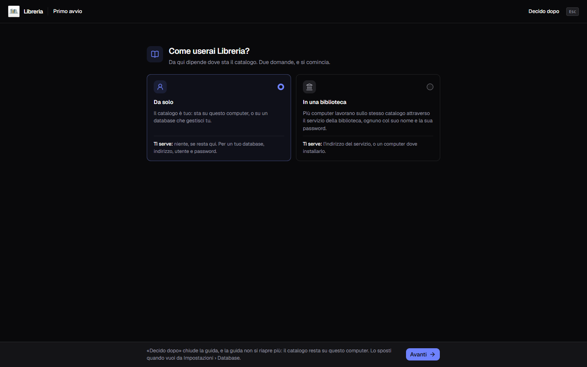

**Italiano** · [English](../en/Installation.md)

# Installazione

L'applicazione gira su **Windows 10 e 11**, e da settembre 2026 anche su
**macOS**: ogni versione porta un file suo, e come si installa lo dice
[Su un Mac](#su-un-mac).

Questa pagina parla dell'app. Il **servizio della biblioteca** — il programma
che tiene un catalogo solo per più computer, ognuno con il suo accesso — si
installa a parte, e lo racconta [Installare il servizio](Installare-il-servizio.md).

Su Windows non serve altro: il componente di sistema che disegna la finestra
(WebView2) è dentro l'installatore, quindi non viene scaricato durante
l'installazione.

## Installare su Windows

1. Scarica il file `Gestionale Libreria_0.8.0_x64-setup.exe`.
2. Doppio clic. L'installatore chiede per prima cosa la lingua, italiano o
   inglese, e propone quella di Windows; poi chiede poco.
3. Finito: trovi il collegamento **sul desktop** e **nel menu Start**.

L'installazione è **per il solo utente corrente**: non chiede i permessi di
amministratore e non tocca il resto del computer.

## «Windows ha protetto il PC»

Al primo avvio dell'installatore Windows mostra una schermata blu di SmartScreen
con quel titolo. Succede perché **il programma non ha una firma digitale**, e non
è un segnale che il file sia stato manomesso: un certificato costa un canone
annuo e, da solo, non spegnerebbe nemmeno l'avviso.

Per proseguire: **Ulteriori informazioni** → **Esegui comunque**.

## Su un Mac

Il file è `Gestionale Libreria_0.8.0_universal.dmg`, uno solo per i Mac Intel e
per quelli con Apple Silicon: si apre, si trascina l'applicazione in
**Applicazioni**, e da lì si avvia. È stato provato su un Mac, e funziona.

Al primo avvio macOS dice che l'applicazione **non può essere verificata**, per lo
stesso motivo per cui Windows mostra SmartScreen: non c'è un certificato pagato ad
Apple. Si passa da **Impostazioni di sistema → Privacy e sicurezza**, dove compare
il pulsante **Apri comunque**. Se preferisci il Terminale, la stessa cosa si fa
con:

```
xattr -dr com.apple.quarantine "/Applications/Gestionale Libreria.app"
```

La prima volta che apri la [scansione del codice a
barre](Scansionare-il-codice-a-barre.md), **macOS chiede il permesso di usare la
fotocamera**: concedilo, o il mirino resta nero. Se l'hai negato, si riaccende da
**Impostazioni di sistema → Privacy e sicurezza → Fotocamera**.

Per **aggiornare** si trascina l'applicazione nuova in **Applicazioni** e si
sceglie di sostituire quella che c'è; per **disinstallare** la si trascina nel
Cestino. In tutti e due i casi la cartella dei dati resta dov'è.

I tuoi dati stanno qui, e vale tutto quello che dice il resto di questa pagina:

```
~/Library/Application Support/it.alexkill536ita.gestionale-libreria/
```

## Il primo avvio

La prima volta che apri il programma, con il catalogo ancora vuoto, compare la
**guida al primo avvio**. La domanda è una: **Come userai Libreria?**



- **Da solo** — il catalogo è tuo. Il passo dopo, **Dove sta il catalogo?**,
  offre **Su questo computer**, che non chiede niente, oppure **Su un tuo
  database**: host, porta, nome del database, utente e password, poi **Prova il
  collegamento**, e **Usa questo database** si accende quando il database ha
  risposto. Un database vuoto va bene: il catalogo ci nasce da sé. I database
  che lo possono tenere sono quelli di [Il catalogo su un
  server](Il-catalogo-su-un-server.md);
- **In una biblioteca** — più computer lavorano sullo stesso catalogo,
  attraverso il **servizio della biblioteca**, ognuno col suo nome. Le strade
  sono due, e le racconta il paragrafo qui sotto.

**Decido dopo**, in qualunque passo, chiude la guida e lascia il catalogo su
questo computer. **La guida non ricompare più**, comunque la si chiuda — con una
scelta o con «Decido dopo» —, e non compare affatto a chi aggiorna da una
versione precedente con dei libri in catalogo. Le stesse scelte restano in
**Impostazioni → Database**, raccontate in [Dove stanno i
dati](Dove-stanno-i-dati.md).

### In una biblioteca

**Mi collego al servizio della biblioteca** è la strada di chi usa un servizio
che gira già su un altro computer. Si scrive l'**Indirizzo** che dà chi lo
gestisce — sempre `https://`, con la porta — e si preme **Prova il
collegamento**. Compare l'impronta del servizio: confrontala con quella del
computer dove gira, e se è uguale premi **Mi fido**. Poi **Entra**, oppure **Crea
il primo amministratore** se il servizio non ha ancora nessun utente. Come si
entra lo racconta [I modi di entrare](I-modi-di-entrare.md).

**Questo computer è il server della biblioteca** installa il servizio qui, su
Windows o su un Mac; su Linux la strada non c'è, e un server Linux o Docker si
prepara seguendo [Installare il servizio](Installare-il-servizio.md), per poi
tornare qui e scegliere «Mi collego». Serve la password di un amministratore di
questo computer, e un computer che resta acceso. La guida fa quattro passi, e li
mostra uno sotto l'altro:

1. **Scarico l'installer del servizio**, della stessa versione di quest'app,
   dalla pagina dei rilasci;
2. **Controllo che sia quello del rilascio, con SHA256SUMS**: se l'impronta
   SHA-256 del file non è quella pubblicata, il file si cancella e non parte
   niente;
3. **Installazione, nella sua finestra**: su Windows il sistema chiede il
   permesso di amministratore, e si risponde «Sì»; si apre l'installazione del
   servizio, che va lasciata aperta, perché la sua ultima pagina mostra il
   **Codice di configurazione** e l'**Impronta del certificato**. Su un Mac si
   apre il programma Installer, e se macOS dice che il pacchetto non si può
   verificare si passa da **Impostazioni di sistema → Privacy e sicurezza → Apri
   comunque**; codice e impronta si leggono dal Terminale, coi due comandi che la
   guida mostra;
4. **Aspetto che il servizio risponda su questo computer.**

Finché scarica si può annullare, e non è stato installato niente. Alla fine la
guida dice **Il servizio è installato** e mostra l'impronta: confrontala a
occhio con quella dell'ultima pagina dell'installazione — o con quella del
Terminale, su un Mac — e premi **Mi fido**. Poi si crea il primo
amministratore col codice di configurazione.

Se Windows non dà il permesso, la guida lo dice e propone **Riprova**. **Apri la
pagina dei download** porta ai file, per chi preferisce installare il servizio
da sé e poi tornare con «Indietro» a «Mi collego».

> **Non ancora provato su una macchina vera.** L'installazione del servizio dalla
> guida è stata provata su Windows fino alla richiesta del permesso di
> amministratore — lo scaricamento, il controllo con SHA256SUMS e il permesso
> negato —, ma non un'installazione portata a termine da qui. Su un Mac non è
> mai stata provata.

## Dove finiscono i dati

Su Windows, di partenza, tutto quello che è tuo sta in una cartella sola:

```
%LOCALAPPDATA%\it.alexkill536ita.gestionale-libreria\
```

Incolla quel percorso nella barra di Esplora risorse e ci arrivi. Dentro trovi:

| | |
|---|---|
| `libreria.db` | il catalogo — è questo il file che conta |
| `covers\` | le copertine, un JPEG per libro |
| `miniature\` e `intermedie\` | copie ridotte delle copertine, per le viste piccole e per quelle grandi: si rifanno da sole dall'originale, e cancellarle non perde niente |
| `backups\` | i backup che chiedi tu, se non ne hai scelta un'altra |
| `impostazioni.json` | tema, lingua, valuta, fotocamera, cartella dei backup e del catalogo, la versione che hai saltato, il collegamento al server e quello al servizio della biblioteca. I segreti — la chiave di Google Books, la password del database e il segreto dell'archivio S3 — **non stanno qui** ma nel portachiavi del sistema: il perché è in [Dove stanno i dati](Dove-stanno-i-dati.md) |

Il catalogo — `libreria.db` e `covers\`, con i suoi `backups\` se non ne hai
scelta un'altra — **si può spostare** in un'altra cartella, o stare **su un
server**: lo raccontano [Dove stanno i dati](Dove-stanno-i-dati.md) e
[Il catalogo su un server](Il-catalogo-su-un-server.md). `impostazioni.json`,
`miniature\` e `intermedie\` restano invece sempre qui, perché sono di questo
computer.

Il **programma** invece sta altrove, in `%LOCALAPPDATA%\Gestionale Libreria\` —
non in `Programmi`, dove di solito lo si cerca. Accanto all'eseguibile c'è
`AVVISI-LICENZE.txt`, che raccoglie le licenze dei mille e passa componenti di
altri che il programma incorpora. Non serve andarlo a cercare: lo apre il
programma, dall'ingranaggio in alto a destra, voce **Licenza** — dove c'è anche
la licenza di Gestionale Libreria. Lo stesso elenco sta in [Licenze dei
componenti](Licenze-dei-componenti.md).

## Aggiornare

**L'applicazione ti avvisa quando esce una versione nuova**, ma non la scarica e
non la installa: apre la pagina da cui prendere il file, e il resto lo decidi tu.
Il giro per esteso è in [Aggiornamenti](Aggiornamenti.md).

Per passare a una versione nuova si **installa sopra**, come la prima volta:
**i dati restano dove sono** e li ritrovi tutti. Non serve disinstallare prima.

## Disinstallare

Da **Impostazioni di Windows → App**, oppure con `uninstall.exe` nella cartella
del programma.

**La disinstallazione non cancella il catalogo.** Spariscono il programma, i due
collegamenti e la voce nell'elenco delle app; la cartella dei dati resta al suo
posto, e reinstallando ritrovi tutto. Se vuoi davvero ripartire da zero, quella
cartella va svuotata a mano — ma prima [fai un backup](Backup-e-ripristino.md) e
mettilo altrove.
