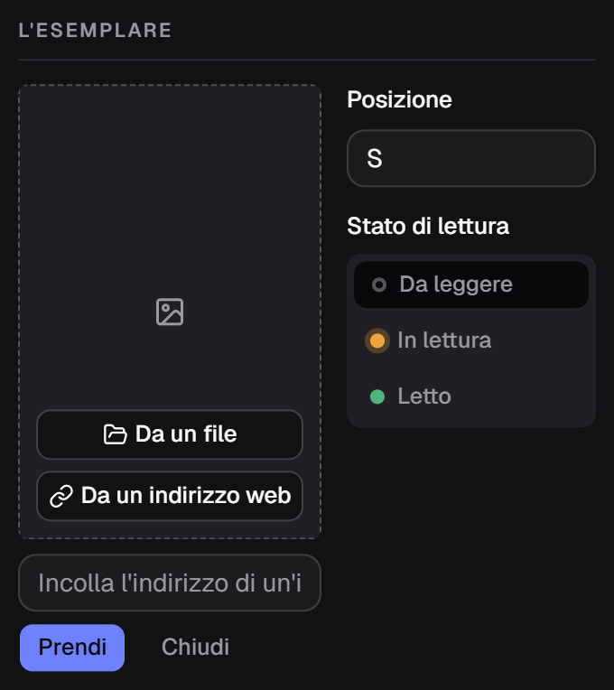
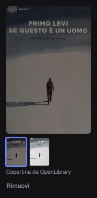
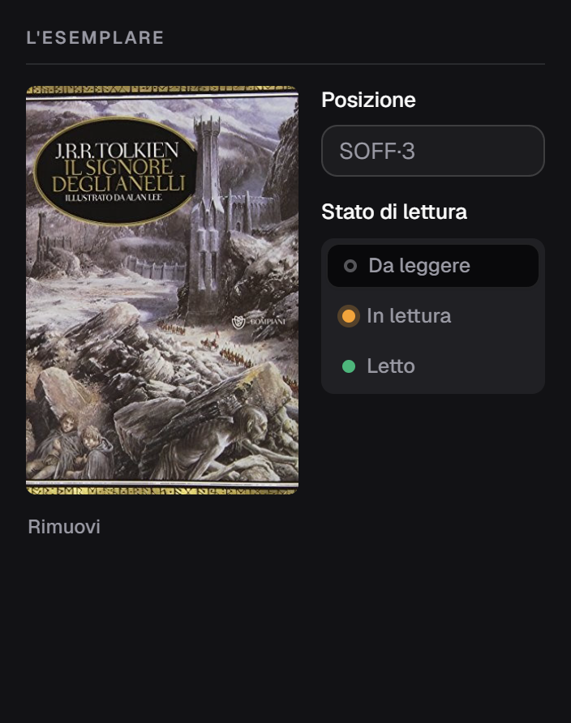

**Italiano** · [English](../en/Covers.md)

# Le copertine

Il riquadro tratteggiato a sinistra nel modulo. Ci si arriva per tre strade.

## 1. Da sola, cercando i metadati

Quando il riquadro è vuoto e [la ricerca dei metadati](Cercare-i-metadati.md) trova
un'immagine, questa scende senza che tu prema niente. Succede con **OpenLibrary**,
con **NiceBooks** e con **AniList** — e la riga sotto l'ISBN dice sempre di chi è
l'immagine arrivata.

Se una copertina c'è già, non viene sostituita: te lo dice una riga sotto l'ISBN
— *«OpenLibrary ha una copertina, ma il riquadro ne ha già una»* — e se la vuoi
davvero basta togliere quella di adesso e ricercare.

**Quando il riquadro è vuoto e la copertina trovata non è entrata** — l'hai
appena tolta, o il download non è riuscito — sotto il riquadro compare
**Prendi la copertina da …** con il nome della fonte che l'aveva proposta —
OpenLibrary, NiceBooks o AniList — e la richiede a lei senza rifare la ricerca.

### Quando ne trovano più di una

OpenLibrary e NiceBooks possono averla tutte e due, e **non è la stessa
immagine**. Quando succede, sotto il riquadro compare una fila di miniature, una
per fonte: quella cerchiata è la copertina che stai vedendo sopra, e cliccando
un'altra prende il suo posto. Sotto la fila c'è scritto da chi viene quella di
adesso.

Non devi scegliere per forza: **la prima scende da sé come sempre**, e la fila è
lì per quando l'immagine arrivata non è quella dell'edizione che hai in mano —
il caso tipico di un manga o di un libro ristampato. Con una fonte sola la fila
non compare, perché non ci sarebbe niente da scegliere.

Vale la pena guardarla anche quando l'immagine è giusta: **le copertine di
NiceBooks sono circa quattro volte più grandi di quelle di OpenLibrary**, che si
ferma sui 500 pixel di altezza. Cambiare fonte scarica la nuova immagine, e
quella che lasci non resta sul disco: se ne va al salvataggio, e se ne va lo
stesso se esci senza salvare — **Annulla**, la `×`, `Esc`, le frecce che passano
a un altro libro, «Butta le modifiche».

Le immagini di **Google Books non si scaricano**, anche quando Google le ha: i
termini d'uso della loro API non permettono di riospitarle. Non è un limite
tecnico ed è inutile riprovare.

## 2. Da un file sul disco

**Da un file** apre la finestra di Windows. Prendi un JPEG, un PNG o un WebP e
lo copia fra le copertine del catalogo: da quel momento è al sicuro anche se
sposti o cancelli l'originale.

## 3. Da un indirizzo web

**Da un indirizzo web** apre una casella dove incollare l'URL di un'immagine, e
**Prendi** la scarica. Serve un indirizzo pubblico: uno della tua rete di casa
viene rifiutato.

Il file arriva sempre fra le copertine del catalogo, dovunque stiano: **il
catalogo non tiene link a immagini altrui**, quindi la copertina resta anche
quando quel sito chiude.

## Cosa entra e cosa no

Qualunque sia la strada, l'immagine dev'essere un **JPEG, un PNG o un WebP**, e
non più grande di **12.000 pixel per lato**; da un indirizzo web, in più, non
oltre **20 MB**. Un file che non va bene non entra e lo dice sotto il riquadro:
*«Formato non riconosciuto: sono accettati JPEG, PNG e WebP.»*, *«L'immagine è
troppo grande.»*, *«Il file dell'immagine è danneggiato o incompleto.»*.

Quello che entra viene **ricodificato in JPEG** alla risoluzione originale: non
viene rimpicciolito, ma un PNG da 12 MB non resta da 12 MB. Una parte trasparente
diventa bianca.

## Chi non ha copertina

Non resta un buco: l'applicazione disegna un dorso con **l'iniziale del titolo**,
su uno di otto colori scelto **in base all'editore**. Due libri dello stesso
editore hanno lo stesso colore, il che rende riconoscibile una collana a colpo
d'occhio; un libro senza editore prende un grigio neutro.

Nella griglia di una serie un volume che hai ma senza copertina porta il suo
dorso disegnato, col numero sopra; i volumi che ti mancano sono invece riquadri
tratteggiati — vedi [Le serie](Le-serie.md).

## Quando una copertina non si vede

Se un'immagine non si carica — il file è sparito, oppure il posto dove stanno le
copertine non risponde, come un server spento — **al suo posto si disegna il
dorso**, lo stesso di un libro senza copertina. Non compare un'icona rotta, e
per questo a colpo d'occhio sembra un libro che la copertina non l'ha mai avuta.

**Non torna da sola** quando il problema si risolve: torna la prossima volta che
la vista si ridisegna, cambiando pagina o riaprendo quella schermata.

### Le copie ridotte

Il catalogo, le righe dei prestiti e degli acquisti, lo storico e le serie
mostrano **una copia piccola** della copertina; il carosello degli editori, la
scheda di un'opera e la striscia dei prestiti una **copia di media grandezza**.
Si fanno da sole la prima volta che servono, e poi restano **su questo
computer**, così le viste non ricaricano ogni volta l'immagine intera.

Non c'è niente da salvare: si rifanno dall'originale quando mancano, e non
entrano nei backup. **Solo il modulo mostra l'originale**, perché è lì che la
copertina si giudica prima di salvarla.

## Togliere una copertina

Sotto l'immagine c'è **Rimuovi**. Il file se ne va al salvataggio, e lo stesso
vale quando **sostituisci** la copertina di un libro già salvato: quella vecchia
se ne va quando salvi quella nuova. Se esci senza salvare, il libro resta con la
copertina che aveva.

**Un file che serve anche a qualcun altro resta.** Se la stessa immagine la usa
un altro libro o un volume [da acquistare](Da-acquistare.md), togliendola da
qui la togli solo da qui. Vale anche quando elimini un libro.

## Dove stanno

Un JPEG per libro con un nome casuale, **accanto al catalogo**: nella cartella
`covers` dentro la cartella del catalogo, che se non l'hai spostata è
`%LOCALAPPDATA%\it.alexkill536ita.gestionale-libreria\`. Con **Sposta qui il
catalogo** le copertine vengono copiate insieme al database — vedi
[Dove stanno i dati](Dove-stanno-i-dati.md).

Con il catalogo **su un server** stanno dove dice «Dove stanno le copertine»:
**Dentro il database**, in una **Cartella** condivisa che ogni computer
raggiunge, o in un **Archivio S3**. Come si sceglie, e come si portano da un
posto all'altro con «Sposta le copertine qui», sta in
[Il catalogo su un server](Il-catalogo-su-un-server.md).

Da qualunque di questi posti, **le copertine entrano nei backup**, quindi un
archivio ripristinato se le riporta dietro — vedi
[Backup e ripristino](Backup-e-ripristino.md).
