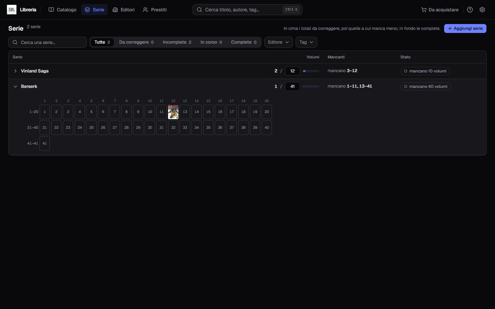
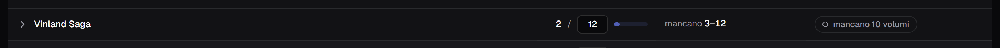
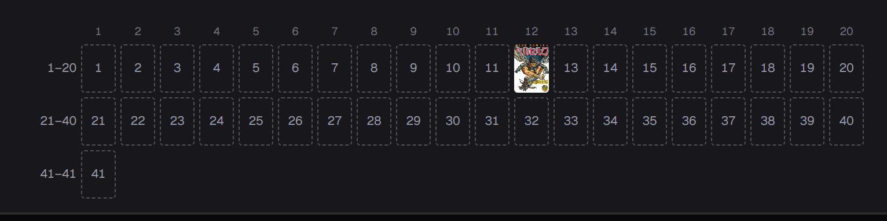
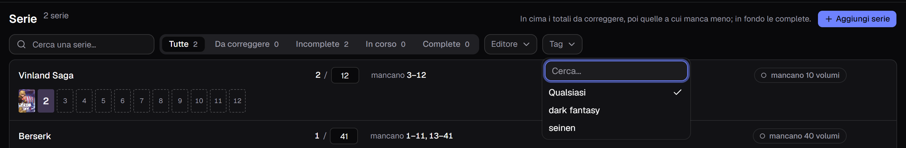
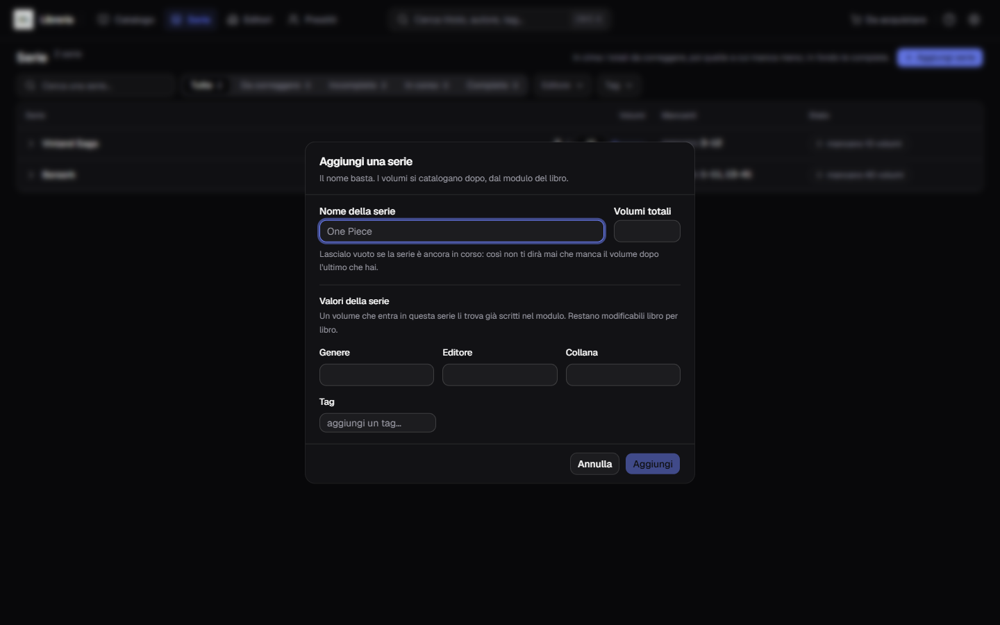
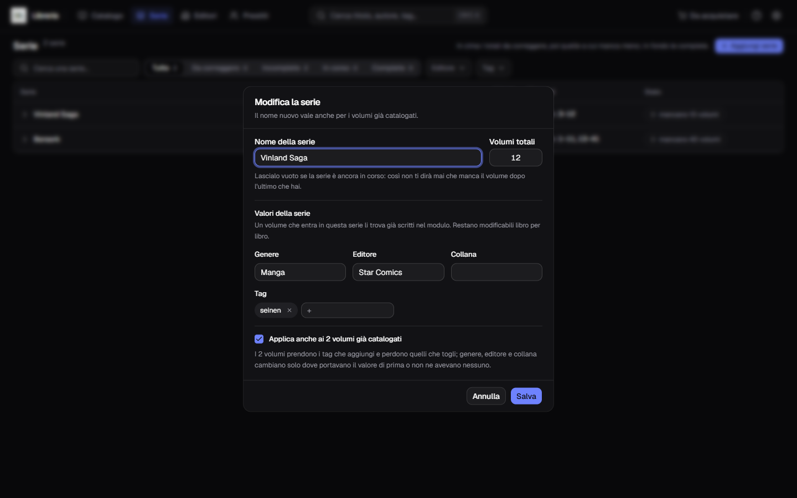
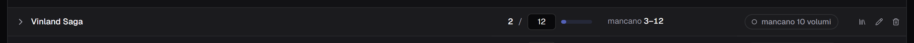
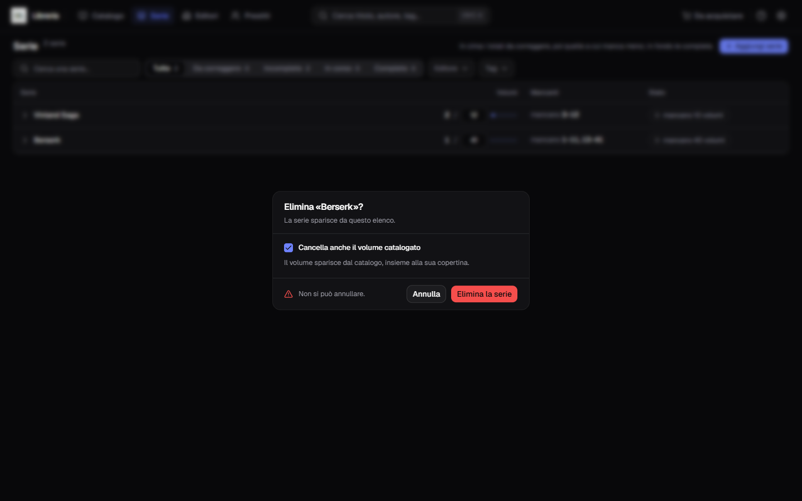

**Italiano** · [English](../en/Series.md)

# Le serie

La voce **Serie** nella barra risponde a una domanda sola: **quali volumi mi
mancano?**

Una serie compare qui appena scrivi il suo nome nel modulo di un libro. Non c'è
niente da preparare prima.

## Come si legge una riga

Ogni serie è una **riga che si apre**: cliccala, e sotto compare la griglia dei
suoi volumi. Se ne tengono aperte quante se ne vuole — due serie aperte insieme
sono l'unico modo di confrontarle — e tornando sulla pagina sono di nuovo tutte
chiuse.

Da sinistra:

- **il nome** della serie;
- **quanti ne hai su quanti** — `2 / 12`. Il totale sta in una casella
  modificabile: correggilo lì e basta, si salva da solo, e la barra accanto
  disegna la stessa frazione;
- **quali mancano**, con i buchi accorpati: `mancano 3–12` invece di
  dieci numeri in fila;
- la pastiglia con lo stato: `mancano 10 volumi`, `serie in corso`, `completa`,
  oppure `totale da correggere` quando hai un volume con un numero più alto del
  totale dichiarato — il volume 14 di una serie che dice di averne 12;
- a destra, tre azioni che compaiono passandoci sopra — **vedi in catalogo**,
  **modifica** ed **elimina**.

## La griglia dei volumi

Aperta la riga, i volumi stanno in una **griglia a venti colonne**: il primo in
alto a sinistra, il ventunesimo a capo. A sinistra di ogni riga c'è la fascia che
copre — `1–20`, `21–37` — e in cima i numeri da 1 a 20.

La posizione è l'informazione: **il volume 23 è sempre la terza casella della
seconda riga**, quindi un buco si trova con l'occhio prima che coi numeri, e due
serie diverse si confrontano perché il passo è lo stesso.

- un volume che **hai** porta la sua copertina, o un dorso disegnato se non ne
  ha una o non si carica — lo spiega [Le copertine](Le-copertine.md);
- uno che **manca** è un riquadro tratteggiato col suo numero;
- oltre l'ultimo volume atteso **non c'è niente**: il 24 di una serie da 23 non
  esiste, e tratteggiarlo direbbe «ti manca».

Fermando il puntatore su una casella si legge **di che volume si tratta** —
`vol. 9 · My dress up darling. Bisque doll Vol.9`, col sottotitolo dove c'è —
e su un riquadro tratteggiato, quale volume manca. Serve soprattutto sulle serie
lunghe, dove venti copertine piccole si somigliano tutte.

**Un mezzo volume non ha una posizione**, e non ne prende una: un `4.5` resta
fuori dalla griglia, e lo dice la frase accanto al conteggio — dov'è già il
volume che nessun numero nomina.

L'ordine dell'elenco non è alfabetico: **in cima i totali da correggere** — le
serie dove hai più volumi di quanti il totale dichiari, che è il segno di un
totale sbagliato — poi quelle a cui manca meno, e in fondo le complete.

Questa pagina dice **quali volumi mancano**; procurarseli è
[Da acquistare](Da-acquistare.md), che però non si riempie da una serie: là il
volume si aggiunge uno per volta, cercandolo col titolo o con l'ISBN oppure
scrivendolo a mano, numero di volume compreso.

## Restringere l'elenco

Sotto la testata c'è una barra che taglia l'elenco mentre la usi. Non c'è niente
da confermare: le righe si riducono a ogni tasto.

- **la casella** cerca nel **nome della serie**, senza badare alle maiuscole:
  `bisque` trova *My dress up darling. Bisque doll*;
- **la fila degli stati** — **Da correggere**, **Incomplete**, **In corso**,
  **Complete** — ne tiene uno per volta, e ognuno porta accanto il suo conto.
  **Tutte** li ritira. Le quattro voci **restano in fila anche quando valgono
  zero**: una fila che cambia numero di voci mentre scegli è peggio di una voce
  che dice zero;
- **le tendine** dei quattro valori della serie — editore, genere, collana e tag
  — tengono un valore per volta, e **Qualsiasi** lo ritira.

**Ogni tendina si scrive.** Aperta ha una casella in cima: digita, e le voci si
assottigliano senza badare né alle maiuscole né agli accenti — `citta` trova
`Città Studi`. **Qualsiasi** resta raggiungibile anche mentre scrivi, così la
via d'uscita non sparisce proprio quando la cerchi.

**Una tendina compare solo dove c'è più di un valore fra cui scegliere.** Se le
serie che vedi sono tutte dello stesso editore, la tendina dell'editore non c'è:
una scelta sola non è una scelta. Ma se il valore che hai già scelto resta
l'unico, la tendina non se ne va — altrimenti quel filtro non si potrebbe più
togliere.

**I conti accanto agli stati guardano gli altri filtri, non l'elenco intero.**
Con un editore già scelto, il numero accanto a «Incomplete» dice quante serie
*di quell'editore* sono incomplete. Perciò un conto a zero vuol dire una cosa
sola: scegliendo quello non resta niente, e nessuna pastiglia ti promette dodici
serie per poi dartene zero.

Con un filtro addosso il conteggio in testa alla pagina cambia forma — **1 di
2 serie** invece di *2 serie* — e in fondo alla barra compare **Azzera**, che
li toglie tutti in un colpo. Se non resta nessuna riga, il riquadro che vedi non
è quello di un elenco vuoto: dice *«Nessuna serie con questi filtri»*, ricorda
quante sono in tutto, e offre **Togli i filtri**.

**Una cosa che vale la pena sapere prima di vederla.** Filtra per **Da
correggere**, scrivi il totale giusto in una riga, e dopo un attimo quella riga
se ne va. Non è un difetto: ha smesso di essere da correggere, e sparire è la
conferma che il totale adesso torna.

## Aggiungere una serie

**Aggiungi serie**, in alto a destra.

Il nome basta. Il totale si può lasciare vuoto, e conviene farlo quando la serie
è ancora in corso: senza totale, l'applicazione non ti dirà mai che manca il
volume dopo l'ultimo che hai.

Sotto ci sono già i quattro valori della sezione qui sotto — tag, genere, editore
e collana — e si possono riempire subito o lasciare che li impari da sé.

I volumi si catalogano dopo, dal modulo del libro, scrivendo quel nome nel campo
Serie.

## I valori della serie

Oltre al nome e al totale, una serie porta con sé quattro cose: **tag, genere,
editore e collana**. Non c'è da dichiararle: **la serie le impara dai volumi che
le assegni.**

- i **tag** si sommano — quelli di ogni volume entrano nella serie, e da soli non
  ne escono più;
- **genere, editore e collana** li detta il **primo volume che ne porta uno**, e
  nessun volume salvato dopo li sposta. Senza questa regola la serie inseguirebbe
  l'ultimo libro toccato, e l'editore ballerebbe a ogni salvataggio.

Da lì tornano indietro. **Un libro che entra in quella serie se li trova già
scritti nel modulo**, e con prudenza:

- i **tag** si aggiungono a quelli che hai già messo;
- **genere, editore e collana** si riempiono **solo dove erano vuoti** — quello
  che hai scritto tu non si tocca;
- un tag che hai tolto **non ritorna** finché resti in quella serie.

Se la serie ha riempito qualcosa sotto **Altri dettagli**, quel pannello si apre
da sé: così lo vedi invece di scoprirlo dopo aver salvato.

## Correggere i valori a mano

La matita apre il dialogo, dove i quattro valori stanno sotto il nome e il
totale. Sono caselle come quelle del modulo, con gli stessi suggerimenti.

In modifica compare anche una spunta, **accesa**: *«Applica anche ai N volumi già
catalogati»*. È il modo di sistemare quaranta volumi in un colpo, e **non è una
sostituzione**:

| Cosa cambi nel dialogo | Cosa succede ai volumi |
|---|---|
| Aggiungi un tag | entra su tutti |
| Togli un tag | esce da tutti quelli che ce l'hanno |
| Cambi genere, editore o collana | si scrive **solo** dove il volume portava il valore di prima, o non ne aveva nessuno |
| **Svuoti** una casella | **niente**: vuol dire «la serie non lo detta più», non «cancellalo dai libri» |

Le ultime due righe sono la ragione per cui questa non è una sostituzione secca:
il volume ristampato da un altro editore non viene appiattito sugli altri, e una
casella svuotata per distrazione non porta via un dato da quaranta libri.

**Sui tag tolti, invece, guarda due volte prima di salvare.** Siccome la serie ha
già imparato i tag di *tutti* i suoi volumi, quello che togli dalla casella se ne
va davvero da tutti i volumi che ce l'avevano — anche se ce l'avevi messo tu, su
un volume solo. È voluto, ma è la cosa che si nota dopo.

Togliendo la spunta i volumi già catalogati restano come sono, e i valori
varranno solo per quelli che aggiungerai dopo. Quando crei una serie nuova la
spunta non c'è: non ci sono ancora volumi da toccare.

## Modificare ed eliminare

Passa il puntatore su una riga: a destra compaiono tre pulsanti — il primo apre
il **catalogo filtrato** su quella serie, poi la matita e il cestino.

Il nome della serie non è un collegamento: cliccarlo apre la griglia dei volumi,
che è il gesto principale della pagina, e il catalogo sta in quel primo pulsante.

La matita apre il dialogo qui sopra. Il cestino chiede conferma:

Attenzione alla spunta, che è **attiva di default**:

- **spuntata** — spariscono anche i volumi catalogati, con le loro copertine;
- **tolta** — i volumi restano nel catalogo e perdono soltanto serie e numero.

Non si annulla. Una serie senza volumi non mostra la spunta, perché non c'è
niente da portarsi dietro.

**Se un volume della serie è in prestito, con la spunta accesa l'eliminazione si
ferma** e dice chi ce l'ha: un libro che è a casa di qualcuno non può sparire dal
catalogo. Te lo fai restituire — il giro è in [I prestiti](I-prestiti.md) — oppure
togli la spunta, e la serie se ne va lasciando i volumi dove sono.

## Il totale dei volumi: due strade

Lo stesso numero si tocca in due posti, e non fanno la stessa cosa:

| Dove | Cosa succede svuotando la casella |
|---|---|
| **Qui, in `/serie`** | il totale sparisce davvero |
| Nel modulo di un libro | **non** succede niente: il totale resta |

La differenza è voluta. Quel numero appartiene alla serie, non alla singola
copia: se svuotare la casella nel modulo lo azzerasse, salvare *un* volume
cancellerebbe il totale per tutti gli altri. La casella nel modulo serve perché
è lì che il totale arriva da AniList senza che tu debba digitarlo.

## Una serie vuota non sparisce

Una serie aggiunta a mano resta nell'elenco anche senza volumi, e anche dopo un
riavvio. Se non la vuoi più, si toglie con il suo cestino.
