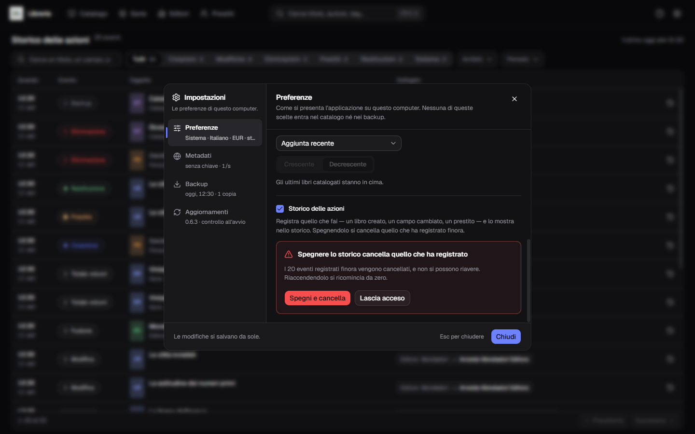
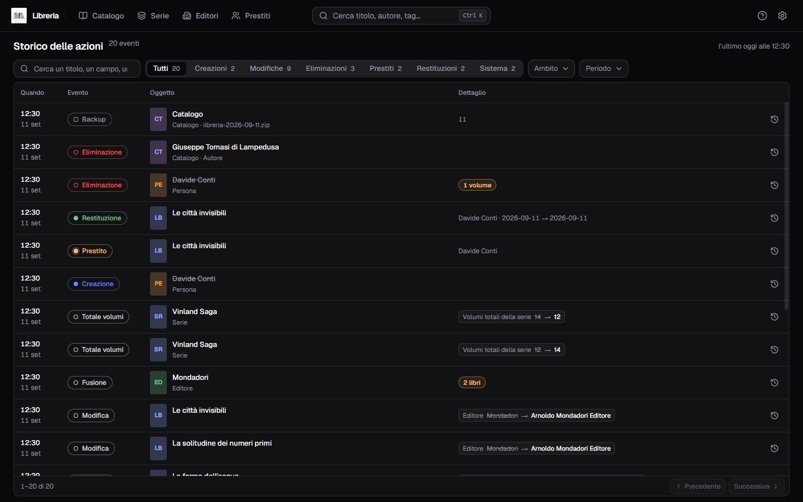
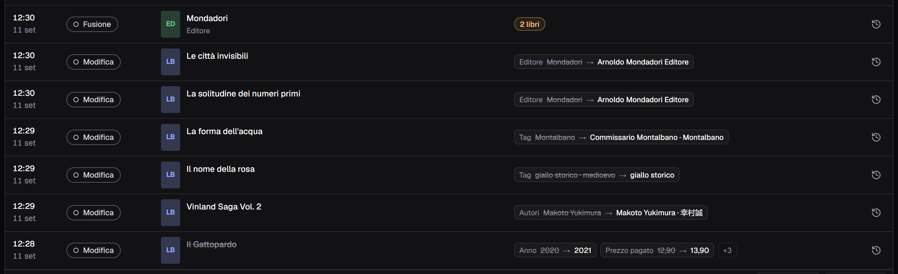
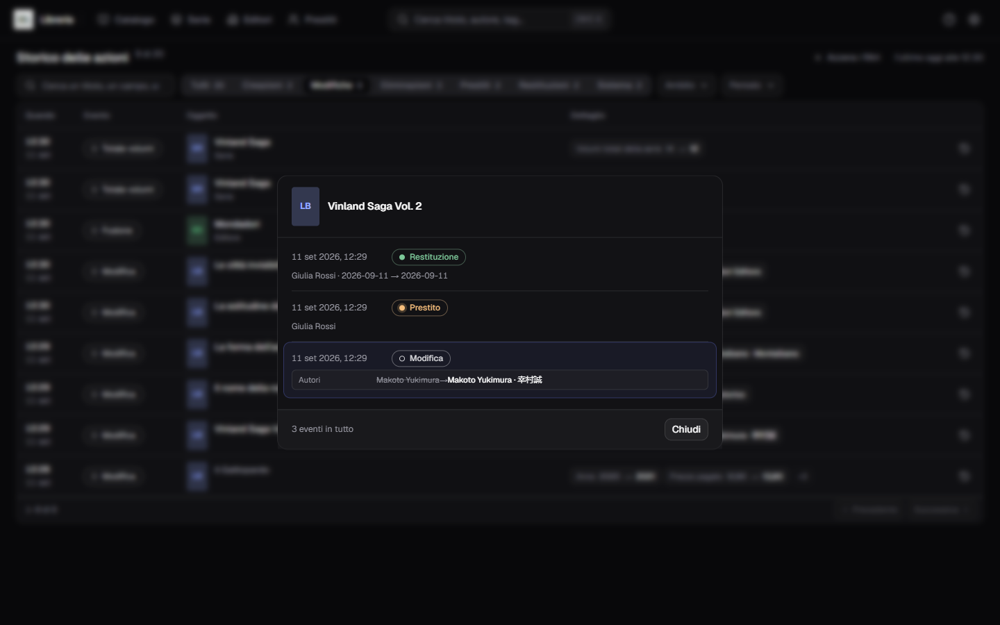
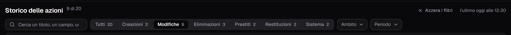

**Italiano** · [English](../en/The-activity-log.md)

# Lo storico delle azioni

Risponde a una domanda sola: **cosa è cambiato, e quando?** Un libro catalogato,
un prezzo corretto, un prestito registrato, due editori fusi — ogni gesto che
tocca il catalogo lascia una riga, dalla più recente in giù.

**Nasce spento**, e finché è spento non registra niente.

## Accenderlo, e cosa vuol dire spegnerlo

La casella **Storico delle azioni** sta nelle [Impostazioni](Impostazioni.md),
sezione **Preferenze**. Accendila e da quel momento si registra quello che fai:
il primo evento dello storico è l'accensione stessa.

| Cosa fai | Cosa succede |
|---|---|
| **Accendi** la casella | si comincia a registrare, senza domande: non porta via niente |
| **Spegni** la casella | la spunta **non si muove** finché non confermi |

**Spegnerlo cancella quello che ha registrato**, ed è la cosa più importante di
questa pagina. Sotto la casella compare la domanda — *«Spegnere lo storico
cancella quello che ha registrato»* — che dice **quanti eventi sta per portare
via**: *«I 20 eventi registrati finora vengono cancellati, e non si possono
riavere. Riaccendendolo si ricomincia da zero.»* I due pulsanti sono **Spegni e
cancella** e **Lascia acceso**.

Qui «spento» vuol dire che di quello che hai fatto non resta niente, non che si
smette di scrivere sopra una pila che rimane. Se lo spegni per sbaglio, la strada
indietro è [ripristinare un backup](Backup-e-ripristino.md) preso prima — che
però riporta indietro *tutto* il catalogo, non solo lo storico.

## Lo storico tiene un anno

Gli eventi più vecchi di un anno vengono cancellati **all'avvio del programma**,
e sotto la casella c'è la riga che lo dice prima che succeda: *«Lo storico tiene
un anno: gli eventi più vecchi vengono cancellati all'avvio.»*

Il tetto è **fisso**: non c'è una casella per allungarlo o accorciarlo, ed è una
scelta e non una mancanza — un numero da scegliere sarebbe una domanda in più
per una risposta che non cambia. Serve perché lo storico **cresce più in fretta
del catalogo che descrive**: ogni modifica è un evento più una riga per ogni
campo cambiato, e una serata passata a catalogare ne lascia qualche centinaio.

È l'unica cosa che porta via eventi da sola. Tutto il resto — svuotarlo
spegnendo la casella, sostituirlo con un ripristino — è un gesto tuo.

## Come ci si arriva

L'**ingranaggio** in alto a destra è un menu, e porta tre voci:
[Dizionari del catalogo](I-dizionari-del-catalogo.md), **Storico delle azioni**
e, sotto, **Impostazioni**.

Con lo storico spento **quella voce non c'è**, e ne restano due: non c'è nessuno
storico da aprire.

## Come si legge la tabella

In alto a sinistra il conto degli eventi — `20 eventi` — e a destra quando è
arrivato l'ultimo: *«l'ultimo oggi alle 12:30»*.

| Colonna | Cosa mostra |
|---|---|
| Quando | l'ora sopra, il giorno sotto |
| Evento | la pastiglia dell'azione: `Creazione`, `Modifica`, `Eliminazione`, `Prestito`, `Restituzione`, `Backup`, `Ripristino`… |
| Oggetto | la copertina col titolo, e sotto la riga che lo distingue dagli altri |
| Dettaglio | cosa è cambiato |
| Storia | il tasto che apre lo storico completo di quella cosa |

Le righe sono **cinquanta per pagina**, con **Precedente** e **Successiva** in
fondo alla scheda come nel [catalogo](Il-catalogo.md). Cambiando pagina la lista
torna in cima da sé.

La copertina si legge **adesso**, quindi c'è per i libri che sono ancora nel
catalogo. Per tutto il resto — una serie, un editore, una persona, il catalogo
stesso — al suo posto c'è una tessera colorata con la sigla di cosa si tratta.

## Cosa è cambiato

Una riga di **Modifica** lo dice campo per campo, ed è la ragione per cui questa
pagina esiste: in un riquadro il nome del campo, il valore di prima barrato, la
freccia, e il valore nuovo — `Prezzo pagato · 12,90 → 13,90`.

- in cella ci stanno **due coppie**, e il resto diventa un `+3`. Fermaci sopra il
  puntatore e li leggi tutti;
- un valore che prima non c'era si legge *vuoto* in corsivo. Una casella
  lasciata vuota sembrerebbe un dato perduto, e non lo è;
- i nomi dei campi sono **quelli del modulo**, quindi `Editore` qui e `Editore`
  là dove l'hai scritto, e un valore lunghissimo si taglia con un `…`.

**Un evento massivo dice il numero invece di diventare quel numero di righe**:
`2 libri` accanto alla fusione di due editori, `3 volumi` accanto a una serie
eliminata coi suoi volumi.

Dove non c'è niente da confrontare, il dettaglio porta una nota: l'ISBN del
libro appena creato, il nome di chi ha preso un libro in prestito, il file di un
backup.

## Lo storico completo di una cosa

Il tasto in fondo a ogni riga apre la storia intera di quel libro — o di quella
serie, di quell'editore, di quella persona. Là i dettagli si leggono **per
intero**, senza `+N`, e la riga da cui sei partito è segnata, così non la perdi
fra sette eventi.

**Quella storia non passa dai filtri della pagina**, perché «completo» vuol dire
completo: con **Restituzioni** addosso la tabella mostra due righe in tutto, e la
storia di uno di quei due volumi ne mostra tre — la restituzione che hai
filtrato, il prestito che l'ha preceduta e la modifica di prima.

## Filtrare

Sopra la tabella:

- la **casella di ricerca** cerca nei titoli, nelle note e **dentro i campi
  cambiati** — così «Einaudi» trova anche l'evento in cui l'editore è diventato
  Einaudi;
- la **fila dei sette stati** — **Tutti** più i sei verbi: Creazioni, Modifiche,
  Eliminazioni, Prestiti, Restituzioni, Sistema — ognuno col suo conto;
- **Ambito** restringe a Libro, Serie, Editore, Persona o Catalogo;
- **Periodo** offre Oggi, Ultimi 7 giorni e Ultimi 30 giorni. **Qualsiasi** toglie
  il filtro.

**I conti guardano gli altri filtri, non lo storico intero.** Un conto a zero non
dice che quel tipo di evento non c'è mai stato: dice che *scegliendo questo, con i
filtri che hai adesso, non resta niente*. I sette stati restano in fila anche
quando valgono zero: una fila che cambia numero di voci mentre filtri è peggio di
una voce che dice zero.

Con un filtro addosso il conto in testa diventa `9 di 20`, e accanto compare
**Azzera i filtri**, che li toglie tutti in un colpo.

## Un libro eliminato resta leggibile

Il titolo compare **barrato**, con la tessera al posto della copertina; aprendo
la sua storia completa una pastiglia lo dice: *«Non è più in catalogo»*.

Succede perché l'evento porta il titolo **copiato**, non un rimando a un libro
che deve ancora esistere. Senza quella copia lo storico diventerebbe muto
proprio il giorno dopo un'eliminazione, che è precisamente il giorno in cui lo
vai a leggere.

## Quello che non entra nello storico

- **la chiave di Google Books non ci finisce mai.** Se la cambi, la riga dice
  `presente` o `assente` e nient'altro: un segreto non va scritto dove poi si
  copia e si incolla;
- **descrizione e note registrano solo il fatto di essere cambiate.** Cambiano di
  mille caratteri per volta, e quello che serve sapere è *che* è successo: il
  campo compare, i due valori restano *vuoto*;
- **importare una copertina non è un'azione.** Scrive un file e non tocca il
  catalogo, e quel libro potresti non salvarlo mai. Il cambio di copertina si
  legge come il campo `Copertina` dentro la modifica del libro, che è il momento
  in cui succede davvero.

## Un ripristino sostituisce anche lo storico

**È giusto che lo sostituisca** — quello storico descriveva *quel* catalogo — ma
va detto prima e non scoperto dopo, e la conferma del ripristino lo dice per
intero: *«Con il catalogo viene sostituito anche il suo storico: quello
dell'archivio prende il posto di quello di adesso.»* Il giro sta in
[Backup e ripristino](Backup-e-ripristino.md).

## Quando la pagina non ha righe

Sono tre cose diverse, e la pagina le distingue:

| Cosa leggi | Cosa vuol dire |
|---|---|
| **Lo storico è spento** | la casella nelle Preferenze non è accesa: da qui in poi non si registra niente |
| **Non c'è ancora niente** | è acceso, e non hai ancora fatto niente da registrare |
| **Nessun evento con questi filtri** | gli eventi ci sono, ma questi filtri non ne lasciano passare nessuno: togline uno |
